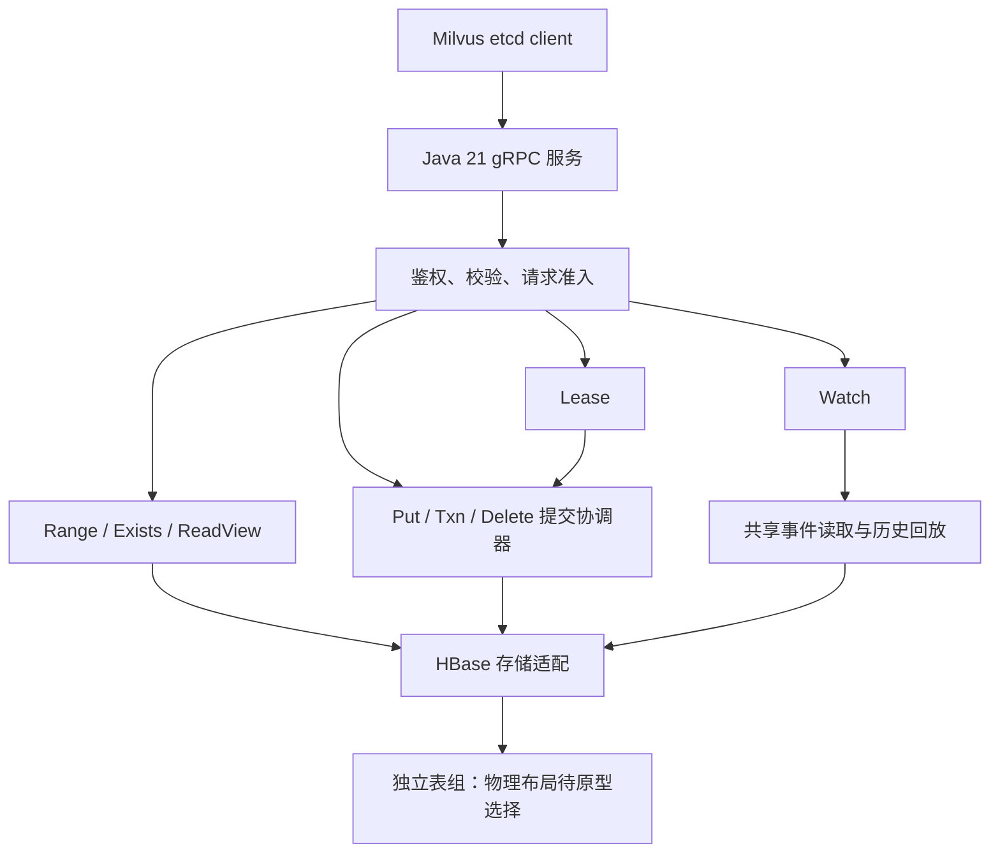

# etcd-hbase 开发计划与进度记录

> 文档版本：0.10（J06–J09 公开工程交付） · 更新日期：2026-10-30 · 开发基线：**JDK 21**
>
> 当前状态：开发计划及 M0 设计已批准，进入 M0。J03 已在 PR #7 批准合并，提供 gRPC 骨架、Header/Error 工厂及最小 Go/Java 验证；未实现业务仍返回 UNIMPLEMENTED。J04 的统一身份契约、连接工厂及多种认证的真实临时 HBase 验证已随 PR #8 批准合并；目标环境身份和权限尚未验收。J05 的公开盐候选、两种表布局及初始化原型已实现并通过公开验证，见 PR #9；PR #9 已批准合并，目标盐规则仍待输入。J06 的公开配置、请求生命周期和基础观测已随 PR #10 批准合并；J07 公开协议工具已随 PR #11 正式批准合并；J08 公开 SPI 契约与模块边界已随 PR #12 正式批准合并；J09 已交付统一公开验证入口和实际运行包/镜像检查，许可及制品决定仍待输入。本文中的后续类、表结构和算法仍按任务逐项实现；勾选任务必须附实现、验证和评审证据。

## 1. 评审摘要

### 1.1 要交付什么

实现独立的 Java 服务，提供当前 Milvus 所需的 etcd v3 gRPC API，底层存储使用标准 HBase。Milvus 继续使用原有 Go etcd client，通过 endpoints 接入该服务。服务处理原始 key/value 字节和 etcd 协议元数据，不解释 collection、partition、segment 或 Kafka 消息内容。

项目面向开源交付。公开仓库提供可独立构建和运行的默认实现；Milvus 是首期参考集成，协议与存储内核不依赖其业务模型。扩展发行版通过独立工程引用公开制品、添加 provider 和配置，复用相同的事务、Lease、Watch 与恢复内核。

一个逻辑 etcd 集群使用独立的一张或多张 HBase 表，监听端口直接绑定该表组。服务副本共享相同表组；不在 rowkey 中引入额外集群路由 ID。

首版交付范围为新建集群，第 4 节能力矩阵列入首版的全部功能均须交付。开发检查点允许分批贯通链路，正式首版验收仍覆盖完整范围；Count 保留已接受差异，矩阵明确不支持的能力返回对应错误。本文不能作为“完整实现全部原生 etcd 功能”的声明。

### 1.2 已确认需求与开发完成度

以下勾选表示需求已确认，**不计入开发任务完成数**：

- [x] 使用 JDK 21，开发、构建、CI、运行镜像统一基线。
- [x] 独立服务，使用标准 HBase Java Client。
- [x] 所有物理 rowkey 加可配置的前缀盐；具体算法和预分区参数待输入。
- [x] 独立表组与监听端口对应，不增加集群路由 ID。
- [x] 不加载全部 KV 或整棵目录树到内存。
- [x] 仅接入新集群，不开发原生 etcd 迁移工具。
- [x] Milvus 集成验证采用 Kafka；兼容服务自身不依赖 Kafka，不包含 Woodpecker 接入任务。
- [x] Milvus 最低支持版本为 v3.0.1；本轮固定审计该 tag，更新版本需复核调用与依赖。
- [x] HBase 账号密码通过 etcd Authenticate 接口提供；兼容层用该凭据完成后端认证，token 关联对应后端身份。
- [x] Count 使用本页数量或真实存在性结果，规则见第 4 节。
- [x] 公开仓库面向开源，文档、配置、依赖和 CI 使用公开可获取的资源。
- [x] 扩展发行版通过稳定接口接入定制实现；扩展契约和默认实现提前纳入开发与评审。

补充设计前提：目标 HBase 平台具备充足容量与成熟运维能力。以此开展实现，容量数据用于确定兼容层调度、资源消耗和实际收益；不预设 HBase 总体容量不足。应用副本以无本地持久化、可在 K8s 替换和扩展为部署目标，具体验收见第 3.5 节。

开发状态：**已完成 3 / 78，未完成 75 / 78；已验收阶段 0 / 9。** 每次更新任务状态后，同步第 2 节汇总。

### 1.3 评审需要形成的结论

| 评审项 | 需要回答的问题 | 责任角色 | 当前状态 | 结论/记录 |
|---|---|---|---|---|
| RV01 协议范围 | 当前 Milvus 调用与首版 API 矩阵是否完整，Count 差异是否可接受？ | Milvus / 服务开发 | 待评审 | — |
| RV02 盐与表设计 | 实际盐规则、预分区、表/Region 数是否符合设计要求？ | HBase / 服务开发 | 待输入、待评审 | — |
| RV03 一致性内核 | 跨行 Txn、发布、恢复、旧 owner 隔离、读保护是否可证明？ | 一致性 / 存储评审 | 待评审，M2 原型验证 | — |
| RV04 HBase 压力 | 全桶扫描、固定协调记录、内部写放大是否满足预算？ | HBase / SRE | 待目标，M1/M2/M7 验证 | — |
| RV05 Lease / Watch | 续租与到期竞争、删除事件、回放交接和内存上限是否完整？ | 服务开发 / Milvus | 待评审，M4 验证 | — |
| RV06 认证与发布 | Authenticate 到 HBase 的身份桥接、跨副本凭据使用、启动/后台恢复及轮换是否可操作？ | 运维 / SRE | 待输入、待评审 | — |
| RV07 开源与扩展边界 | 默认发行版能否独立运行？公开 SPI、扩展契约、兼容版本及制品边界是否清晰？ | 维护者 / 服务开发 | 待评审，M0/M1/M5 验证 | — |

首轮评审认可方向并建议进入实现，任务调整与补充设计已纳入本版；对应协议和算法在任务实施中细化。评审反馈处置记录见第 11.3 节。M2 的正确性与兼容层提交负载验证通过后才冻结内核，生产发布仍需 M7/M8 的证据；任务完成数不代表工期或阶段通过。

## 2. 进度记录规则与阶段总览

### 2.1 状态定义

| 状态 | 记录规则 |
|---|---|
| 未开始 | 未提交实现；默认状态 |
| 进行中 | 填写负责人及当前分支/工单，记录剩余工作 |
| 待验证 | 实现已提交，完成标准尚未全部验证 |
| 待评审 | 实现及验证证据齐全，等待代码或阶段评审 |
| 阻塞 | 写明阻塞事项、解除条件、责任人和下次跟进时间 |
| 已完成 | 实现、完成标准验证、评审三项齐全；填写完成日期并勾选任务 |

任务复核失败时取消勾选，并改为进行中或待验证；不能仅因为 PR 已合并或代码可编译而标为已完成。未完成数包含进行中、待验证、待评审及阻塞。

### 2.2 阶段看板

| 阶段 | 目标 | 总任务 | 已完成 | 未完成 | 阶段状态 | 负责人 | 计划/实际完成日期 | 验收记录 |
|---|---|---:|---:|---:|---|---|---|---|
| M0 | 工程、运行环境与协议基线 | 10 | 3 | 7 | 进行中 | Codex | — / — | J00/J02/J03 已完成；J01 剩余补验、J04 目标身份与阶段验收未完成 |
| M1 | HBase 存储、盐桶扫描与预算 | 10 | 0 | 10 | 未开始 | 待分配 | — / — | — |
| M2 | 提交、MVCC、恢复与热点可行性 | 10 | 0 | 10 | 未开始 | 待分配 | — / — | — |
| M3 | KV / Range / Txn | 7 | 0 | 7 | 未开始 | 待分配 | — / — | — |
| M4 | Lease、注册监听与 Watch | 8 | 0 | 8 | 未开始 | 待分配 | — / — | — |
| M5 | Auth、GC、运维与生命周期 | 10 | 0 | 10 | 未开始 | 待分配 | — / — | — |
| M6 | Milvus 新集群接入 | 8 | 0 | 8 | 未开始 | 待分配 | — / — | — |
| M7 | HBase 压力、故障与长期运行 | 8 | 0 | 8 | 未开始 | 待分配 | — / — | — |
| M8 | 新集群灰度与交付 | 7 | 0 | 7 | 未开始 | 待分配 | — / — | — |
| **合计** | | **78** | **3** | **75** | **进行中** | | | |

### 2.3 已完成 / 未完成记录

**已完成任务：J00、J02、J03。** 以下按实际实现、验证与正式批准核对；不据此宣布 M0 通过。

| 完成日期 | 任务 ID | 交付内容 | PR / commit | 验证报告 | 评审人 |
|---|---|---|---|---|---|
| 2026-10-12 | J00 | 静态调用、API 矩阵与目标初稿 | [PR #3](https://github.com/Reidddddd/etcd-hbase/pull/3) | [J00 审计](docs/reports/j00-baseline-audit.md) | Huginn-kio，APPROVED |
| 2026-10-14 | J02 | 上游 proto、生成与 wire 守卫 | [PR #6](https://github.com/Reidddddd/etcd-hbase/pull/6) | [协议基线](docs/protocol/m0-wire-baseline.md)；J03 当前回归覆盖 | Reidddddd，APPROVED |
| 2026-10-28 | J03 | gRPC 骨架、Header/Error 与最小 Go 互通 | [PR #7](https://github.com/Reidddddd/etcd-hbase/pull/7) | [J03 说明](docs/protocol/j03-grpc-skeleton.md)；31 项测试及运行证据 | Reidddddd，APPROVED |

**未完成任务：75 项。J01 的公开工程基线已批准合并，目标兼容及发行镜像等剩余检查随 J04/J09 补验；J01 与 J04–J09 仍未勾选。** 每个任务的状态、负责人和证据直接写在任务下面；不要另建一份重复任务清单。

建议每个任务使用独立 PR 或可审查的提交，PR 标明任务 ID。完成一个任务时同时更新：任务勾选、跟踪字段、阶段计数、完成记录。阶段验收另留报告，不能仅根据完成数判断阶段通过。

保留现有 78 个主任务 ID。`Jxx.n` 是可独立记录与评审的子任务，不增加主任务总数；子任务按其明确依赖推进，主任务依赖描述整体交付所需输入，不把后续子项作为提前原型的统一前置。负责人、大小（S/M/L/XL）、预计投入及验证层次在排期时补充。主任务在其适用子交付全部完成后勾选，不能按任务个数换算完成百分比或工期。

阶段表示验收范围，实际执行按子任务依赖交错推进。跨阶段任务按本阶段所需子交付验收，例如 M2 验收 J28.1 与 J29.1–J29.3，M3 补 J28.2，M4 补 J29.4；后续子项未完成时主任务仍未完成，阶段验收记录列出已验收子项和剩余归属。各阶段通过只表明本阶段退出条件成立，正式首版必须完成全部 78 个主任务及适用验收项。

## 3. 工程与架构基线

### 3.1 JDK 21 工程

| 项目 | 开发要求 |
|---|---|
| Java | JDK 21；发行版和补丁版本锁定；不开启 preview 特性 |
| 构建 | Maven 多模块 + Wrapper + Java 21 toolchain；`maven.compiler.release=21` |
| 协议 | 以 Milvus 实际使用的 etcd v3.5.23 proto 生成 Java gRPC，保留服务路径及 wire 字段 |
| 依赖 | 锁定 protoc、grpc-java、protobuf、HBase client、Hadoop、Netty、Guava；在 JDK 21 下检查收敛与运行兼容 |
| HBase | 官方 AsyncConnection / AsyncTable 优先；按后端身份复用连接，不按请求创建 |
| 并发 | CompletionStage 主路径；虚拟线程可用于合适的阻塞辅助任务，HBase RPC、scanner、队列及字节仍受硬预算限制 |
| 模型 | 可用 record / sealed interface；byte[] 防御性复制，ByteKey 自定义内容比较与 hash |
| 可观测性 | SLF4J + 统一日志规范；有限类别指标，禁止将完整 key、账号密码或 token 作为日志/指标内容 |

HBase client/Hadoop 的具体版本尚未冻结；M0 验证经兼容性验证的依赖组合在 JDK 21 下访问实际集群，不将 Java 基线降为待定项。[HBase Java 支持矩阵](https://hbase.apache.org/docs/configuration/basic-prerequisites/)

拟建模块：

```text
protocol  上游 etcd proto、生成配置
spi       公开扩展契约、共享不可变模型与能力声明
core      模型、存储 port、MVCC、Range、Txn、Lease、Watch、配额
hbase     物理编码、官方 client 适配、扫描与 CAS
grpc      协议映射、鉴权、请求校验、流控与错误投影
server    启动、端口与表组绑定、生命周期
admin     空表组初始化、诊断、本服务备份恢复
testkit   Go client 驱动、原生 etcd 对照、故障与负载记录
```

spi 不引用 HBase、gRPC 或 core 的实现类型，只包含明确公开的扩展契约与必要不可变 DTO；内部存储 port、读视图和提交状态模型保留在 core，不因 hbase 需要实现它们而自动成为公开 SPI。core 依赖 spi 的环境扩展契约；hbase 实现 core 的内部存储接口；grpc 依赖 protocol/core/spi；server 负责组装。testkit 提供默认实现和扩展实现可复用的契约验证。proto / mock 由生成器维护，不手工修改生成结果。

### 3.1.1 开源发行版与扩展发行版

| 边界 | 公开仓库 | 扩展工程 |
|---|---|---|
| 协议、事务、Lease、Watch、恢复 | 完整包含首版承诺能力 | 引用公开版本，不复制内核实现 |
| 默认 HBase 适配、盐策略与运行配置 | 可公开使用并有测试向量/示例 | 通过对应 SPI 添加 provider |
| 认证 | 提供 Authenticate 桥接契约及已验证的标准接入路径，明确支持范围 | 实现目标环境的 BackendIdentityProvider 或 HBase 连接适配 |
| 配置、指标与部署 | 文件/环境变量、通用指标、公开运行示例 | 通过扩展配置源、指标适配和部署模板集成 |
| 依赖与构建 | 公共依赖、公开制品和无扩展环境的 CI | 独立 pom 引用发布版本，单独管理额外依赖 |
| 发布与验证 | 公开 artifact、接口变更记录、testkit 契约套件 | 固定兼容版本；通过相同套件后发布扩展制品 |

默认构建不解析扩展工程，不要求其仓库、包源或 provider 存在。配置、示例、报告和文档不包含环境专用地址、凭据或未公开版本标识。扩展工程自行维护额外配置及文档，公开仓库只记录接口和通用例子。

### 3.1.2 SPI 与默认实现

| 接口 / 扩展点 | 默认交付 | 契约约束 |
|---|---|---|
| SaltStrategy | 公开 HashSaltStrategy；候选 CRC32 对完整逻辑标识取模，桶号使用固定宽度大端编码，算法/桶数/盐宽版本化 | 点读和范围扫描使用同一 profile；输出预分区边界与测试向量；不能在线悄悄改变格式 |
| BackendIdentityProvider | 已验证的标准 HBase 认证适配；本地无认证模式仅由明确开发配置选择 | 接收 Authenticate 凭据，返回授权后端上下文；不假定全部 HBase 支持直接用户名密码登录；不可伪成功 |
| HBaseConnectionFactory | 官方 client 连接管理 | 如需暴露 HBase 特有类型，将接口放在 hbase 的明确公开 API 中；保持身份隔离、连接复用、超时与关闭契约 |
| EndpointBindingProvider | 静态端口→表组配置 | 不增加 rowkey 路由 ID；校验表组/schema/盐配置一致性 |
| ConfigurationSource | YAML / 环境变量 | 输入经过统一 schema 校验；不能替代 Authenticate 的后端凭据来源 |
| MetricsAdapter | 通用有限类别指标适配 | 指标名、单位与预算含义稳定；不写完整 key、凭据或环境专用标识 |

通用 SPI 使用公开不可变 DTO、异常/能力类型，不暴露 CommitCoordinator、候选 qualifier、内部存储 port 或可修改的提交状态。盐策略、后端身份及连接适配优先验证；配置、指标和端口绑定接口先验证真实装配需求，再确认公开 API 最小范围。HBase 特有接口单独标注 client 版本支持范围，不污染通用 spi 模块。

provider 接口允许第三方实现，不封闭实现集合。公开 DTO 的构造字段、错误类型和默认行为同样纳入兼容检查；首个稳定接口版本发布前可按评审迭代，发布后按声明的兼容策略维护。

提交选择、revision 规则、可见性、fencing、读保护、Lease 到期原子性和 Watch 顺序是内核不变量。provider 必须满足相同契约；配置或扩展不能跳过这些步骤。盐策略变化还需要独立的数据格式转换方案，不能仅凭接口兼容直接升级已有表组。

### 3.1.3 扩展加载与兼容策略

1. 首版采用构建时加入 classpath、启动时加载的 provider；可使用 JDK 21 ServiceLoader，配置显式选择 provider ID，不依赖发现顺序。provider ID 重复、缺失或能力不兼容时清晰失败。
2. 依赖方向为 `spi ← core/hbase/grpc`，扩展工程依赖已发布 SPI 或明确公开的 HBase 适配 API。静态检查阻止对未公开实现包的引用；provider 生命周期由 server 统一管理。
3. 不提供运行时任意上传插件或热替换存储编码。初始化完成后复用已选 provider，避免在请求路径重复扫描 ServiceLoader；验证 fat JAR 的服务描述符合并与实际发现结果。
4. SPI、应用版本、存储 schema 和盐 profile 分别版本化。公开 API 变更检查、兼容版本矩阵、弃用周期与升级说明进入 CI 和发布流程；无法兼容的变更需要明确版本迁移。
5. testkit 提供盐编码/范围、认证身份隔离、连接生命周期、取消/异常、预算及 provider 装配契约；默认实现和公开示例扩展均执行。扩展发行版使用同一套件，并独立记录额外环境验证。

候选扩展工程结构（仅接口与制品关系）：

```text
extension-distribution/
├── pom.xml                 引用固定的公开 artifact/SPI 版本
├── providers/              定制 provider，不复制提交内核
├── assembly/               装配 server 和 provider
├── config-examples/        占位配置
└── contract-tests/         复用 testkit 契约及升级验证
```

开源许可证候选为 Apache-2.0，维护者确认后添加 LICENSE/NOTICE；生成协议和依赖的来源、版本、许可证及所需通知一并记录。README、贡献指南、公开示例、变更记录及发布文档都是交付任务，见 J09/J59/J84–J86。[ServiceLoader](https://docs.oracle.com/en/java/javase/21/docs/api/java.base/java/util/ServiceLoader.html)、[Apache License 2.0](https://www.apache.org/licenses/LICENSE-2.0)

### 3.2 请求路径



单活提交器保留为首版实现基线：每表组一个活跃提交执行器，其他副本转发修改请求，先验证正确性与可恢复性。扩大服务副本数可分担读请求和 Watch 连接，单表组修改仍经过统一排序；后续是否增加提交并行由兼容层负载报告决定。HBase 容量充足不替代应用提交调度的验证。

### 3.3 表、盐与深层目录

以下为独立 history 表候选。逻辑上的当前值、历史版本、提交决定和事件必须存在；物理上是否分别建表在 J05/J10/J11/J20/J24/J25 及 J52.1 的原型评估后选择。

| 逻辑数据 | 候选物理表 | 内容 / 访问 |
|---|---|---|
| latest | latest | 已落地 KV 和私有候选；原始 key 点读及区间扫描 |
| history | history | 已提交不可变版本及逻辑删除；按 key/revision 定位 |
| journal / events | system，可按负载拆表 | manifest、提交决定、事件页及恢复检查点 |
| lease / binding / expiry | system，可按负载拆表 | 租约点读，限定 lease 或时间窗口扫描 |
| auth / control | system，可按维护需要拆表 | 必要的非敏感认证元数据、owner epoch、提交水位、落地及压缩水位；不保存明文后端密码 |

```text
latest:  Salt(key) || rawKey
history: Salt(key) || OrderedEncode(key) || BE64(revision)
system:  Salt(type + identity) || type || Encode(identity)
```

物理历史存储同时评估两种方案：

| 候选 | 原型内容 | 选择依据 |
|---|---|---|
| 独立 history 表 | 每个已提交 key/revision 保存不可变记录，再更新 latest | 准备/落地写入量、点读与历史扫描、删除枚举及恢复步骤 |
| HBase 原生 Cell 多版本 | 自定义 timestamp 与逻辑 revision 的映射，按版本范围读取已提交值；尽量合并当前值与历史的物理存储 | 版本可见性、迟到写隔离、删除/重建、列间一致性、保留与回收、恢复及访问成本 |

HBase 支持显式 Cell timestamp 和版本范围读取，适合评估历史存储；全局提交、事务归属和可见性仍由应用协议决定。原型必须覆盖失败事务与旧 owner 写入同 revision 的隔离，不能仅凭 timestamp 上界判定提交成功。原生方案须评估 max/min versions、TTL、删除标记和 compaction 与逻辑 Compact、跨副本读保护的关系；revision 型 timestamp 不能直接套用按墙钟计算的 TTL。是否减少独立表或收尾步骤由报告确认，不提前删除提交记录或历史语义。[HBase 多版本](https://hbase.apache.org/book.html#versions)

实际盐输入、算法、字节长度、桶列表和预分区必须按已确认的盐编码规则冻结。配置记录 schema 与盐版本，运行中改变桶数或算法需要单独的重编码设计。

`/a/b/c/d/e/y` 和 `/a/b/c/d/` 可以落在不同桶。读取 `/a/b/c/d/` 的全部后代时，对每个桶扫描这个逻辑前缀对应的 start/stop row，再按原始 key 归并。**有 N 个桶就有 N 个定位开销；全部匹配记录合计为 K，不是每桶都读取 K 条。** 墓碑、候选过滤和预取会产生额外物理读取。

WithPrefix 是字节前缀，返回所有后代，不是第一层 ls；`/root` 也会匹配 `/root2`，`/root/` 才限定相应目录前缀。collection、partition、session 使用各自类别前缀，不能因目录深度而人为截断原请求。未来第一层 ls 若需要，另设计接口或索引。

### 3.4 扫描及内存约束

1. Range 在一个有效 ReadView 中完成；所有桶使用明确边界和必要列。
2. Limit=L 为全局 limit；归并得到 L 条及最多一条额外可见记录用于 More，禁止默认每桶预读 L 条。
3. 全局、表组、请求均限制 scanner、RPC、预取字节和排队时间；有限 scanner 并发不得导致归并等待其他桶时发生 permit 死锁。
4. 无 Limit 的 Range 按原协议返回完整结果。内部流式扫描不消除最终 unary 响应内存，超预算时明确失败，不静默返回半份列表。
5. 请求取消释放 scanner、pin、预算和队列；发布后的恢复工作使用服务持有的有界上下文继续完成。
6. 缓存只保存有限小范围，按字节淘汰。默认一致读复用必须证明覆盖读屏障；断流时弃用无法证明的新鲜结果。
7. 后台遍历按持久化检查点推进；不存在随全部 KV 数量增长的常驻目录索引。

### 3.5 无本地持久化与 K8s 多副本

部署目标为 Deployment + Service；业务数据恢复不依赖 Pod 名称、本地磁盘或应用 PVC。HBase 保存业务权威状态，安全凭据获取机制按第 5.4 节设计；本地仅保留可丢失的有界缓存、连接和正在服务的流。Deployment 管理可替换副本，HPA 可按 CPU、内存或自定义指标调整副本数；具体版本与模板由 J56 验证。[Deployment](https://kubernetes.io/docs/concepts/workloads/controllers/deployment/)、[HPA](https://kubernetes.io/docs/concepts/workloads/autoscaling/horizontal-pod-autoscale/)

| 事项 | 设计要求 | 验收归属 |
|---|---|---|
| 持久状态 | KV/版本、提交决定、owner epoch、Lease、事件、读保护与后台检查点持久化；仅丢本地状态不损坏数据 | J21/J26/J27/J43/J52/J55 |
| 提交与后台任务接管 | owner 由 HBase 权威 epoch/CAS 隔离，旧 Pod 恢复不能越权；Lease/GC/恢复按持久化进度接管 | J21.1/J27/J43/J53/J74 |
| 跨副本身份 | A 登录所得 token 在 B 可用，B 能取得授权 HBase 上下文；定义全部 Pod 重启后的凭据激活与后台恢复流程 | J50/J51/J55/J56 |
| Watch / KeepAlive | Pod 退出后客户端重连到其他副本；历史窗口内按 revision 回放，及时续约不被提前删除；流中断与恢复边界明确 | J42/J46/J47/J62/J75 |
| 请求分布 | 校验固定 Go client 的 endpoints、连接策略及 Service/L7 行为；新增副本能接收新增流量，缩容有明确排空流程 | J56.3/J56.4/J71.1/J75.1 |
| 扩展与指标 | 分别报告读、Watch、单表组提交和续租吞吐；采集副本队列、活跃连接、提交等待及接管时间，HPA 指标不把串行提交饱和误判成可由加 Pod 解决 | J06/J29/J56.4/J71.1/J72 |

gRPC 基于 HTTP/2，可在一个 TCP 连接上复用多个调用。四层均衡按连接分配流量，已有 Watch/KeepAlive 流不会随扩容自动迁移；客户端策略或七层按流均衡需要实际验证。[gRPC 负载均衡](https://grpc.io/blog/grpc-load-balancing/)

无状态部署验收必须包含无缓存路径、多副本访问、删除单 Pod、全部 Pod 重建、滚动升级与缩容。缺少后端身份时保留明确的数据未就绪行为和可达的 Authenticate 入口；不能因所有 Pod 未就绪而让启动认证无入口。服务可恢复或客户端可重连不等于连接无中断，报告分别记录连接恢复、提交接管和 Lease 到期延迟。

## 4. 首版兼容范围

### 4.1 Count 的已接受差异

| 请求 | 结果 | 扫描要求 |
|---|---|---|
| 精确 Get | Count = len(Kvs)，0 或 1 | 点读 |
| 无 Limit 的普通范围 Get | Count = len(Kvs) | 完整读取匹配结果，自然得到数量 |
| 有 Limit 的普通范围 Get | Count = 本页 len(Kvs)；More 必须真实 | 全局 L+1 可见结果，不补扫剩余范围计总数 |
| 精确 key CountOnly | 真实 0/1，Kvs 为空 | 只读存在性元数据 |
| 范围 CountOnly + Limit=1 | 真实存在为 1，否则 0，Kvs 为空 | 有结果可提前结束；确认不存在要检查各桶 |
| 其他范围 CountOnly | 首版明确不支持 | 不执行准确范围总数扫描 |

不返回随机 Count。对照验证只豁免上述已接受差异；More、deleted、Version、Revision、Txn 成败和 Watch 事件不能 mock。忽略历史迁移工具后的当前调用分析支持此选择，但 M6 仍需确认实际部署路径没有新增总数依赖。

轻量 Count 是首版公开能力边界，必须在 README、API 矩阵、示例和版本说明中显式披露。扩展发行版不能在未验证的情况下宣称严格等价于原生 etcd；未来若增加准确范围计数模式，需另立成本与兼容验收，不作为本计划首版默认任务。

### 4.2 RPC 范围

| API | 首版要求 | 对应任务 |
|---|---|---|
| Range | 点、区间、Prefix、FromKey、key 排序、Limit/More、revision、KeysOnly 及矩阵内过滤 | J14/J15/J25/J34/J35 |
| Put / DeleteRange | 原始字节、正确元数据、PrevKV、真实删除数量 | J30/J33 |
| Txn | Compare、Then/Else、混合读写；nested/区间 compare 的请求组合及错误语义在矩阵中明确 | J31/J32 |
| Lease | Grant、KeepAlive、Revoke、TimeToLive；LeaseLeases / TTL keys 纳入管理矩阵 | J40–J43 |
| Watch | 双向流、多个 watchId、范围、startRevision、PrevKV、Created、progress、过滤及 fragment | J44–J47 |
| Auth | Authenticate 桥接 HBase 认证、token 与后端身份关联、刷新及跨副本使用；用户/角色管理 RPC 的映射或明确拒绝结果纳入验收 | J04/J50/J51 |
| Compact | 真实压缩边界与安全历史回收 | J52 |
| 运维 | MemberList、Status、Alarm 查询返回真实地址及可解释状态 | J54 |
| 其他 | 原生 Snapshot、成员变更、MoveLeader、Hash、Defragment、Lock/Election 等逐项标明扩展或 UNIMPLEMENTED | J00/J54 |

能力矩阵须记录 method、请求字段、响应字段、错误、调用证据、支持阶段和验证用例。不支持的字段或 RPC 不返回伪成功；资源限制及错误与当前 Go client/Milvus 消费者一并验证。

### 4.3 首版范围与可追溯基线

J00 将已有调用分析固化为基线：可公开引用的 Milvus tag/commit、Go etcd client 版本、etcd proto/对照版本、部署方式、认证方式及负载 profile。每项能力列出调用位置、具体扫描或更新区间、请求选项组合、响应字段消费者、错误/重试行为和对应验证用例。

“冻结”表示确认请求组合、具体语义、错误映射和资源限制；已经列入首版的能力全部实现，不能在开发时重新解释为可选项。矩阵原已明确拒绝或 UNIMPLEMENTED 的项验收其正确拒绝行为，不能借“完整验收”扩大为全部原生 etcd RPC。Auth 管理能力按第 5.4 节记录后端可映射结果或明确不支持，桥接成功不等于具备原生 RBAC。

能力矩阵和 Count 消费者随集成版本或新调用变化复核；调整首版范围须记录评审决定与影响。检查点只用于提前获得可运行结果，首版发布仍执行完整矩阵。

## 5. 一致性、Lease 与 Watch 的评审设计

### 5.1 提交与恢复基线

HBase 单行 CAS 不提供整个表组的多行事务。以下应用提交协议需要在 M2 完成模型、故障和负载验证：

- `txnId` 隔离准备写；`commitSequence` 排序所有权威提交；`visibleRevision` 只因 KV 修改推进。
- 首版最多保留一个已发布但尚未完成落地的提交。
- 准备 manifest、私有候选、完整事件及辅助状态，确认持久化后，通过权威控制行 CAS 选择提交。
- 发布时比较 ownerEpoch、txnId 和基准状态；旧 owner 迟到写只能写自己的私有候选，不能发布。
- 归档选择结果后，保证已提交历史可读，再更新当前值和辅助索引；独立 history 候选先写 history 再 CAS 更新 latest。原生 Cell 多版本候选按原型结果确定收尾步骤，旧执行器不能覆盖或污染已选版本。
- 落地完成再回复成功。发布 CAS 超时要查询持久化决定，不因超时盲目重复发布。
- ReadView 同时持有提交水位、已选择候选、历史及压缩边界；从未发布候选读不出可见值。
- 指定旧 revision 的范围查询需要枚举仍有有效历史的 key；latest 的逻辑删除入口不能提前物理移除。history、事件及枚举入口回收同时服从压缩水位和有效读保护。
- 跨副本读保护与 GC 必须有持久化注册/过期协议；仅有本地 pin 无法保护其他副本的读。

**固定协调记录与单活调度仍形成应用提交的串行点。** M2 在容量充足的 HBase 上测量兼容层提交吞吐、读屏障、准备/落地成本及模拟续租排队，M4 再补真实 Lease 混合负载。按目标判断是否需要调度或内核调整，不预设存储容量问题，也不将加盐等同于提高提交并行度。

### 5.2 Lease 与服务注册

Milvus 的注册链路是 Grant → Txn 检查注册 key 不存在 → Put 绑定 Lease → 后台 KeepAlive。默认 session TTL 为 15 秒，客户端通常约 TTL/3 续约；一个 Lease 可绑定多个角色 key。

内部记录：

```text
lease/{id}                        TTL、deadline、generation、状态
lease-binding/{id}/{key}          绑定关系与版本标识
lease-expiry/{timeBucket}/{id}/{g} 到期候选
```

所有记录按已确认的盐编码规则加盐。到期索引只扫限定时间窗口，binding 只扫限定 Lease，可能跨全部盐桶，但不扫描全部业务 KV。恢复从持久化处理水位补查遗漏窗口；陈旧候选核对权威 deadline/generation 后跳过，并限流回收。

KeepAlive 基线在续约状态持久化后回复，不改写注册 key，不制造 KV PUT 事件。Lease 元数据提交纳入内部 sequence，不增长 KV revision。批量续约或独立 CAS 属于后续优化，必须先证明与附着、撤销及切换的顺序。

Revoke / 到期通过同一提交内核选择 Lease 失效状态和删除集合，生成真实删除版本及 Watch 事件。验证续约与到期竞争、A 换绑 B、删除后重建、服务长暂停、时钟偏差与 owner 切换。HBase TTL 仅用于已证明安全的辅助清理。

大 Lease 的删除计划可分页准备，但对外统一发布。绑定数量/字节需要准入，确保每个已接受的 Lease 都能在到期处理预算内完成；不能接受无限绑定，随后因普通事务上限而永久无法撤销。

### 5.3 Watch 与注册监听

发现方先 Get session 列表获得 revision R，再按调用方传入的 startRevision 建立 Watch。典型调用从 R+1 开始；兼容服务按协议执行 inclusive startRevision，不能统一替调用方加一。

事件至少包含 revision、事务内顺序、类型、KV、PrevKV，并与 KV 修改属于同一逻辑提交。每实例/表组共享实时 EventTailer，按已发布决定读取已知事件页并分发，不为每个 watcher 重扫 latest 表。

历史回放从提交/事件记录定位，使用交接水位接入实时流。删除 session 的现有消费者使用 PrevKV 解析节点，必须保存旧值。订阅索引随活跃订阅数增长，缓冲受订阅/连接/表组预算限制；慢消费者不得导致无限积压。

历史已压缩时返回对应错误，客户端重读 session 列表再订阅。断线重建、progress、整 revision/fragment 发送与取消按原生协议验证；服务扩副本会增加 tailer 水位/事件读取，历史回放另有预算。

### 5.4 etcd Auth 到 HBase 的身份桥接

账号来源统一为HBase 账号。Milvus 在原有 etcd client 中配置该账号密码，经 etcd `Authenticate(name, password)` 发送给兼容服务：

```text
Milvus etcd client
  → Authenticate(HBase 用户名、密码)
  → BackendIdentityProvider 按目标集群的认证机制完成 HBase 身份认证
  → 验证目标表组所需访问权限，取得可用后端上下文
  → 返回 etcd AuthenticateResponse.token
  → 后续 RPC 携带 token
  → 兼容层解析会话，使用对应后端身份和连接访问 HBase
```

原生 Authenticate 请求具有 name/password 字段，返回 token；本服务将凭据验证桥接到HBase。实际 client 如何消费用户名密码由 B03 验证，不假设所有标准 HBase 部署使用同一种密码认证协议。[etcd 认证设计](https://etcd.io/docs/v3.5/learning/api/)

开发要求：

1. `BackendIdentityProvider` 接收 Authenticate 提供的凭据，并区分认证失败、表组权限不足、后端不可用；HBase 尚不可访问时不能发出伪成功 token。
2. `AuthSessionStore` 保存有界会话，token 关联账号、表组授权及后端上下文/凭据代数。连接复用按表组、账号与凭据代数隔离，缓存和请求合并不能跨未经证明等价的身份权限复用。
3. 密码经 TLS 传输；只在受控凭据上下文中使用，不写入 token、业务 KV、提交 manifest、日志或明文文件。M0 验证实际身份接入并记录跨副本引用/安全交接约束，J50/J51 交付并验证完整机制；token 校验与取得可用 HBase 身份分别验收。不得依赖粘性会话或仅在首个登录 Pod 保存后端身份来满足多副本访问。
4. 写转发、已发布事务落地/恢复、Lease 到期、Watch 回放、GC 和备份必须明确使用哪个已授权后端上下文。凭据生命周期与 token 生命周期分别定义，token 过期不能让已发布事务被静默放弃。
5. 认证入口与数据就绪分开：表组取得有效后端身份并完成必要恢复后开放数据请求；缺少/失效凭据时明确未就绪或返回对应错误，Authenticate 入口仍可用于重新建立身份。首个身份激活、全部 Pod 重启与后台任务恢复流程纳入 J50/J55/J56；凭据引用与解密/激活材料的启动依赖明确，不能形成“先访问 HBase 取凭据才能登录 HBase”的循环。Pod 就绪与数据就绪区分，Authenticate 在数据尚未就绪时仍有可达路由。
6. 账号密码和用户生命周期由HBase 身份系统负责。AuthUserAdd、PasswordChange、用户/角色/权限管理等 RPC 逐项记录可映射能力或明确不支持；认证桥接不能被声明为完整复现原生 etcd RBAC。

## 6. HBase 访问成本与服务验收

### 6.1 已识别的访问成本

| 场景 | 集成负载场景 / 放大 | 必须记录与控制 |
|---|---|---|
| DataCoord 启动恢复 | 示例：32 collection 并发、五类元数据扫描，每次跨 N 桶；参数由集成负载配置给出 | 全局 scanner/带宽准入、恢复耗时、RPC 及物理读取量 |
| 分页 / 无分页 Range | 验证大分页（例如 100000 条）和无分页完整响应 | 小批预取、全局 L+1、响应字节预算；不额外扫描准确 Count |
| GcConfirm | 读取范围全部 key/value 后只判断为空 | 服务基线完整兼容；调用侧改存在性另立工单 |
| 旧 tombstone GC | 按选定版本验证类别扫描；示例页大小 2000 | 真实业务检查仍需读；新集群是否跳过由调用侧确认 |
| 配置轮询 | 验证周期配置读取；示例周期 5 秒，进程数可配置 | 有界小范围缓存、可证明的一致读合并、实际缓存命中与 RPC |
| Lease 续约 | 活跃数 × 约 3/TTL 次每秒 | 状态、到期索引、提交控制写及陈旧记录 GC |
| Watch 与重连 | 每副本共享 tailer，重连可能重读列表及回放 | 副本数、事件字节、回放 RPC、积压/缓冲及重连峰值 |
| 修改 / 范围删除 | 候选、history、latest、事件、辅助索引及后续 GC | 每业务操作 Get/Put/CAS 数、应用字节与物理 IO 放大 |
| 多新集群 | 表数 × 预分区 × 集群数 | Region 总量、空表成本、邻近 HBase 负载影响 |

示例：10000 个 Lease、每 5 秒续约，约 2000 次逻辑续约/秒；实际 HBase RPC 和写入字节由提交/索引机制进一步放大。此数为说明，不作为容量验收目标。

### 6.2 生产验收目标（M0 建立初稿，后续按依赖完善）

| 参数 / 指标 | 目标值 | 数据来源 / 责任人 | 冻结日期 |
|---|---|---|---|
| 点读 / 写 / Txn QPS 与 p99 | 待填写 | 待分配 | — |
| key 数、value 大小分布、历史/删除比例 | 待填写 | 待分配 | — |
| 新集群数、盐桶数、表/Region 上限 | 待填写 | 待分配 | — |
| 全集群恢复时间与同时恢复数 | 待填写 | 待分配 | — |
| 活跃 Lease 数、续约 QPS、到期处理延迟 | 待填写 | 待分配 | — |
| Watch 数、事件速率、事件 p99 延迟、回放窗口 | 待填写 | 待分配 | — |
| HBase RPC / 读写带宽 / scanner / 后台配额 | 待填写 | 待分配 | — |
| JVM heap / direct memory / 响应及事务字节上限 | 待填写 | 待分配 | — |
| 控制行流量上限及热点预算与验收要求 | 待填写 | HBase / 服务开发 | — |
| 邻近业务允许的 p99 / IO 影响 | 待填写 | HBase / SRE | — |
| GC / 备份时间窗口，RPO / RTO | 待填写 | SRE / 业务 | — |

J00.3 建立以下分类的目标初稿；工程、协议生成和实际 HBase 接入可在目标完善期间推进，正式负载/生产验收使用已确认的目标和固定 profile。

| 目标类别 | 单独记录的指标 |
|---|---|
| 容量 | KV/版本/Lease/Watch/表组规模及副本数 |
| 请求延迟 | 点读、范围读、提交、续约的 p50/p95/p99 与队列等待 |
| 恢复 | catalog 恢复、提交接管、Lease 到期延迟、Watch 追赶时间 |
| 资源成本 | 实际 RPC/CAS、读取与写入字节、扫描预取、JVM 与后台成本 |
| 故障恢复与管理收益 | 重启、扩缩容、升级、备份恢复、运维步骤与 RPO/RTO |

“性能达标”引用目标、真实负载及报告，不预设所有场景均比原生 etcd 更快。分别统计业务返回字节、实际读取字节、RPC、CAS、预取及过滤量；能采集时记录 HBase WAL、HFile、复制与 compaction IO。HBase 成本用于解释实现与调优，兼容层的资源上限保护 JVM、队列和请求完成能力。

## 7. 开发依赖与阶段安排

### 7.1 验收框架与执行顺序

以下是验收框架，子任务按实际依赖交错推进：

```text
M0 工程、环境与协议
  → M1 存储、扫描与配额
  → M2 提交、MVCC、恢复与可行性验证
  → M3 KV/Txn → M4 Lease/Watch
  → M5 生命周期、Auth、GC、运维
  → M6 Milvus 新集群接入
  → M7 故障、HBase 压力、长期运行
  → M8 新集群灰度与交付
```

协议、模块接口、部署框架与负载驱动按任务依赖提前开发。基础认证、初始化、运行包和故障驱动更早出现，完整生命周期在 M5 验收；普通存储扫描在 M1 验收，逻辑一致读在 M2/M3 验收。缓存接口可先定义，启用与优化放在直接访问 HBase 的正确性和负载基线之后。M2 未验收前原型不作为生产内核。

M4 优先贯通 Grant→注册 Txn→KeepAlive→到期删除→Watch，再完成剩余管理功能和全部选项。M6 的 smoke 接入随对应接口可用提前开展，正式 Milvus 验收保持完整依赖。故障注入、基础指标和小规模负载贯穿 M1–M6，M7 执行综合组合；首次灰度前提供可用运行手册。

### 7.2 开发检查点

| 检查点 | 可运行结果与证据 | 主要依赖 / 记录 |
|---|---|---|
| C1 基础一致性协议读写 | 固定 Go client 经 Java 服务完成认证范围内 Put/Get、跨桶 Prefix Range 和后端错误识别；验证最小提交与读视图，记录已具备语义和原型限制 | J03/J04/J11/J14/J20–J25 的最小子交付、J30/J34 对应路径、J50.1 基础认证、J56.1 |
| C2 可恢复事务服务 | Compare/Then/Else、统一 revision、历史读、双副本切换与崩溃恢复；形成物理历史存储选择报告 | M2 核心退出条件、J30–J33、J28.2、J55 恢复路径 |
| C3 Milvus 注册发现 | 固定 Milvus 版本的注册、续租、失联删除、列表→Watch 和断线回放 | J40–J47 对应路径、J60.1、J62 对应消费者 |
| C4 完整首版与发行包 | 完整能力矩阵、全部 Milvus 消费路径、GC、备份、监控、综合负载、手册和公开交付 | M3–M8 适用验收项与全部主任务 |

C1 是具备基础一致性语义的协议读写检查点：覆盖 J20–J25 的最小提交和读视图，确认写入发布依据、未发布候选不可见、Range 在统一逻辑读视图完成。更早的 HBase 连接与 Get/Put/CAS/Scan 验证由 J04/J11 承担，记录为存储接入证据。完整事务语义、并发历史、双副本切换与崩溃恢复继续由 M2/M3 和 C2 验收。

检查点记录使用的 commit、部署/profile、验证层次、成功与故障路径、未覆盖项和下一步；各阶段独立验收，检查点不替代完整首版范围。

### 7.3 第一批启动顺序与前置依赖

以下为已有任务的执行顺序索引；实际看板以子任务或独立交付物建立依赖，状态和证据仍以第 8 节为准。波次表示启动依赖，负责人、大小与日期在实际排期时填写，不能据此视为任务已开始。

| 启动波次 | 已有任务 / 子交付 | 前置依赖与启动条件 | 第一批交付 |
|---|---|---|---|
| A：已有约束可启动 | J01 | 已确认 JDK 21、模块与初步协议基线 | Maven/Wrapper/toolchain、生成模块构建与 CI 基础；完整依赖锁定按实际版本完成 |
| A：已有分析可启动 | J00.1 | 已有静态调用分析；记录可公开引用的集成与 client 版本 | 调用/版本审计初稿，覆盖实际区间、选项、响应及错误消费者 |
| A：开源规则可启动 | J09 | 已确认开源交付要求；构建规则随 J01 完善 | 仓库/贡献规范、许可证候选与来源通知、公开构建规则；许可证确认单独记录 |
| A：目标初稿可启动 | J00.3 | 第 6.2 节目标类别与已有负载信息 | 分类目标初稿及待补数据；具体负载报告执行前确认对应 profile |
| A：按盐输入启动 | J05.1 / J05.2 | J05.1 使用 B01 已具备的 profile 输入；J05.2 可先评估公开候选配置，不等待完整 B05 | 盐测试向量/预分区、两种历史存储候选配置；缺失的目标环境规则保持待输入 |
| B：工程基础可用后 | J02 | J01 的生成模块构建基础可用 | 固定 etcd proto、生成配置、服务路径和 wire 字段核对 |
| B：调用审计可用后 | J00.2 | J00.1 的调用/版本审计结果；缺口列明 | 全部首版能力/请求组合与验证用例矩阵，Count 消费者及明确拒绝项 |
| B：实际后端输入可用后 | J04.1 → J04.2 | J01 的实际接入构建基础及 B02/B03；连接操作等待身份机制、测试访问条件具备 | 接入适配边界与实际身份下 Get/Put/CAS/Scan，认证/超时错误证据 |
| B：配置/记录框架 | J06.1 / J06.2 | J01 的对应构建基础 | 配置 schema、基础日志/指标；取消传播与完整提交恢复语义随后完成 |
| C：协议生成可用后 | J03 / J07 | J02；J03 与 J07 按各自依赖推进 | gRPC 最小请求/流/错误互通，Go 驱动及原生对照记录格式 |

J02/J03/J07 等基础交付按所需工程输入推进，不能等待 J00 的全部容量输入或 M0 整体验收。缺少目标环境输入时，使用公开可复现配置推进工程与候选原型；实际身份/盐规则的验收仍等待其明确前置条件。后续每轮将当前可启动子项、实际前置和剩余输入记录在第 11.1 节，不建立重复的完成状态清单。

负责人和日期在里程碑排期时填写。开源默认实现、SPI 契约与扩展发行版验证均计入工作量；M0/M2 根据实际原型和团队投入重估，不沿用未验证的日期承诺。

## 8. 分阶段开发任务

每项包含实现与完成标准；跟踪字段记录实际交付、验证及评审，未完成项仍保留其后续验证要求。

### M0：工程、运行环境与协议基线

**状态：进行中｜已完成 3 / 10｜未完成 7｜负责人：Codex｜计划/实际日期：— / —**

**进入条件：** 以公开技术范围和集成调用分析开始；B01–B06 按具体任务关闭，默认实现使用公开可复现环境。

**阶段交付：** docs/api-matrix.md、docs/milvus-etcd-usage.md、依赖锁定/CI、环境与容量输入报告。

- [x] **J00｜固化当前 Milvus 请求选项、API 范围与 Count 差异**
  - 依赖：已有调用分析与初步技术/协议基线；负载目标按 J00.3 单独完善。
  - 完成标准：交付 docs/api-matrix.md、docs/milvus-etcd-usage.md 与分类目标报告；固定可公开引用的版本、具体区间、响应/错误消费者、全部首版能力和 Count 差异，不引入迁移工具。
  - 子任务 / 交付物（各项记录状态、负责人、日期、PR 与证据）：
    - [x] **J00.1** 调用/版本审计：固定 Milvus tag/commit、Go client、etcd 协议与部署方式，记录扫描/更新范围和实际消费路径。
      - 状态：已评审合并（静态交付）；证据：[调用基线](docs/milvus-etcd-usage.md)、[固定源码摘要与 RPC 清单](docs/baselines/j00-source-baseline.json)。
    - [x] **J00.2** 能力矩阵：覆盖首版全部功能、参数组合、响应字段、错误行为、Count 消费者和原已明确不支持项。
      - 状态：已评审合并（静态交付）；证据：[API 矩阵与 33 项用例定义](docs/api-matrix.md)，行为用例尚未执行。
    - [x] **J00.3** 负载与目标：按第 6.2 节分类建初稿，按任务需要完善；不阻塞 J01/J09 和基础协议工程。
      - 状态：已评审合并（静态交付）；证据：[分类目标及 8 项负载 profile 初稿](docs/acceptance-targets.md)，实际环境/目标仍待 B01–B06 输入。
  - 验证层次：工程/环境；涉及客户端互通的部分另记 L2。
  - 跟踪：状态=已完成；负责人=Codex；分支=codex/j00-baseline；完成日期=2026-10-12；PR/commit=[PR #3](https://github.com/Reidddddd/etcd-hbase/pull/3)；验证报告=[J00 静态审计](docs/reports/j00-baseline-audit.md)；评审人/结论=Huginn-kio，APPROVED；只关闭静态审计范围。

- [ ] **J01｜Maven 模块、Wrapper、Java 21 toolchain、release=21、CI 和依赖锁定**
  - 依赖：已确认的 JDK 21、模块及初步协议基线；不等待 J00 全部交付。
  - 完成标准：开发/CI/镜像 Java 基线统一 21，可重复构建；protobuf/Netty/Guava/Hadoop 冲突及解决方式有记录。
  - 验证层次：工程/环境；涉及客户端互通的部分另记 L2。
  - 跟踪：状态=待验证（公开基线已批准合并）；负责人=Codex；完成日期=—；PR/commit=[PR #5](https://github.com/Reidddddd/etcd-hbase/pull/5)；验证依据=[工具链说明](docs/build/m0-toolchain.md)；评审人/结论=Reidddddd，APPROVED；目标兼容与镜像剩余项分别在 J04/J09 补验。

- [x] **J02｜vendoring etcd proto 和 Java 生成配置**
  - 依赖：J01 的生成模块构建基础可用；其余依赖锁定按对应接入任务验收。
  - 完成标准：服务路径及字段编号与 v3.5.23 对照。
  - 验证层次：工程/环境；涉及客户端互通的部分另记 L2。
  - 跟踪：状态=已完成；负责人=Codex；完成日期=2026-10-14；PR/commit=[PR #6](https://github.com/Reidddddd/etcd-hbase/pull/6)；验证依据=[协议基线](docs/protocol/m0-wire-baseline.md)、scripts/verify/j03.sh；评审人/结论=Reidddddd，APPROVED。

- [x] **J03｜KV/Watch/Lease/Auth 等 gRPC 骨架与 Header/Error 工厂**
  - 依赖：J02。
  - 完成标准：Go client 能完成最小请求/流和错误识别。
  - 验证层次：工程/环境；涉及客户端互通的部分另记 L2。
  - 跟踪：状态=已完成；负责人=Codex；完成日期=2026-10-28；PR/commit=[PR #7](https://github.com/Reidddddd/etcd-hbase/pull/7)；验证入口=scripts/verify/j03.sh（31 项，0 失败/错误/跳过）；范围=[J03 骨架说明](docs/protocol/j03-grpc-skeleton.md)；评审人/结论=Reidddddd，APPROVED；不包含后端业务成功语义。

- [ ] **J04｜实际后端身份接入与基础 HBase 操作**
  - 依赖：J01 的实际接入构建基础；B02/B03 的身份/访问输入，子项按第 7.3 节推进。
  - 完成标准：使用 Authenticate 凭据来源约束下的实际身份，在 JDK 21 和固定 client 下完成连接/Get/Put/CAS/Scan；认证失败和超时不变成空结果，凭据不泄露；会话、跨副本、轮换及后台身份完整验收归 J50/J51。
  - 子任务 / 交付物（各项记录状态、负责人、日期、PR 与证据）：
    - [ ] **J04.1** 确认实际认证机制与 BackendIdentityProvider/HBase 连接适配边界，记录跨副本与后台身份所需输入。
    - [ ] **J04.2** 完成基础连接及 Get/Put/CAS/Scan，记录身份隔离、认证失败、超时和关闭行为。
  - 验证层次：工程/环境；涉及客户端互通的部分另记 L2。
  - 跟踪：状态=待目标验证（公开交付已批准合并）；负责人=Codex；完成日期=—；PR/commit=[PR #8](https://github.com/Reidddddd/etcd-hbase/pull/8)，合并提交 dc081ab；验证入口=scripts/verify/hbase-probe.sh --profile public-local（合并前 53 项，0 失败/错误/跳过）；范围=[后端接入说明](docs/hbase/j04-backend-access.md)；评审人/结论=Reidddddd，APPROVED，超时通知隔离及有界准入修复已复核；真实临时 HBase 覆盖 SIMPLE、Kerberos（密码/keytab/票据缓存）、服务器签发的 delegation token、独立账号密码 DIGEST 测试扩展，验证服务端实际身份、ACL、Get/Put/CAS/Scan、独立读回及失败反例；目标身份、权限与 TLS 尚未验证。

- [ ] **J05｜盐 profile、候选表配置与初始化 CLI 原型**
  - 依赖：B01 的编码输入；候选表配置不等待完整 B05 负载目标。
  - 完成标准：所有记录类型加盐，固定测试向量与预分区；输出独立 history 与原生 Cell 多版本候选表配置及建表原型，物理布局按 J11/J24/J25/J52 报告选择，rowkey 不加集群路由 ID。
  - 子任务 / 交付物（各项记录状态、负责人、日期、PR 与证据）：
    - [ ] **J05.1** 盐 profile：盐输入/编码、桶列表、版本和预分区边界，默认公开测试向量与扩展约束。
      - 公开候选：CRC32-IEEE、16 桶、2 字节大端；Java 与 Python 独立核对 8 组向量及 15 个 split keys。3 个真实临时 RegionServer 下，两组各 2,048 条数据的逐批写入分散到 16 个 Region，实际服务端计数和读回通过；同边界无盐对照及单热 key 仍集中于一个 Region。B01 目标 profile 尚未确认，该验证不代表生产吞吐或消除单行热点。
    - [ ] **J05.2** 候选表配置：列族、版本/TTL/删除行为、schema 和表组配置；支持两种历史存储原型。
      - 公开候选：独立 history 三表与原生 Cell 多版本两表配置；严格 JSON 校验、列族/版本/TTL/删除策略、权限意图和 namespace 表组隔离已实现。历史语义和布局选择继续由后续任务验证。
    - [ ] **J05.3** 初始化 CLI 原型：空表组创建、配置校验和重复操作保护；正式启动/恢复归 J55。
      - 公开原型：离线 plan、指纹确认 apply、同方案只读重复、匹配空表的部分恢复及冲突拒绝已通过真实临时 HBase 验证；支持调用者提供的 J04 授权身份，公开 CLI 当前装配显式本地无认证模式。
  - 验证层次：工程/环境；涉及客户端互通的部分另记 L2。
  - 跟踪：状态=待目标验证（公开范围已批准合并，目标盐规则待输入）；负责人=Codex；完成日期=—；PR/commit=[PR #9](https://github.com/Reidddddd/etcd-hbase/pull/9)；验证入口=scripts/verify/j05.sh --scope public（5f30bfa 本地 104 项，0 失败/错误/跳过，包含 J04 认证回归、J05 真实初始化、loopback 别名的真实 CLI 回归与多服务器盐分布；5 份服务器日志留存；后续布局采样职责拆分的盐探针与 CLI 定向 16 项通过）；使用与边界=[初始化说明](docs/admin/j05-initialization.md)；评审人/结论=已修复维护者提出的配置衔接、解析职责、盐探针布局采样和测试命名反馈，Reidddddd 已批准，PR #9 合并为 44caeba；目标身份/TLS、B01 及 M0 最终验收保持开放。

- [ ] **J06｜配置 schema、日志、指标、deadline/取消上下文**
  - 依赖：J01。
  - 完成标准：配置非法时清晰失败；凭据不进入日志。
  - 子任务 / 交付物（各项记录状态、负责人、日期、PR 与证据）：
    - [x] **J06.1** 配置与启动：schema 校验、端口/表组绑定及非法配置错误。
    - [ ] **J06.2** 基础日志/指标：请求、排队、提交、流和资源记录，凭据不进入日志或标签。
    - [ ] **J06.3** 请求上下文：deadline、取消传播与释放；已发布提交继续由服务恢复上下文持有。
  - 验证层次：工程/环境；涉及客户端互通的部分另记 L2。
  - 跟踪：状态=公开子交付已批准合并；负责人=Codex；完成日期=—；PR/commit=[PR #10](https://github.com/Reidddddd/etcd-hbase/pull/10)，合并提交 3439ac3；验证入口=scripts/verify/j06.sh；范围=[运行配置与请求生命周期](docs/config/j06-runtime-configuration.md)；评审人/结论=作者自审、独立 agent 复核与 Reidddddd 正式 APPROVED；最终 head be2a49f 的 CI 为 182 项 Java 与 7 项 Python 门禁，零失败/错误/跳过。已实现请求/准入/清理基础观测，完整提交/流指标归 J29，已发布提交的服务恢复上下文归 J27，目标身份/TLS 激活仍待相应任务；这些更广的子任务未因公开交付而整体勾选。

- [ ] **J07｜原生 etcd 对照 testkit、Go 请求驱动与历史记录格式**
  - 依赖：J02。
  - 完成标准：固定 etcd v3.5.23、请求和结果格式；只允许已接受的 Count 差异，Lease ID 身份映射不能掩盖事件或版本错误。
  - 验证层次：工程/环境；涉及客户端互通的部分另记 L2。
  - 跟踪：状态=公开子交付已正式批准合并；负责人=Codex；完成日期=—；PR/commit=[PR #11](https://github.com/Reidddddd/etcd-hbase/pull/11)，合并提交 e88377d；验证入口=scripts/verify/j07.sh；范围=[Go 驱动与原生对照器](docs/testing/j07-protocol-oracle.md)；评审人/结论=作者自审、本 review chat 独立复核及 Reidddddd 两阶段复核完成，八项反馈关闭并正式 APPROVED；已审 head be263af 的五组 CI 成功，J07 为 183 项 Java、Go 普通/race 各 8 包223通过事件、两次 native 与10条互通，范围重叠不相加。完整 C01–C33 Java 业务、目标 HBase 与 M0 整体验收仍未完成。

- [ ] **J08｜公开扩展 SPI 与内部 port 边界**
  - 依赖：J01 和初步需求基线；J00.2 完善时核对能力。
  - 完成标准：明确公开 API 最小范围、内部存储/提交模型边界及 provider ID/版本/生命周期；先验证盐/身份/连接和装配需求，再稳定配置/指标/绑定接口；内核不变量不能通过扩展绕过。
  - 验证层次：工程/环境；涉及客户端互通的部分另记 L2。
  - 跟踪：状态=公开契约与工程边界子交付已正式批准合并；负责人=Codex；完成日期=—；PR/commit=[PR #12](https://github.com/Reidddddd/etcd-hbase/pull/12)，合并提交 eecc95e；验证入口=scripts/verify/j08.sh；契约=[公开 SPI](docs/spi/m0-spi-contract.md)、[模块边界](docs/architecture/m0-module-boundaries.md)；评审人/结论=作者自审、本 review chat 独立复核及 Reidddddd 两阶段复核完成，分支冲突、PR 描述追溯 P3 与集成待验证项已关闭，并对 head e607d52 正式 APPROVED。该已审版本六组 CI 成功，J08 为93项 Java、5项 Python、8模块/60生产源码/28生产依赖，实际 SPI JAR jdeps仅 java.base；各入口范围重叠不相加。完整加载、发行兼容和升级归 J18/J19/J58；目标身份/ACL/TLS、完整 Java/Milvus 与 M0 最终验收仍未完成。

- [ ] **J09｜开源仓库规范、许可证与公开构建边界**
  - 依赖：已确认的开源交付要求；构建规则随 J01 完善，不等待 J00 完整审计。
  - 完成标准：维护者确认许可证；记录 LICENSE/NOTICE、协议与依赖来源要求；提供贡献/问题/变更模板，固定 artifact 命名与发布位置；建立仅使用公开依赖、占位配置及公开可获取资源的 CI 规则。
  - 验证层次：工程/环境；涉及客户端互通的部分另记 L2。
  - 跟踪：状态=公开实现已交付，发行决定待输入；负责人=Codex；完成日期=—；PR/commit=[PR #13](https://github.com/Reidddddd/etcd-hbase/pull/13)；验证入口=scripts/verify/m0.sh --scope public、scripts/verify/report-index.py；使用与边界=[公开构建及运行包](docs/build/j09-public-delivery.md)；评审人/结论=作者自审和独立 agent 复核通过；c30210b 两轮各 190 项 Java、9 JAR 摘要一致、Go 普通/race 各 8 包90事件、原生两次/10负例及实际运行包通过；该 head 七组 CI 全成功，实际 Eclipse Adoptium 21.0.12.1+1-LTS 镜像以 65532:65532 运行、UNIMPLEMENTED/退出143/资源回收通过，实际 merge checkout 双亲已核对。本机缺 Docker 仍记录 partial。已承接 J07/J08 最新整改，最终组合 head 与验证结论随 PR #13 记录，维护者正式 review 待完成；I07/I08 记录为 waiting_input，不新增未经批准的项目 LICENSE/正式 NOTICE，不发布制品。

**退出条件：** JDK 21 依赖和实际 HBase 认证可用，盐规则/预分区及目标已记录；Go client 最小协议/流/错误互通。原型不代表完整业务语义。公开 SPI、许可证/仓库规则及公共构建边界已评审。

- [ ] **M0 阶段验收通过**（本阶段必需子交付、退出条件、验证报告和评审结论齐全；跨阶段剩余项及主任务计数保留，见第 11.4 节）。

### M1：存储、扫描与预算

**状态：进行中（J10–J16 公开实现与本地验证完成，待评审）｜已完成 0 / 10｜未完成 10｜负责人：Codex｜计划/实际日期：— / —**

**进入条件：** M0 中对应 client、协议及盐配置已具备；扫描验证使用冻结数据集。

**阶段交付：** rowkey/schema 说明、存储适配、扫描边界报告、RPC/字节基准。

- [ ] **J10｜ByteKey、KeyRange、RowKeyCodec、内部存储 proto**
  - 依赖：J05。
  - 完成标准：零字节、FF、长 key、尾斜杠、前缀/保序性质正确；同时记录 rowkey/revision 与原生 Cell timestamp 候选编码，不提前冻结物理历史布局。
  - 验证层次：L1 存储/内核。
  - 跟踪：状态=实现与本地验证完成，待评审；负责人=Codex；完成日期=—；PR/commit=codex/j10-byte-storage-codec；验证报告=所属 PR 验证说明及 J10 CI；评审人/结论=维护者待评审。新编码的真实 HBase 排序与双布局对照由 J11 继续验证。

- [ ] **J11｜基础 HBase 适配与两种历史存储原型**
  - 依赖：J04/J10。
  - 完成标准：各项操作、身份/超时错误与强一致行为正确；交付独立 history 和原生 Cell 多版本的版本读写/扫描原型，记录配置、物理 IO 与版本保留约束；逻辑提交/可见性由 M2 验证。
  - 子任务 / 交付物（各项记录状态、负责人、日期、PR 与证据）：
    - [ ] **J11.1** 基础操作：Get/Put/CAS/批量访问以及按盐桶扫描，不启用业务缓存。
    - [ ] **J11.2** 物理历史原型：两种候选的时间范围/版本读取、逻辑删除、重建和配置/compaction 行为，交付对照报告。
  - 验证层次：L1 存储/内核。
  - 跟踪：状态=公开原型实现与本地验证完成，待评审；负责人=Codex；完成日期=—；PR/commit=codex/j11-hbase-storage-prototypes；验证报告=所属 PR、J11 CI 和 docs/storage-format.md；评审人/结论=维护者待评审。目标身份/权限、M2 事务可见性与最终历史布局不计为通过。

- [ ] **J12｜BucketCursor 与异步扫描暂停/恢复/取消**
  - 依赖：J11。
  - 完成标准：缓冲有界，出错和取消释放资源。
  - 验证层次：L1 存储/内核。
  - 跟踪：状态=公开实现与本地验证完成，待评审；负责人=Codex；完成日期=—；PR/commit=codex/j12-bucket-cursor；验证报告=所属 PR 和 M1 CI；评审人/结论=维护者待评审。冻结数据的有限页、部分消费重开和单游标取消通过；远端 scanner lease 收敛及 M2 读视图继续单列。

- [ ] **J13｜ScanScheduler、BudgetManager、请求准入**
  - 依赖：J12。
  - 完成标准：scanner、RPC、字节公平预算；无 permit 死锁。
  - 验证层次：L1 存储/内核。
  - 跟踪：状态=公开扫描路径实现与本地验证完成，待评审；负责人=Codex；完成日期=—；PR/commit=codex/j13-scan-budget；验证报告=所属 PR 和 M1 CI；评审人/结论=维护者待评审。单账本、分区预留、公平有限页、排队与总读取上限、清理失败额度隔离已验证；目标 client 超调/内存峰值和远端 lease 收敛仍需验收。

- [ ] **J14｜SortedMergeCursor、Limit、More、轻量 Count**
  - 依赖：J12/J13。
  - 完成标准：全局排序、页边界和空桶正确；没有准确 Count 扫描。
  - 验证层次：L1 存储/内核。
  - 跟踪：状态=公开实现与本地验证完成，待评审；负责人=Codex；完成日期=—；PR/commit=codex/j14-sorted-merge；验证报告=所属 PR 和 M1 CI；评审人/结论=维护者待评审。原始字节全局排序、Limit/More、页内 Count、墓碑及小 scanner 配额已验证；M2 并发读视图不计为通过。

- [ ] **J15｜元数据列选择和 ExistsExecutor**
  - 依赖：J11/J14。
  - 完成标准：存在性返回真实 0/1；不读取无关 value。
  - 验证层次：L1 存储/内核。
  - 跟踪：状态=公开实现与定向验证完成，待评审；负责人=Codex；完成日期=—；PR/commit=codex/j15-metadata-existence；验证报告=所属 PR 和 M1 CI；评审人/结论=维护者待评审。存在性为真实 0/1，元数据归并不取 value；选定版本后取值并核对元数据，错误不退化为不存在。

- [ ] **J16｜有界缓存与请求合并接口及延后启用**
  - 依赖：J14 接口；实现/启用须已有 J17 直接访问基线与 J25/J51.1 的视图/身份约束。
  - 完成标准：先定义接口并提供无缓存路径；基线完成后实现字节淘汰和身份/视图隔离，记录收益；一致读失效与跨副本证明归 J36。
  - 验证层次：L1 存储/内核。
  - 跟踪：状态=无缓存接口与直接路径已实现并定向验证，优化启用延后；负责人=Codex；完成日期=—；PR/commit=codex/j16-direct-read-boundary；验证报告=所属 PR 和 M1 CI；评审人/结论=维护者待评审。RecordReader/PointResult 保持请求和结果所有权；J17 基线、J25/J51.1 与 J36 前置未齐，不启用缓存/合并。

- [ ] **J17｜冻结数据集扫描基准与 HBase 操作放大记录**
  - 依赖：J11–J15、B05。
  - 完成标准：覆盖空范围、深层目录、墓碑与多盐桶；区分返回/物理读取行及字节、定位 RPC、预取和各桶分布；建立恢复扫描基线。
  - 验证层次：L1 存储/内核。
  - 跟踪：状态=未开始；负责人=待分配；完成日期=—；PR/commit=—；验证报告=—；评审人/结论=—。

- [ ] **J18｜公开默认 provider、盐 profile 与配置示例**
  - 依赖：J04/J05/J08/J10/J11。
  - 完成标准：实现公开默认盐/绑定/配置 provider，固定测试向量和预分区示例；以标准 HBase 接入完成连接/Get/Put/CAS/Scan 契约，本地无认证模式明确配置选择；构建和基础验证不依赖扩展发行版。
  - 验证层次：L1 适配契约 + 工程/公开扩展装配。
  - 跟踪：状态=未开始；负责人=待分配；完成日期=—；PR/commit=—；验证报告=—；评审人/结论=—。

- [ ] **J19｜provider 装配、显式选择与公开示例扩展**
  - 依赖：J08/J18。
  - 完成标准：实现 ServiceLoader/装配注册，重复 ID、缺失、不兼容能力明确失败；生命周期有界；提供最小示例 provider 及 testkit 契约，验证打包后的服务描述符与实际加载结果。
  - 验证层次：L1 适配契约 + 工程/公开扩展装配。
  - 跟踪：状态=未开始；负责人=待分配；完成日期=—；PR/commit=—；验证报告=—；评审人/结论=—。

**退出条件：** 各桶 start/stop、字节排序、全局 Limit/More/Count 正确；无 N×L 默认预取与 permit 死锁，scanner/字节/取消资源受预算控制。并发 MVCC 语义留到 M2；J16 先记录缓存接口，启用子交付归直接访问基线之后，M1 不等待缓存优化。公开默认 provider 与示例扩展装配契约通过，不依赖扩展发行版完成基础访问。

- [ ] **M1 阶段验收通过**（本阶段必需子交付、退出条件、验证报告和评审结论齐全；跨阶段剩余项及主任务计数保留，见第 11.4 节）。

### M2：提交、MVCC、恢复与热点可行性

**状态：未开始｜已完成 0 / 10｜未完成 10｜负责人：待分配｜计划/实际日期：— / —**

**进入条件：** M1 直接访问、扫描及预算对应能力可用；不等待缓存优化。最小模型和故障驱动随组件实现开展，正式负载报告使用明确目标/profile。

**阶段交付：** 提交状态机/不变量、存储格式、故障恢复报告、并发历史与 HBase 热点/放大报告。

- [ ] **J20｜控制状态、sequence/revision/txnId 模型**
  - 依赖：J11。
  - 完成标准：sequence/revision/txnId 的状态转换和不变量明确，元数据提交不增长 KV revision；原生多版本候选记录 revision/timestamp 映射、失败事务和旧 owner 候选隔离规则。
  - 验证层次：L1 存储/内核。
  - 跟踪：状态=未开始；负责人=待分配；完成日期=—；PR/commit=—；验证报告=—；评审人/结论=—。

- [ ] **J21｜提交 owner 隔离与修改请求转发**
  - 依赖：J20。
  - 完成标准：两副本竞争、旧执行器恢复不会发布旧事务。
  - 子任务 / 交付物（各项记录状态、负责人、日期、PR 与证据）：
    - [ ] **J21.1** owner/fencing：HBase 权威 epoch/CAS、两副本竞争及旧执行器恢复隔离；K8s 进程退出接管。
    - [ ] **J21.2** 请求转发：目标发现、身份/上下文传播、取消/超时和结果未知边界；不因转发重试重复承诺提交。
  - 验证层次：L1 存储/内核。
  - 跟踪：状态=未开始；负责人=待分配；完成日期=—；PR/commit=—；验证报告=—；评审人/结论=—。

- [ ] **J22｜私有准备版本与有界提交计划**
  - 依赖：J11/J13/J20。
  - 完成标准：部分准备失败不可见；候选按 txnId 隔离，分页 manifest 和大计划内存有界；两种物理布局均不能让旧候选污染已选版本。
  - 验证层次：L1 存储/内核。
  - 跟踪：状态=未开始；负责人=待分配；完成日期=—；PR/commit=—；验证报告=—；评审人/结论=—。

- [ ] **J23｜发布 CAS 与结果未知查询**
  - 依赖：J21/J22。
  - 完成标准：发布成功/失败/未知结果可从持久化状态判定。
  - 验证层次：L1 存储/内核。
  - 跟踪：状态=未开始；负责人=待分配；完成日期=—；PR/commit=—；验证报告=—；评审人/结论=—。

- [ ] **J24｜已提交版本存储与提交收尾**
  - 依赖：J23。
  - 完成标准：按选定布局保证已提交历史可恢复读取，旧执行器不能覆盖新状态；依据两种物理历史原型选择布局与收尾步骤，保留决定归档与幂等恢复；不以候选类名限定实现。
  - 子任务 / 交付物（各项记录状态、负责人、日期、PR 与证据）：
    - [ ] **J24.1** 对照选择：结合 J05/J10/J11/J20 及 J52.1 的原型输入，验证候选历史视图并记录存储选型、恢复和访问成本依据；J25 随后用选定布局完整验收一致读，M2 共同冻结。
    - [ ] **J24.2** 提交收尾：归档已选决定、保证历史可读、更新当前值/索引与持久化进度；覆盖迟到写和重复收尾。
  - 验证层次：L1 存储/内核。
  - 跟踪：状态=未开始；负责人=待分配；完成日期=—；PR/commit=—；验证报告=—；评审人/结论=—。

- [ ] **J25｜一致读屏障、历史视图与版本可见性**
  - 依赖：J14/J20–J24。
  - 完成标准：默认一致读及历史 Range 在同一逻辑视图完成，处理已发布未收尾状态；两种候选均验证失败版本隔离、删除/重建、列间元数据一致性及历史 key 枚举。
  - 验证层次：L1 存储/内核。
  - 跟踪：状态=未开始；负责人=待分配；完成日期=—；PR/commit=—；验证报告=—；评审人/结论=—。

- [ ] **J26｜跨副本 SnapshotPinManager 与 GC 边界接口**
  - 依赖：J25。
  - 完成标准：pin 注册/过期/读超时竞争时不返回损坏快照。
  - 验证层次：L1 存储/内核。
  - 跟踪：状态=未开始；负责人=待分配；完成日期=—；PR/commit=—；验证报告=—；评审人/结论=—。

- [ ] **J27｜RecoveryManager 与幂等落地检查点**
  - 依赖：J20–J26。
  - 完成标准：每个崩溃窗口恢复；内部重复恢复不增长 revision。
  - 验证层次：L1 存储/内核。
  - 跟踪：状态=未开始；负责人=待分配；完成日期=—；PR/commit=—；验证报告=—；评审人/结论=—。

- [ ] **J28｜内核模型与真实 RPC 并发历史验证**
  - 依赖：J07/J25/J27。
  - 完成标准：内核最小 Compare/Put/Delete/Read 模型和真实 Go client RPC 历史分别验证；内核通过不能替代协议/消费者通过。
  - 子任务 / 交付物（各项记录状态、负责人、日期、PR 与证据）：
    - [ ] **J28.1** M2：基于 J07/J25/J27 以内核最小操作驱动模型检查，覆盖并发、取消与恢复。
    - [ ] **J28.2** M3：依赖 J30–J33 的真实 RPC 路径，验证 Go client 并发历史；与内核证据分别记录，不形成 M2 等待 M3 的循环。
  - 验证层次：J28.1 为 L1；J28.2 为 L2，不互相替代。
  - 跟踪：状态=未开始；负责人=待分配；完成日期=—；PR/commit=—；验证报告=—；评审人/结论=—。

- [ ] **J29｜提交、读视图与续租调度负载报告**
  - 依赖：J21–J27、J28.1；目标 profile 按 B04/B05 明确。
  - 完成标准：分别交付提交路径、读屏障与模拟续租报告，M4 后补真实 Lease 混合负载；记录单活排队、p99、操作数/字节与接管成本，按结果决定后续调度/并行优化。
  - 子任务 / 交付物（各项记录状态、负责人、日期、PR 与证据）：
    - [ ] **J29.1** M2：提交路径、控制 CAS、准备/收尾写入及大事务排队报告。
    - [ ] **J29.2** M2：读屏障、读视图、跨桶与并发恢复时的读取成本报告。
    - [ ] **J29.3** M2：模拟续租元数据提交，与业务提交竞争的近似负载报告。
    - [ ] **J29.4** M4：依赖 J40–J43，补真实 Lease/业务/到期任务混合负载并复核调度结论。
  - 验证层次：L1 存储/内核。
  - 跟踪：状态=未开始；负责人=待分配；完成日期=—；PR/commit=—；验证报告=—；评审人/结论=—。

**退出条件：** 提交不变量、J28.1 内核历史、跨副本读保护、全部崩溃窗口与旧 owner 隔离有证据；J29.1–J29.3 提交/读/模拟续租报告支持内核选型。J28.2 归 M3、J29.4 归 M4，阶段记录保留跨阶段未完成项，完整首版仍需全部子交付。

- [ ] **M2 阶段验收通过**（本阶段必需子交付、退出条件、验证报告和评审结论齐全；跨阶段剩余项及主任务计数保留，见第 11.4 节）。

### M3：KV / Range / Txn

**状态：未开始｜已完成 0 / 7｜未完成 7｜负责人：待分配｜计划/实际日期：— / —**

**进入条件：** 正式验收使用 M2 已验证内核；RPC 原型可随对应内核能力提前贯通，完整对外功能按能力矩阵开发。

**阶段交付：** KV/Txn 原生对照、Range 参数矩阵、删除/缓存正确性及预算报告。

- [ ] **J30｜Put、新建/更新/重建、PrevKV 与 Lease 参数模型**
  - 依赖：M2。
  - 完成标准：KV 元数据和准备事件正确；Lease 参数与校验接口清晰，真实绑定/换绑行为待 J41 完成后联动验证，不提前宣称 WithLease 完整。
  - 验证层次：L1 内核 + L2 协议/Go client。
  - 跟踪：状态=未开始；负责人=待分配；完成日期=—；PR/commit=—；验证报告=—；评审人/结论=—。

- [ ] **J31｜TxnEvaluator、Then/Else、读分支**
  - 依赖：J30。
  - 完成标准：CAS 真败不写；Else 写分支正常增长一次 revision。
  - 验证层次：L1 内核 + L2 协议/Go client。
  - 跟踪：状态=未开始；负责人=待分配；完成日期=—；PR/commit=—；验证报告=—；评审人/结论=—。

- [ ] **J32｜duplicate/nested Txn 校验与混合操作**
  - 依赖：J31。
  - 完成标准：原生对照验证每种接受/拒绝组合。
  - 验证层次：L1 内核 + L2 协议/Go client。
  - 跟踪：状态=未开始；负责人=待分配；完成日期=—；PR/commit=—；验证报告=—；评审人/结论=—。

- [ ] **J33｜点删、前缀/区间 DeletePlanner**
  - 依赖：J22/J31。
  - 完成标准：真实 deleted、PrevKV、统一删除视图。
  - 验证层次：L1 内核 + L2 协议/Go client。
  - 跟踪：状态=未开始；负责人=待分配；完成日期=—；PR/commit=—；验证报告=—；评审人/结论=—。

- [ ] **J34｜revision、KeysOnly、min/max revision 等 Range 选项**
  - 依赖：J25。
  - 完成标准：矩阵内选项正确；超预算不部分返回。
  - 验证层次：L1 内核 + L2 协议/Go client。
  - 跟踪：状态=未开始；负责人=待分配；完成日期=—；PR/commit=—；验证报告=—；评审人/结论=—。

- [ ] **J35｜key 升降序与非 key 排序的支持边界**
  - 依赖：J34。
  - 完成标准：当前 Milvus key 排序及全局分页正确；其他排序逐项支持或明确拒绝，记录全范围处理成本及预算，不能静默按 key 排序。
  - 验证层次：L1 内核 + L2 协议/Go client。
  - 跟踪：状态=未开始；负责人=待分配；完成日期=—；PR/commit=—；验证报告=—；评审人/结论=—。

- [ ] **J36｜缓存失效、跨副本水位与默认一致读复用**
  - 依赖：J16/J25/J30/J51.1；默认无缓存 KV 功能先验收，不作为基础认证或配置读取前置。
  - 完成标准：不相关写优化有证明；漏失效时放弃无法证明的缓存。
  - 验证层次：L1 内核 + L2 协议/Go client。
  - 跟踪：状态=未开始；负责人=待分配；完成日期=—；PR/commit=—；验证报告=—；评审人/结论=—。

**退出条件：** 无 Lease 联动的点/范围读写、条件事务、删除、版本、More 与 Count 对照及 J28.2 真实 RPC 并发历史通过；基础无缓存路径独立记录，缓存启用须完成 J36 证明。Lease 参数模型具备，完整 WithLease 验收在 M4。

- [ ] **M3 阶段验收通过**（本阶段必需子交付、退出条件、验证报告和评审结论齐全；跨阶段剩余项及主任务计数保留，见第 11.4 节）。

### M4：Lease、注册监听与 Watch

**状态：未开始｜已完成 0 / 8｜未完成 8｜负责人：待分配｜计划/实际日期：— / —**

**进入条件：** M2 内核已验收，M3 对应 Put/Txn/Delete 和事件准备可用。

**阶段交付：** Lease 时序/竞争报告、注册监听端到端报告、Watch 协议/回放报告、续约与事件读取账本。

- [ ] **J40｜LeaseStore、Grant、TimeToLive、ID 碰撞检查及管理列表**
  - 依赖：M2/J30。
  - 完成标准：重启恢复权威状态；真实 remaining/granted TTL、过期/不存在语义正确；LeaseLeases 和 TTL keys 按能力矩阵交付。
  - 子任务 / 交付物（各项记录状态、负责人、日期、PR 与证据）：
    - [ ] **J40.1** 优先：Grant、基本 TimeToLive 和持久化租约状态，支撑注册/续约闭环。
    - [ ] **J40.2** 完整：ID 碰撞、管理列表、TTL keys 和全部矩阵选项，首版全部验收。
  - 验证层次：L1 内核 + L2 协议/Go client；注册联动另记 L3。
  - 跟踪：状态=未开始；负责人=待分配；完成日期=—；PR/commit=—；验证报告=—；评审人/结论=—。

- [ ] **J41｜绑定/换绑、附着与撤销顺序及多角色注册联动**
  - 依赖：J40/J31。
  - 完成标准：Put WithLease 与提交原子性正确；A 换绑 B、删除后重建、旧 generation 和 revoke 竞争均不误删；多角色注册全有或全无。
  - 验证层次：L1 内核 + L2 协议/Go client；注册联动另记 L3。
  - 跟踪：状态=未开始；负责人=待分配；完成日期=—；PR/commit=—；验证报告=—；评审人/结论=—。

- [ ] **J42｜KeepAlive 双向流与持久化后回复**
  - 依赖：J40/J41。
  - 完成标准：成功回复后的 TTL 承诺在故障/切换下成立；纯续约不增长 KV revision 或产生 session PUT；记录每次续约写放大，合并窗口先证明。
  - 验证层次：L1 内核 + L2 协议/Go client；注册联动另记 L3。
  - 跟踪：状态=未开始；负责人=待分配；完成日期=—；PR/commit=—；验证报告=—；评审人/结论=—。

- [ ] **J43｜ExpiryWorker、时间窗口索引、Revoke 与撤销恢复**
  - 依赖：J33/J41/J42。
  - 完成标准：限定到期窗口与持久化水位补查，不扫描全部业务 KV；核对 generation 并统一提交删除/PrevKV/事件；多副本任务接管、旧 worker 返回与 Pod 重建不误删，记录到期延迟和陈旧索引。
  - 验证层次：L1 内核 + L2 协议/Go client；注册联动另记 L3。
  - 跟踪：状态=未开始；负责人=待分配；完成日期=—；PR/commit=—；验证报告=—；评审人/结论=—。

- [ ] **J44｜已提交事件页、共享 EventTailer 与事件读取预算**
  - 依赖：J23/J24。
  - 完成标准：事件和 KV 同一逻辑提交；每实例/表组共享实时读取，通过已选择决定定位事件页，不为每个 watch 重扫 latest；记录副本读放大。
  - 验证层次：L1 内核 + L2 协议/Go client；注册联动另记 L3。
  - 跟踪：状态=未开始；负责人=待分配；完成日期=—；PR/commit=—；验证报告=—；评审人/结论=—。

- [ ] **J45｜Watch 双向流 create/cancel、范围订阅索引**
  - 依赖：J44。
  - 完成标准：多 watchId、精确 key/区间、inclusive startRevision、Created、PrevKV 及过滤正确；内存随活跃订阅增长，不维护全部 KV 树。
  - 验证层次：L1 内核 + L2 协议/Go client；注册联动另记 L3。
  - 跟踪：状态=未开始；负责人=待分配；完成日期=—；PR/commit=—；验证报告=—；评审人/结论=—。

- [ ] **J46｜历史回放、实时交接、progress 与 fragment**
  - 依赖：J45。
  - 完成标准：快照到订阅及回放到实时窗口不漏事件；整 revision、顺序、重连与 fragment 中断边界按原生协议验证。
  - 子任务 / 交付物（各项记录状态、负责人、日期、PR 与证据）：
    - [ ] **J46.1** 历史回放与实时交接：水位、inclusive startRevision、重连以及快照→订阅窗口无遗漏。
    - [ ] **J46.2** progress：进度水位及完整事件关系，单独记录原生对照结果。
    - [ ] **J46.3** fragment：大 revision 分片、顺序、断流恢复边界，独立验证；首版全部交付。
  - 验证层次：L1 内核 + L2 协议/Go client；注册联动另记 L3。
  - 跟踪：状态=未开始；负责人=待分配；完成日期=—；PR/commit=—；验证报告=—；评审人/结论=—。

- [ ] **J47｜gRPC readiness、慢消费、取消与 compaction 错误**
  - 依赖：J26/J46。
  - 完成标准：订阅/连接/表组缓冲均有界；取消释放资源；历史不足返回原生可识别错误，客户端重新读取列表，不能丢事件后继续伪装正常。
  - 验证层次：L1 内核 + L2 协议/Go client；注册联动另记 L3。
  - 跟踪：状态=未开始；负责人=待分配；完成日期=—；PR/commit=—；验证报告=—；评审人/结论=—。

**退出条件：** Grant→注册事务→KeepAlive→到期删除→Watch 完整链路及所有管理/选项通过；固定版本默认 session、主备、多角色、PrevKV、回放与慢消费通过，J29.4 真实 Lease 混合负载有报告。15 秒为当前参考值，随固定集成版本复核。

- [ ] **M4 阶段验收通过**（本阶段必需子交付、退出条件、验证报告和评审结论齐全；跨阶段剩余项及主任务计数保留，见第 11.4 节）。

### M5：Auth、GC、运维与生命周期

**状态：未开始｜已完成 0 / 10｜未完成 10｜负责人：待分配｜计划/实际日期：— / —**

**进入条件：** 基础认证、运行包、初始化与身份生命周期子项按各自依赖提前开发；完整 M5 验收要求 M2–M4 的状态/读保护/事件/Lease 接口可用，部署与运行规范明确。

**阶段交付：** 认证矩阵、GC/Compact 报告、Java 21 镜像、生命周期/备份/schema 手册。

- [ ] **J50｜Authenticate 会话与跨副本后端身份**
  - 依赖：J03/J04/J20。
  - 完成标准：原有 Go client 使用 HBase 凭据 Authenticate，后续 token 在任意副本关联可用授权身份；多账号隔离、更新与失效后再认证验证；凭据不进入 token/日志/明文存储，不依赖粘性会话。
  - 子任务 / 交付物（各项记录状态、负责人、日期、PR 与证据）：
    - [ ] **J50.1** 基础认证提前：依赖 J03/J04，打通 Authenticate 与后续 RPC；最终状态/会话语义与 J20 核对。
    - [ ] **J50.2** 跨副本：A 登录、B 访问与 owner 转发，安全身份引用/获取机制及有界会话，不只校验 token。
    - [ ] **J50.3** 重建恢复：定义全部 Pod 重启、无客户端在线、token/凭据失效时的授权获取或再激活流程；已发布工作保持可恢复，认证入口可达。
  - 验证层次：L1 内核/生命周期 + L2 协议；运行/制品另记工程验收。
  - 跟踪：状态=未开始；负责人=待分配；完成日期=—；PR/commit=—；验证报告=—；评审人/结论=—。

- [ ] **J51｜身份生命周期与 Auth 管理 RPC 验收**
  - 依赖：J50；无缓存路径先完成，缓存启用时与 J36 补失效联动。
  - 完成标准：表组权限、后端身份/连接轮换与失效生效，转发和后台任务身份可追溯；完整记录 Auth 管理 RPC 的后端映射或明确拒绝，原生 client 可识别错误，首版矩阵范围保持完整。
  - 子任务 / 交付物（各项记录状态、负责人、日期、PR 与证据）：
    - [ ] **J51.1** 身份生命周期：先验收无缓存路径的权限、会话/连接失效、凭据轮换和后台授权来源。
    - [ ] **J51.2** Auth 用户/角色管理 RPC：按矩阵逐项实现映射或明确拒绝，不伪造另一套账号；完整交付所承诺行为。
    - [ ] **J51.3** 启用缓存后：依赖 J36，补跨副本身份隔离与轮换失效联动证据。
  - 验证层次：L1 内核/生命周期 + L2 协议；运行/制品另记工程验收。
  - 跟踪：状态=未开始；负责人=待分配；完成日期=—；PR/commit=—；验证报告=—；评审人/结论=—。

- [ ] **J52｜Compact 与历史/事件/决定回收**
  - 依赖：原型按 J52.1 提前；完整 Compact/回收依赖 J26/J27/J47。
  - 完成标准：逻辑压缩边界、当前有效值和读引用正确；两种物理历史候选原型验证版本数、TTL、删除标记、compaction 和读保护后按选定布局回收，不提前删除可读版本。
  - 子任务 / 交付物（各项记录状态、负责人、日期、PR 与证据）：
    - [ ] **J52.1** M1/M2 原型：依赖 J11/J20 的候选格式，验证版本数、TTL、删除标记和 compaction 配置，提出安全回收约束；支持 J24 选型，不等待完整 Compact RPC。
    - [ ] **J52.2** M5 完整回收：依赖 J26/J27/J47，交付 Compact、事件/决定与历史安全 GC，覆盖活跃读和 Watch 竞争。
  - 验证层次：L1 内核/生命周期 + L2 协议；运行/制品另记工程验收。
  - 跟踪：状态=未开始；负责人=待分配；完成日期=—；PR/commit=—；验证报告=—；评审人/结论=—。

- [ ] **J53｜陈旧准备、Lease 索引 GC 与检查点**
  - 依赖：J43/J52。
  - 完成标准：存储长期增长有界，后台不冲击前台配额。
  - 验证层次：L1 内核/生命周期 + L2 协议；运行/制品另记工程验收。
  - 跟踪：状态=未开始；负责人=待分配；完成日期=—；PR/commit=—；验证报告=—；评审人/结论=—。

- [ ] **J54｜MemberList/Status/Alarm 和 unsupported RPC**
  - 依赖：J03/J21。
  - 完成标准：返回真实地址/状态；能力矩阵逐项对应。
  - 验证层次：L1 内核/生命周期 + L2 协议；运行/制品另记工程验收。
  - 跟踪：状态=未开始；负责人=待分配；完成日期=—；PR/commit=—；验证报告=—；评审人/结论=—。

- [ ] **J55｜空表组初始化、schema 校验和 bootstrap 幂等**
  - 依赖：J05/J27/J50。
  - 完成标准：重复启动不覆盖已运行状态。
  - 子任务 / 交付物（各项记录状态、负责人、日期、PR 与证据）：
    - [ ] **J55.1** 提前：基于 J05/J04 完成空表组初始化原型、schema/盐校验和 bootstrap 幂等；数据访问按已实现能力开放。
    - [ ] **J55.2** 完整：依赖 J27/J50，验证重启恢复、身份激活、后台检查点及重复启动不覆盖状态，全部 Pod 重建可恢复。
  - 验证层次：L1 内核/生命周期 + L2 协议；运行/制品另记工程验收。
  - 跟踪：状态=未开始；负责人=待分配；完成日期=—；PR/commit=—；验证报告=—；评审人/结论=—。

- [ ] **J56｜运行包、K8s 就绪与多副本生命周期**
  - 依赖：J06；基础运行包先交付，完整生命周期依赖 J55.2/J50/J51.1。
  - 完成标准：JDK 21 镜像/包可运行，Deployment/Service 模板不依赖应用 PVC；启动/数据就绪/认证路由明确，优雅排空与接管可操作；扩缩容、长连接分布和 HPA 指标验证，不取消已发布提交必要恢复。
  - 子任务 / 交付物（各项记录状态、负责人、日期、PR 与证据）：
    - [ ] **J56.1** 运行包提前：依赖 J01/J03/J06 的对应子项，提供可启动 JDK 21 包/镜像和开发配置。
    - [ ] **J56.2** 就绪：依赖 J55.2/J50，验证首次认证、恢复及数据门禁，未就绪时 Authenticate 仍可达；readiness 与 liveness 行为分开。
    - [ ] **J56.3** 优雅关闭：停止准入、排空流/请求、提交 owner 与后台任务接管、资源关闭；终止超时后重建仍可恢复。
    - [ ] **J56.4** K8s 模板：Deployment/Service、滚动更新/缩容、可用性配置及 HPA 指标/上下限说明；在 J71.1/J75.1 记录真实请求分布。
  - 验证层次：L1 内核/生命周期 + L2 协议；运行/制品另记工程验收。
  - 跟踪：状态=未开始；负责人=待分配；完成日期=—；PR/commit=—；验证报告=—；评审人/结论=—。

- [ ] **J57｜本服务备份、隔离恢复和 schema 升级**
  - 依赖：J52/J55。
  - 完成标准：manifest 明确一致边界；恢复可重复。
  - 验证层次：L1 内核/生命周期 + L2 协议；运行/制品另记工程验收。
  - 跟踪：状态=未开始；负责人=待分配；完成日期=—；PR/commit=—；验证报告=—；评审人/结论=—。

- [ ] **J58｜公开 API 兼容检查与扩展契约套件**
  - 依赖：J08/J19/J50/J51/J56。
  - 完成标准：建立 SPI/应用/schema/盐版本矩阵；检查二进制/源码 API 变化及未公开包引用；默认和示例扩展通过身份隔离、取消、异常、预算及连接生命周期套件；明确弃用与不兼容变更流程。
  - 验证层次：L1 内核/生命周期 + L2 协议；运行/制品另记工程验收。
  - 跟踪：状态=未开始；负责人=待分配；完成日期=—；PR/commit=—；验证报告=—；评审人/结论=—。

- [ ] **J59｜独立默认发行包、Quickstart 与公开 CI**
  - 依赖：J09/J18/J19/J56/J58、M3/M4。
  - 完成标准：新环境仅使用公开仓库和依赖即可构建/启动 JDK 21 默认发行包；示例完成认证范围内的 KV、Txn、Lease、Watch 流程；README 明示 Count/其他兼容边界；打包默认不包含或解析扩展工程。
  - 验证层次：L1 内核/生命周期 + L2 协议；运行/制品另记工程验收。
  - 跟踪：状态=未开始；负责人=待分配；完成日期=—；PR/commit=—；验证报告=—；评审人/结论=—。

**退出条件：** etcd Authenticate 提供 HBase 凭据的完整链路、跨副本身份、凭据轮换与后台恢复验证通过；压缩和回收不破坏有效读/Watch；初始化幂等、生命周期及一致边界备份恢复可操作。默认发行包 Quickstart 和公开 CI 可复现，SPI/API 兼容与示例扩展契约通过。

- [ ] **M5 阶段验收通过**（本阶段必需子交付、退出条件、验证报告和评审结论齐全；跨阶段剩余项及主任务计数保留，见第 11.4 节）。

### M6：Milvus 新集群接入

**状态：未开始｜已完成 0 / 8｜未完成 8｜负责人：待分配｜计划/实际日期：— / —**

**进入条件：** J60.1 smoke 随对应能力提前开展；正式验收要求 M3–M5 首版能力通过，独立空表组和 Kafka 环境已准备。

**阶段交付：** 新集群部署配置、完整调用覆盖表、集成/故障报告、调用侧风险关闭记录。

- [ ] **J60｜新集群模板把外部 etcd endpoints 指向 Java 服务**
  - 依赖：smoke 按 J60.1 对应能力提前开展；正式验收依赖 M3–M5。
  - 完成标准：空表组首次启动及所有全局 key 路径可用。
  - 子任务 / 交付物（各项记录状态、负责人、日期、PR 与证据）：
    - [ ] **J60.1** 提前 smoke：固定公开 Milvus 版本与 Kafka 部署配置，随协议/认证/注册发现能力可用验证最小接入，记录未覆盖项。
    - [ ] **J60.2** 正式接入：M3–M5 完整能力验收后，验证空表组启动、全部全局 key 路径、所有首版消费链路和部署说明。
  - 验证层次：L3 Milvus 消费者。
  - 跟踪：状态=未开始；负责人=待分配；完成日期=—；PR/commit=—；验证报告=—；评审人/结论=—。

- [ ] **J61｜Root/Data/Query catalog 恢复和业务 CRUD 场景**
  - 依赖：J60。
  - 完成标准：完整对象、索引、任务、target 状态正确。
  - 子任务 / 交付物（各项记录状态、负责人、日期、PR 与证据）：
    - [ ] **J61.1** Root catalog：对象、DDL、索引和对应前缀读取/更新，独立覆盖表。
    - [ ] **J61.2** Data catalog：恢复扫描、任务、segment/索引元数据和业务 CRUD，独立覆盖表。
    - [ ] **J61.3** Query catalog：target/任务与恢复、更新链路，独立覆盖表；实际范围按固定版本核对。
  - 验证层次：L3 Milvus 消费者。
  - 跟踪：状态=未开始；负责人=待分配；完成日期=—；PR/commit=—；验证报告=—；评审人/结论=—。

- [ ] **J62｜Session、streaming resolver、主备与 proxy watcher**
  - 依赖：J60。
  - 完成标准：验证 Get R 后 Watch R+1、注册/续约/失联删除、多角色、主备接管、PrevKV、断线/压缩重建与旧 token；无幽灵 session。
  - 子任务 / 交付物（各项记录状态、负责人、日期、PR 与证据）：
    - [ ] **J62.1** Session：注册/续租/失联删除、Get R→Watch R+1、多角色与 PrevKV。
    - [ ] **J62.2** 主备：竞争、接管、旧实例恢复和相应事务消费。
    - [ ] **J62.3** Resolver：streaming 注册发现、断线/压缩重建与 token 更新。
    - [ ] **J62.4** Proxy / 节点 watcher：各消费者独立记录事件覆盖和无幽灵 session 结果；补跨 Pod 重连证据。
  - 验证层次：L3 Milvus 消费者。
  - 跟踪：状态=未开始；负责人=待分配；完成日期=—；PR/commit=—；验证报告=—；评审人/结论=—。

- [ ] **J63｜配置 5 秒周期读和写后读取**
  - 依赖：基础读取依赖 J60 对应接入及 J25/J34；缓存收益另依赖 J36。
  - 完成标准：先验证多进程周期读取和写后读取的正确 view、错误行为；缓存/合并启用后独立报告合并率与访问成本，不以优化完成阻塞基础功能。
  - 子任务 / 交付物（各项记录状态、负责人、日期、PR 与证据）：
    - [ ] **J63.1** 无缓存路径：配置轮询和写后读取正确，周期参数化，记录实际调用与响应消费者。
    - [ ] **J63.2** 优化路径：依赖 J36 后验证身份/视图失效与合并收益，分别报告正确性和性能。
  - 验证层次：L3 Milvus 消费者。
  - 跟踪：状态=未开始；负责人=待分配；完成日期=—；PR/commit=—；验证报告=—；评审人/结论=—。

- [ ] **J64｜StreamingCoord/Node 的元数据及 Kafka 环境业务恢复**
  - 依赖：J60。
  - 完成标准：先子元数据后 checkpoint 的既有顺序有效。
  - 验证层次：L3 Milvus 消费者。
  - 跟踪：状态=未开始；负责人=待分配；完成日期=—；PR/commit=—；验证报告=—；评审人/结论=—。

- [ ] **J65｜CDC ModRevision 条件删除、Telemetry 全局前缀**
  - 依赖：J60。
  - 完成标准：旧删除不误删新任务；无 rootPath 白名单遗漏。
  - 验证层次：L3 Milvus 消费者。
  - 跟踪：状态=未开始；负责人=待分配；完成日期=—；PR/commit=—；验证报告=—；评审人/结论=—。

- [ ] **J66｜TSO/ID 初始化与后端读取失败端到端链路**
  - 依赖：J60。
  - 完成标准：高水位读取失败不成为零值安全初始化；审计所有消费/吞错点，修复调用侧或验证隔离方案，附端到端故障证据。
  - 验证层次：L3 Milvus 消费者。
  - 跟踪：状态=未开始；负责人=待分配；完成日期=—；PR/commit=—；验证报告=—；评审人/结论=—。

- [ ] **J67｜健康检查/部署脚本/etcdctl 常用入口适配**
  - 依赖：J54/J60。
  - 完成标准：Member URLs、TLS、Status 与操作手册一致。
  - 验证层次：L3 Milvus 消费者。
  - 跟踪：状态=未开始；负责人=待分配；完成日期=—；PR/commit=—；验证报告=—；评审人/结论=—。

**退出条件：** catalog 恢复/CRUD、发现/主备、配置、Streaming、CDC/Telemetry、TSO 和运维调用全链路可用；J66 已知吞错风险有处理与证据。

- [ ] **M6 阶段验收通过**（本阶段必需子交付、退出条件、验证报告和评审结论齐全；跨阶段剩余项及主任务计数保留，见第 11.4 节）。

### M7：HBase 压力、故障与长期运行

**状态：未开始｜已完成 0 / 8｜未完成 8｜负责人：待分配｜计划/实际日期：— / —**

**进入条件：** M6 功能完整；第 6.2 节目标、数据分布及压测环境冻结。

**阶段交付：** 容量/放大账本、原生对照、故障/长稳报告、生产配额与准入结论。

- [ ] **J70｜参数化启动恢复与数据规模报告**
  - 依赖：M6。
  - 完成标准：以固定版本/部署 profile 参数化恢复并发、元数据类别、页大小、盐桶和数据量，记录恢复时间、RPC、scanner 与物理读取；32×五类作为示例，不作为固定协议或唯一目标。
  - 验证层次：L1/L2/L3 综合验证，各层证据分别记录。
  - 跟踪：状态=未开始；负责人=待分配；完成日期=—；PR/commit=—；验证报告=—；评审人/结论=—。

- [ ] **J71｜配置/发现进程数、盐桶数和并发扩大**
  - 依赖：J63/J70。
  - 完成标准：多进程/多副本读取正确，报告合并收益、真实连接分布、扩缩容后队列与请求 p99，不把副本数量等同于单表组写入扩展。
  - 子任务 / 交付物（各项记录状态、负责人、日期、PR 与证据）：
    - [ ] **J71.1** K8s 扩展：依赖 J56.4 与完整接入，逐级增加 Pod、连接、盐桶和表组，验证新增副本实际承担请求/流并报告单表组提交行为。
    - [ ] **J71.2** 重复读取：依赖 J63 的优化路径，测量配置/发现请求合并与身份隔离；无缓存基线并列保存。
  - 验证层次：L1/L2/L3 综合验证，各层证据分别记录。
  - 跟踪：状态=未开始；负责人=待分配；完成日期=—；PR/commit=—；验证报告=—；评审人/结论=—。

- [ ] **J72｜热点、长 key、大 value、大 txn/删除**
  - 依赖：J29/M6。
  - 完成标准：协调热点和读写放大明确，超预算行为正确。
  - 验证层次：L1/L2/L3 综合验证，各层证据分别记录。
  - 跟踪：状态=未开始；负责人=待分配；完成日期=—；PR/commit=—；验证报告=—；评审人/结论=—。

- [ ] **J73｜HBase Region move/split、RS 重启、延迟及网络故障**
  - 依赖：M6。
  - 完成标准：超时分类、恢复、重试和扫描续读正确。
  - 验证层次：L1/L2/L3 综合验证，各层证据分别记录。
  - 跟踪：状态=未开始；负责人=待分配；完成日期=—；PR/commit=—；验证报告=—；评审人/结论=—。

- [ ] **J74｜每个提交窗口 kill/pause、旧 owner 返回**
  - 依赖：J27/M6。
  - 完成标准：不丢已发布状态，不暴露准备数据。
  - 验证层次：L1/L2/L3 综合验证，各层证据分别记录。
  - 跟踪：状态=未开始；负责人=待分配；完成日期=—；PR/commit=—；验证报告=—；评审人/结论=—。

- [ ] **J75｜慢 Watch、续租风暴、时钟/暂停与 GC/备份并行**
  - 依赖：M5/M6。
  - 完成标准：在冻结 Lease/Watch 规模和副本数下，及时续租/到期、回放连续、内存与后台配额有界；原生语义和 TTL 承诺不因调优被破坏。
  - 子任务 / 交付物（各项记录状态、负责人、日期、PR 与证据）：
    - [ ] **J75.1** Pod/流恢复：滚动升级、删单 Pod、全 Pod 重建与缩容，验证跨副本认证、Watch 回放、KeepAlive 重连和后台任务接管。
    - [ ] **J75.2** 竞争/压力：慢 Watch、续约/到期并发、时钟变化、暂停、GC 与备份组合，记录延迟与有界资源。
  - 验证层次：L1/L2/L3 综合验证，各层证据分别记录。
  - 跟踪：状态=未开始；负责人=待分配；完成日期=—；PR/commit=—；验证报告=—；评审人/结论=—。

- [ ] **J76｜KV/历史数据持续增长与 JVM 长期运行**
  - 依赖：J70–J75。
  - 完成标准：内存增长与历史窗口内磁盘增长可解释，无资源泄漏；停止写入、推进逻辑 Compact 并完成后台回收后按设计收敛，记录 HBase 物理 compaction 的观察口径。
  - 验证层次：L1/L2/L3 综合验证，各层证据分别记录。
  - 跟踪：状态=未开始；负责人=待分配；完成日期=—；PR/commit=—；验证报告=—；评审人/结论=—。

- [ ] **J77｜相同负载原生 etcd 与 HBase 服务对照**
  - 依赖：J07/J70–J76。
  - 完成标准：同一负载分别报告容量、请求延迟、恢复时间、资源成本、故障恢复和管理收益；正确性只允许已接受的兼容差异，不预设所有场景更快。
  - 验证层次：L1/L2/L3 综合验证，各层证据分别记录。
  - 跟踪：状态=未开始；负责人=待分配；完成日期=—；PR/commit=—；验证报告=—；评审人/结论=—。

**退出条件：** 恢复、热点、续约、Watch、长期内存/磁盘、邻近负载及故障行为达标；收益仅按实测报告，未通过项不被平均值或成功场景掩盖。

- [ ] **M7 阶段验收通过**（本阶段必需子交付、退出条件、验证报告和评审结论齐全；跨阶段剩余项及主任务计数保留，见第 11.4 节）。

### M8：新集群灰度与交付

**状态：未开始｜已完成 0 / 7｜未完成 7｜负责人：待分配｜计划/实际日期：— / —**

**进入条件：** M7 已通过，值班/配额/认证/备份/发布责任人就绪。

**阶段交付：** 灰度与发布记录、演练报告、运行/容量/值班手册、最终评审结论。

- [ ] **J80｜新表组创建/初始化与首个非关键新集群部署**
  - 依赖：M7；J83.1 的首次灰度手册和 J56.4 部署模板可用。
  - 完成标准：配额、凭据、盐规则、初始化记录齐全。
  - 验证层次：部署/运维/公开交付；按场景关联 L1/L2/L3。
  - 跟踪：状态=未开始；负责人=待分配；完成日期=—；PR/commit=—；验证报告=—；评审人/结论=—。

- [ ] **J81｜本服务版本回退、schema 升级和表组备份恢复演练**
  - 依赖：J57/J80。
  - 完成标准：表格式/进行中提交兼容，隔离恢复可操作；应用版本回退不覆盖业务数据，不以切换空原生 etcd 作为数据回退。
  - 验证层次：部署/运维/公开交付；按场景关联 L1/L2/L3。
  - 跟踪：状态=未开始；负责人=待分配；完成日期=—；PR/commit=—；验证报告=—；评审人/结论=—。

- [ ] **J82｜扩大新建集群覆盖及监控门槛**
  - 依赖：J80/J81/J83 的必要操作验证及值班移交已完成。
  - 完成标准：恢复、读写、Watch、Lease、GC 指标稳定。
  - 验证层次：部署/运维/公开交付；按场景关联 L1/L2/L3。
  - 跟踪：状态=未开始；负责人=待分配；完成日期=—；PR/commit=—；验证报告=—；评审人/结论=—。

- [ ] **J83｜运行手册、值班移交和容量扩展手册**
  - 依赖：初稿依赖 J56/J57 对应运行与恢复流程；各子项按灰度/演练执行。
  - 完成标准：首次灰度前有可执行手册，J81 验证后更新，扩大覆盖前完成必要移交；故障诊断、表组恢复、扩缩容与配额变更可操作。
  - 子任务 / 交付物（各项记录状态、负责人、日期、PR 与证据）：
    - [ ] **J83.1** J80 前：启动/认证、告警、诊断、恢复、回退、扩缩容和应急操作初稿。
    - [ ] **J83.2** J81：按手册执行恢复/升级/回退演练，修正文档并记录操作证据。
    - [ ] **J83.3** J82 前：完成必要值班移交与容量/扩展说明，操作责任人和剩余限制明确。
  - 验证层次：部署/运维/公开交付；按场景关联 L1/L2/L3。
  - 跟踪：状态=未开始；负责人=待分配；完成日期=—；PR/commit=—；验证报告=—；评审人/结论=—。

- [ ] **J84｜开源交付文档、示例与兼容范围复核**
  - 依赖：J09/J59/J77。
  - 完成标准：README、Quickstart、贡献指南、API/能力矩阵、部署和故障手册齐全；默认示例可复现；文档与制品中无环境专用地址、凭据、非公开版本标识或扩展工程依赖，声明仅覆盖验证结果。
  - 验证层次：部署/运维/公开交付；按场景关联 L1/L2/L3。
  - 跟踪：状态=未开始；负责人=待分配；完成日期=—；PR/commit=—；验证报告=—；评审人/结论=—。

- [ ] **J85｜公开制品、依赖清单与版本发布流程**
  - 依赖：J58/J59/J84。
  - 完成标准：发布流程记录 source/binary、摘要、依赖/SBOM、许可证通知、变更记录和兼容矩阵；JDK 21 构建可追溯；在隔离环境验证公开制品来源及启动；发布记录包含维护者结论。
  - 验证层次：部署/运维/公开交付；按场景关联 L1/L2/L3。
  - 跟踪：状态=未开始；负责人=待分配；完成日期=—；PR/commit=—；验证报告=—；评审人/结论=—。

- [ ] **J86｜独立扩展与升级测试基线**
  - 依赖：J19/J58/J81/J85。
  - 完成标准：独立扩展只引用公开制品并通过契约；首版交付升级测试机制及初始兼容基线，存在前一发行版后执行真实跨版本演练；不把尚不存在的前版作为首版阻塞条件。
  - 子任务 / 交付物（各项记录状态、负责人、日期、PR 与证据）：
    - [ ] **J86.1** 首版：独立扩展装配、兼容版本矩阵和升级/拒绝测试机制，覆盖 API/schema/盐 profile 及进行中提交。
    - [ ] **J86.2** 条件验收：已有前一兼容发行版时执行真实升级/回退演练；首版报告标注不适用及触发条件，后续发布必须补执行。
  - 验证层次：部署/运维/公开交付；按场景关联 L1/L2/L3。
  - 跟踪：状态=未开始；负责人=待分配；完成日期=—；PR/commit=—；验证报告=—；评审人/结论=—。

**退出条件：** 非关键新集群灰度、升级回退和隔离恢复通过，扩大接入前完成监控门槛及必要运行移交；正式发布由项目发布流程记录。公开制品/文档/许可、默认独立运行、独立扩展及升级测试基线完成；存在前版时补真实跨发行版演练，首版明确条件不适用。

- [ ] **M8 阶段验收通过**（本阶段必需子交付、退出条件、验证报告和评审结论齐全；跨阶段剩余项及主任务计数保留，见第 11.4 节）。

## 9. 验证与证据要求

每项主任务标记验证层次；子任务按其实际对象记录。工具随功能开发，小 PR 执行所触及场景，阶段验收组合对应证据，发布执行完整首版清单。

| 层次 | 验证对象 | 主要归属 |
|---|---|---|
| L1 存储/内核 | 编码、版本、提交、恢复、取消、读保护及资源释放 | J10–J29，Lease/Watch 内核对应项 |
| L2 协议/Go client | 请求组合、响应、错误识别、重试、流恢复 | J03/J07、M3–M5、J28.2 |
| L3 Milvus 消费者 | 初始化/恢复、注册发现、主备、配置和业务操作 | M6，综合验证 M7 |

KV 一致性与 Watch 的顺序、完整性及恢复分别验证，再验证联动。内部幂等恢复与客户端结果未知后再次发起请求分别记录，不能将内部 txnId 当作客户端自带去重标识。测试映射只允许必要身份对应，revision 顺序、事务归属及字段引用关系必须保持。

### 9.1 原生对照

使用同一 Go etcd client 请求序列，对照原生 etcd v3.5.23 与本服务：KV 字节、顺序、More、Version/CreateRevision/ModRevision、相对 revision 变化、Txn 分支、删除数量、Lease 与 Watch 事件均需核对。自动 Lease ID 可做身份映射；只允许第 4 节 Count 差异，不允许归一化掩盖遗漏、顺序或版本错误。

### 9.2 故障与并发矩阵

| 场景 | 必须确认的结果 | 任务 |
|---|---|---|
| 部分准备写失败 | 未发布，所有读仍见旧视图 | J22/J27/J74 |
| 发布 CAS 成功但响应丢失 | 查询出已选择事务，内部恢复不重复提交 | J23/J27/J74 |
| owner 切换、旧进程暂停后返回 | 旧 owner 不发布，旧落地写不覆盖新版本 | J21/J24/J74 |
| 已提交历史可读、当前值部分收尾 | 选定物理布局下新旧 ReadView 正确，恢复幂等 | J24/J25/J27 |
| 原生多版本配置/compaction 与读竞争 | 保留范围内历史完整，失败/迟到版本不可见 | J11/J24–J26/J52 |
| pin 注册 / 过期与 GC 竞争 | 有效读不损坏，过期读明确失败 | J26/J52/J74 |
| KeepAlive 与到期同时执行 | 不提前删除已承诺存活的 key，不复活已撤销租约 | J41/J42/J43/J75 |
| key 换绑或删除后重建 | 旧 binding 不删除新绑定/新版本 | J41/J43 |
| 注册的多角色事务部分准备失败 | 不出现只注册一部分角色的可见状态 | J31/J41/J62 |
| Watch 建立、回放与实时交接期间写入 | 无遗漏，范围与 inclusive startRevision 正确 | J45/J46/J62 |
| 断流、历史压缩、旧 token | 正确错误与列表重建，不保留已删除 session | J47/J51/J62 |
| 慢消费者、大 revision、fragment 中断 | 缓冲有界，完整事件与恢复边界符合协议 | J46/J47/J75 |
| Region move/split、scanner 失效 | 同一 ReadView 下安全续读，无跳过、错误重复 | J12/J25/J73 |
| HBase 认证失败 / 超时 / 重试耗尽 | 原因正确传播，不成为空 KV 或安全初始化 | J04/J03/J66/J73 |
| gRPC deadline / 取消 | 释放未提交资源；已发布状态继续恢复 | J06/J12/J27/J74 |
| JVM 长暂停、时钟跳变 | 旧 epoch/pin/到期任务不能越权；TTL 承诺可解释 | J21/J26/J43/J75 |
| K8s 扩缩容、删 Pod、全部 Pod 重建 | token 跨副本可用、认证入口可达、提交/后台可接管、流可恢复 | J50/J55/J56/J71/J75 |

错误必须从 HBase 异常来源及重写点，经异步异常解包、存储层、提交层、gRPC、Go client sentinel，追踪到真实 Milvus 消费者。记录 client 内部重试、CAS 未知结果与 blanket fallback。边界返回正确错误不代表调用方处理正确。

已知调用侧风险：当前 TSO Load 可能把读取错误当成零时间。J66 必须修复调用侧行为或验证可隔离该故障的接入方案，之后才能承诺分配器故障安全；本服务不能用空结果掩盖故障。

### 9.3 容量与长期运行

使用参数化 profile 分别扩大 KV 总量、版本数、桶数、活跃请求、Lease、Watch、服务副本和表组；恢复并发、扫描类别、页大小及轮询周期均按固定版本/部署给出。请求 p99、恢复时间、提交接管、到期延迟、Watch 追赶和 GC 进度分别记录，HBase 成本和兼容层排队按实际测量报告。

固定活跃请求与预算后增加 KV 总量，常驻内存不应因全量 key 索引而等比例增长；历史窗口、事件速率、大 unary 响应及短期事务的内存要单独解释。heap、direct memory、线程、future、scanner、pin、订阅、队列和缓存均需有上限及泄漏记录。历史窗口内磁盘增长属于预期；停止写入、推进逻辑 Compact 并完成安全回收后应按设计收敛，物理释放单独记录 HBase compaction 的完成条件。

后续如在 Milvus 仓库运行 Go 验证，遵守所选版本的测试约定，包括 `-tags dynamic,test -gcflags="all=-N -l" -count=1`。涉及错误分类/投影时按 G1 审计来源、G2 追踪真实故障、G3 限定声明、G4 自查；本次不新增或执行实现测试。

## 10. 风险、阻塞与决策记录

### 10.1 风险台账

以下为已识别、尚未关闭的风险；解决方案验证后补证据，不因文档评审通过自动关闭。

| ID | 风险 | 处理与关闭标准 | 关联任务 | 责任人 | 状态 / 证据 |
|---|---|---|---|---|---|
| R01 | 全桶前缀扫描及恢复并发导致读放大 | 真实恢复数据下满足 scanner/带宽/恢复目标，报告每桶 RPC 和预取 | J13/J14/J17/J70 | 待分配 | 未关闭 / — |
| R02 | 单活提交、固定协调操作与大事务排队限制吞吐 | 容量充足的后端上测应用调度/控制 CAS，按报告调整 | J20/J29/J72 | 待分配 | 未关闭 / — |
| R03 | Lease 高频持久化及旧 expiry 记录放大 | 真实续约负载、切换安全、索引 GC 与到期延迟验证 | J42/J43/J53/J75 | 待分配 | 未关闭 / — |
| R04 | HBase 多行提交与故障窗口导致不一致 | 完成提交/读保护证明及全部故障窗口验证 | J21–J28/J74 | 待分配 | 未关闭 / — |
| R05 | Watch 回放、慢消费、重连风暴扩大 IO/内存 | 共享 tailer、回放限流、流控与历史交接验证 | J44–J47/J62/J75 | 待分配 | 未关闭 / — |
| R06 | 无分页响应或大 Txn 突破内存 | 实际最大请求预算、准入及明确失败行为验证 | J13/J22/J34/J72 | 待分配 | 未关闭 / — |
| R07 | JDK 21、client、Hadoop 与认证组合不兼容 | 经兼容性验证的版本及实际账号完成访问和生命周期验证 | J01/J04/J56 | 待分配 | 未关闭 / — |
| R08 | 当前调用方吞错，如 TSO 零值初始化 | 原因到消费者端到端验证，修复或验证隔离方案 | J66/J73 | 待分配 | 未关闭 / — |
| R09 | 物理布局、版本保留/GC/备份成本未按口径记录 | 对照布局，记录历史窗口与回收后的磁盘收敛及维护成本 | J05/J52/J53/J57/J76 | 待分配 | 未关闭 / — |
| R10 | Count 差异在新调用路径被当成总数 | M0/M6 实际消费者审计，仅放行已接受的语义 | J00/J07/J61/J65 | 待分配 | 未关闭 / — |
| R11 | 默认发行包隐式依赖扩展工程或专用环境 | 无扩展资源的公开 CI、隔离构建/启动和文档/制品复核通过 | J09/J18/J59/J84 | 待分配 | 未关闭 / — |
| R12 | 扩展引用未公开实现或绕过内核契约 | 公开 API 边界、引用检查、相同契约与升级演练通过 | J08/J19/J58/J86 | 待分配 | 未关闭 / — |
| R13 | Pod 替换后身份不可用、提交/流/后台不能接管 | 无粘性会话依赖，跨副本与全 Pod 重建故障证据通过 | J50/J55/J56/J71/J75 | 待分配 | 未关闭 / — |
| R14 | 原生版本自动回收或迟到写破坏逻辑历史 | 原型覆盖配置/compaction、提交隔离、历史读和安全回收 | J11/J20/J24–J26/J52 | 待分配 | 未关闭 / — |

### 10.2 外部输入 / 阻塞事项

| ID | 待补输入 | 影响 | 责任人 | 解除条件 | 下次跟进 | 状态 |
|---|---|---|---|---|---|---|
| B01 | 盐算法、编码、桶数、预分区边界 | J05/J10 生产编码 | 待分配 | 规则及示例校验数据确认 | 待安排 | 待输入 |
| B02 | HBase/client/Hadoop 版本及 JDK 21 允许组合 | J01/J04 | 待分配 | 实际版本、依赖、启动参数确认 | 待安排 | 待输入 |
| B03 | Authenticate 提供的 HBase 账号密码如何转换实际后端认证，跨副本/启动/后台身份及轮换流程 | J04/J50/J51/J56 | 待分配 | 实际 client 认证机制、身份激活与安全交接/轮换流程验证 | 待安排 | 待输入 |
| B04 | 应用提交、读屏障及续租排队的验收 profile | J29 负载报告与调度选型 | 服务开发 | 目标请求规模、延迟与报告判定口径明确；不阻塞基础实现 | 待安排 | 待输入 |
| B05 | 真实 KV/版本/请求与新集群数量分布 | J17/J70–J77 | 待分配 | 第 6.2 节目标和负载数据冻结 | 待安排 | 待输入 |
| B06 | TLS、token/凭据安全交接、部署、监控与 RPO/RTO 规范 | J50/J56/J57/J80 | 待分配 | 规范与验收负责人确认 | 待安排 | 待输入 |

这些输入阻塞对应能力冻结或生产验收；不阻塞其余已具备条件的工程任务。

### 10.3 决策登记

| ID | 决策 | 当前结论 | 状态 | 后续验证 / 变更记录 |
|---|---|---|---|---|
| D01 | Java 基线 | JDK 21，构建/运行/CI 一致 | 需求已确认 | J01/J04/J56 |
| D02 | 集群隔离 | 端口绑定独立 HBase 表组，无新增路由 ID | 需求已确认 | J55/J60/J80 |
| D03 | Count | 本页数量与真实存在性；More/deleted/revision 保持真实 | 需求已确认 | J00/J07/M6 |
| D04 | 迁移与 Kafka | 新集群接入，无迁移工具；服务不依赖 Kafka | 需求已确认 | J00/J60/J64 |
| D05 | 提交内核 | 单活提交器为首版实现基线，最多一个已发布未收尾提交 | 评审保留，具体协议待 M2 验证 | RV03/RV04/J29 |
| D06 | 表布局 | 独立 history 与 HBase 原生 Cell 多版本对照，保留统一逻辑提交/历史语义 | 原型后选择 | J05/J10/J11/J20/J24/J25/J52 |
| D07 | 续约实现 | 权威状态持久化后回复；合并/独立 CAS 先证明 | 候选，待 M2/M4 验证 | J29/J42/J43 |
| D08 | 调用侧优化 | GcConfirm 等另立工单，服务基线不预支其收益 | 开发范围约定 | 如实施，记录 PR 与端到端证据 |
| D09 | 认证凭据来源 | HBase 账号密码由 etcd Authenticate 提供，token 关联对应后端身份 | 需求已确认 | J04/J50/J51；实际认证机制与身份交接待验证 |
| D10 | 开源与扩展发行版 | 默认实现可独立构建运行；扩展以独立工程和稳定接口复用内核 | 需求已确认，边界待评审 | J08/J09/J18/J19/J58/J59/J84–J86 |
| D11 | 扩展加载 | 显式 provider ID，启动时装配，接口/能力/格式分别版本化 | 候选，待契约与打包验证 | J08/J19/J58 |
| D12 | 开源许可证 | Apache-2.0 候选，维护者确认后补 LICENSE/NOTICE | 待确认 | J09/J85 |
| D13 | K8s 部署 | 无本地业务持久化的可替换副本，身份共享与协调任务可接管 | 设计目标，待多副本验收 | 第 3.5 节；J50/J56/J71/J75 |
| D14 | 后端容量前提 | HBase 容量与运维能力充足，重点验证兼容层正确性、调度和实际成本 | 需求前提已确认 | 第 6 节；J29/J70–J77 |

## 11. 日常更新与评审记录模板

### 11.1 本轮进度

```text
日期：YYYY-MM-DD
更新人：
本轮完成：Jxx（PR、验证、评审证据）
进行中：Jxx（当前进度、剩余工作）
待验证 / 待评审：
新增或解除阻塞：Bxx / Rxx
下一轮：Jxx
阶段计数：Mx 已完成 a / 总数 b
目标或设计变更：Dxx / RVxx（理由、影响、复验要求）
```

| 日期 | 更新人 | 完成任务 | 进行中 / 下一步 | 阻塞 / 风险变化 | 证据 |
|---|---|---|---|---|---|
| 2026-10-09 | 文档整理 | 无开发任务完成 | 计划供评审，开始条件按 M0 检查 | B01–B06 待输入 | 本文；无实现验证报告 |
| 2026-10-09 | 需求澄清 | 无开发任务完成 | 模块去前缀；Authenticate 桥接 HBase 账号密码，更新 J04/J50/J51 | D09 确认；跨副本/启动/后台身份衔接仍待验证 | 第 3.1、5.4 节；无实现验证报告 |
| 2026-10-09 | 开源规划 | 无开发任务完成 | 通用化文档；补公开 SPI、默认实现、独立扩展及发布任务 | D10 确认，RV07 待评审；R11/R12 未关闭 | 第 3.1.1–3.1.3 节；无实现验证报告 |
| 2026-10-09 | 评审反馈修订 | 无开发任务完成 | 固定首版范围、拆子任务、调整依赖/检查点，补原生多版本原型与 K8s 多副本 | D05/D06 更新；D13/D14、R13/R14 新增；风险未因文档修改关闭 | PR #1 首轮反馈；本版文档，无实现验证报告 |
| 2026-10-09 | 二轮建议补充 | 无开发任务完成 | 明确 C1 成熟度，补第一批启动顺序与实际前置 | F07/F08 文档已处理；首版范围与开发计数保持 | PR #1 二轮方案评论；第 7.2/7.3 节，无实现验证报告 |
| 2026-10-12 | Codex | 无已评审完成任务，计数仍为 0/78 | J00.1–J00.3 本地交付待评审；下一项 J01 | Milvus 最低 v3.0.1 已确认；etcd 仍为 v3.5.23；TSO 吞错风险保留；B01–B06 待输入 | [J00 审计报告](docs/reports/j00-baseline-audit.md)；静态验证通过，未执行运行验证 |

### 11.2 单任务完成记录

```text
任务 ID：Jxx / Jxx.n
验证层次：L1 / L2 / L3 / 工程或运维
任务大小 / 预计投入 / 实际投入：
负责人：
实现 PR / commit：
完成标准逐项结果：
验证环境：JDK / client / HBase 版本、盐配置、数据规模
故障与并发场景：
HBase RPC / 字节 / CAS 放大及预算占用：
验证报告：
评审人 / 结论 / 日期：
未覆盖项与后续工单：
完成日期：
```

### 11.3 评审意见与关闭记录

| 意见 ID | 阶段 / 任务 / 设计项 | 评审人 | 意见 | 处理人 | 处理 PR / 证据 | 复核人 / 日期 | 状态 |
|---|---|---|---|---|---|---|---|
| F01 | J00 / 第 4、6 节 | 首轮方案评审 | 固定首版范围与调用/版本基线，分类记录目标 | 本版修订 | 第 4.3、6.2 节；J00.1–J00.3 | 待复核 / — | 文档已处理，实现待验收 |
| F02 | J05/J10/J11/J20/J24/J25/J52 | 首轮方案评审 | 评估原生 Cell 多版本，物理布局由原型决定 | 本版修订 | 第 3.3、5.1 节；D06/R14 | 待复核 / — | 原型任务已补，选型未完成 |
| F03 | 第 2、7、8 节 | 首轮方案评审 | 保留主 ID，拆交付物、调整依赖、提前运行与接入 | 本版修订 | 子任务与 C1–C4；J51/J63/J83/J86 依赖调整 | 待复核 / — | 文档已处理，实现待验收 |
| F04 | 第 9 节 / M7 | 首轮方案评审 | 三层证据、参数化负载、历史回收口径 | 本版修订 | 各任务验证层次；J28/J70/J76/J77 | 待复核 / — | 文档已处理，验证未执行 |
| F05 | 第 3.1 节 / SPI | 首轮方案评审 | 公开 SPI 与内部存储/提交模型分开 | 本版修订 | 第 3.1、3.1.2 节；J08/J19/J58 | 待复核 / — | 文档已处理，契约待验证 |
| F06 | 第 3.5、5.4 节 / K8s | 补充部署讨论 | 可替换 Pod、跨副本身份、接管和流恢复 | 本版修订 | J50/J55/J56/J71/J75；D13/R13 | 待复核 / — | 设计要求已补，实现待验收 |
| F07 | C1 / 第 7.2 节 | 二轮方案评论 | 明确 C1 含最小提交与基础一致读，基础存储验证归 J04/J11 | 本版修订 | C1 名称、成熟度说明与原依赖 | 待复核 / — | 文档已处理，实现待验收 |
| F08 | 第一批任务 / 第 7.3 节 | 二轮方案评论 | 看板使用子交付依赖，列第一批可启动项及实际输入 | 本版修订 | A/B/C 启动顺序及 J02/J04 工程依赖说明 | 待复核 / — | 执行顺序已补，开发未开始 |

### 11.4 阶段验收记录

每阶段任务之后的阶段验收勾选，只在下列字段齐全时更新：

```text
阶段：Mx
负责人：
主任务已完成数 / 总数：
本阶段已验收子交付 / 跨阶段剩余项及归属：
阶段退出条件及结果：
设计、实现、验证报告：
HBase 压力 / 故障 / 并发证据：
未关闭风险及其是否允许进入下一阶段：
评审人及结论：
实际验收日期：
下一阶段准入条件：
```

## 12. 发布完成标准

以下为总体验收清单，不替代任务及阶段计数：

- [ ] JDK 21、HBase 依赖组合、实际认证和镜像验证通过。
- [ ] Authenticate→HBase 身份→token→后续 RPC 链路、跨副本隔离及启动/后台/轮换流程验证通过。
- [ ] 盐编码配置、预分区、所有记录类型与表组隔离验证通过。
- [ ] 版本/调用基线固定，首版矩阵全部能力完成，Count 消费者与差异已验证，原已明确不支持项正确拒绝。
- [ ] 跨 key 提交、读视图、旧 owner 隔离、未知 CAS、恢复及 GC 已验证。
- [ ] Lease 续约承诺、绑定竞争、到期删除与 Watch 联动已验证。
- [ ] 注册列表/监听、主备切换、断线回放及 token 更新已验证。
- [ ] 所需 Milvus catalog、Streaming、CDC、配置与 TSO 路径完成端到端验收。
- [ ] 参数化恢复、提交调度、真实续租和 Watch 负载满足目标；容量/延迟/恢复/成本/管理收益分别报告。
- [ ] JVM、scanner、pin、future、缓存、队列及事件缓冲有界，长期运行无未解释增长。
- [ ] 本服务备份恢复、schema 升级、应用版本回退与新集群灰度演练通过。
- [ ] 运行手册、容量、告警、值班与评审证据齐全，发布声明只覆盖已验证结果。
- [ ] 公开仓库和默认发行包独立构建/运行，公开 CI 无扩展工程依赖，示例及 Count 边界可复现。
- [ ] SPI 契约、API 兼容检查、示例扩展与升级测试基线通过；存在前一发行版时真实跨版本演练通过，首版记录条件不适用。
- [ ] K8s 多副本、token 跨副本、删 Pod/全部 Pod 重建、滚动更新/缩容及 Watch/KeepAlive 恢复验证通过。
- [ ] LICENSE/NOTICE、贡献与发布文档、依赖/SBOM、制品摘要及公开发布记录齐全。

版本回退指本服务应用版本及兼容表格式的回退；不能把已写入 HBase 的集群直接指向空的原生 etcd 作为数据回退方式。本计划不包含原生 etcd 与 HBase 之间的数据迁移。

## 13. 依据与阅读方式

### 13.1 Milvus 代码基线

Milvus 最低支持版本已确认 v3.0.1。J00 固定审计该 tag 的 `658cbd16899bb715a17d4d6f727531a376678ca6`，etcd API/client/server 与原生对照为 v3.5.23。完整引用与范围见 [调用基线](docs/milvus-etcd-usage.md)。以下为该基线的相对路径参考；不能以路径相同假设更新版本的行为一致：

| 主题 | 文件 / 定位 |
|---|---|
| Range / Walk / Count 消费 | `internal/kv/etcd/etcd_kv.go`：WalkWithPrefix、LoadWithPrefix、Has、HasPrefix |
| 注册、Lease、多角色事务、主备 | `internal/util/sessionutil/session_util.go`：registerService、getOpsForCoordinator、processKeepAliveResponse、ProcessActiveStandBy |
| session 列表与事件、PrevKV、重建 | 同上：GetSessions、WatchServices、handleWatchResponse、handleReWatch |
| 默认 TTL | `pkg/util/paramtable/component_param.go`：common.session.ttl |
| QueryNode 发现 | `internal/querycoordv2/server.go`：startQueryCoord、watchNodes |
| Proxy 发现 | `internal/util/proxyutil/proxy_watcher.go`：WatchProxy |
| Streaming 服务发现 | `internal/util/streamingutil/service/discoverer/session_discoverer.go`：initDiscover、watch、handleETCDEvent |
| DataCoord 恢复 | `internal/datacoord/meta.go`：collection 并发恢复路径 |
| GC 判空与旧 tombstone | `internal/metastore/kv/datacoord/kv_catalog.go`；`internal/metastore/kv/rootcoord/legacy_tombstone_gc.go` |
| 配置轮询 | `pkg/config/etcd_source.go` |
| Streaming catalog 与 checkpoint 顺序 | `internal/metastore/kv/streamingcoord/kv_catalog.go`；`internal/metastore/kv/streamingnode/kv_catalog.go`；`internal/streamingnode/server/wal/recovery/` |
| CDC 条件删除 | `internal/cdc/meta/replicate_meta.go` |
| TSO 高水位读取 | `internal/tso/tso.go`：Load |

集成验证需要同时核对所选版本的设计文档与源码；升级版本时重新核对调用清单、错误消费和恢复顺序，并记录可公开引用的依据。

J00 已交付 [API 矩阵](docs/api-matrix.md)、[调用基线](docs/milvus-etcd-usage.md) 与 [分类目标初稿](docs/acceptance-targets.md)，包含区间、调用选项、响应/错误消费者和验证用例定义。交付目前待评审，不能记录为已完成任务或运行兼容性已通过。

### 13.2 官方协议与接口资料

- [etcd v3.5 API](https://etcd.io/docs/v3.5/learning/api/) 与 [API 保证](https://etcd.io/docs/v3.5/learning/api_guarantees/)。
- [HBase Java 支持矩阵](https://hbase.apache.org/docs/configuration/basic-prerequisites/)、[HBase Reference Guide](https://hbase.apache.org/book.html) 与 [多版本](https://hbase.apache.org/book.html#versions)。
- [HBase AsyncTable](https://hbase.apache.org/2.6/devapidocs/org/apache/hadoop/hbase/client/AsyncTable.html) 与 [AdvancedScanResultConsumer](https://hbase.apache.org/2.6/devapidocs/org/apache/hadoop/hbase/client/AdvancedScanResultConsumer.html)；实际实现按 M0 冻结的客户端版本核对。
- [gRPC Java 生成代码](https://grpc.io/docs/languages/java/generated-code/)、[流控](https://grpc.io/docs/guides/flow-control/)、[取消](https://grpc.io/docs/guides/cancellation/)。
- [JDK 21 虚拟线程 JEP 444](https://openjdk.org/jeps/444)。
- [Kubernetes Deployment](https://kubernetes.io/docs/concepts/workloads/controllers/deployment/)、[HPA](https://kubernetes.io/docs/concepts/workloads/autoscaling/horizontal-pod-autoscale/) 与 [gRPC 负载均衡](https://grpc.io/blog/grpc-load-balancing/)。
- [PR #1 首轮方案评审](https://github.com/Reidddddd/etcd-hbase/pull/1#issuecomment-6079716796)：采用任务拆分、执行顺序与存储原型建议；反馈处理见第 11.3 节。
- [PR #1 二轮方案评论](https://github.com/Reidddddd/etcd-hbase/pull/1#issuecomment-6080280645)：认可 v0.5 进入实现；C1 成熟度与第一批启动顺序已补入第 7.2/7.3 节。

盐算法、编码、桶列表与预分区作为版本化配置及测试向量维护；默认实现和扩展实现都通过相同契约验证。文档与示例配置只使用占位凭据。
