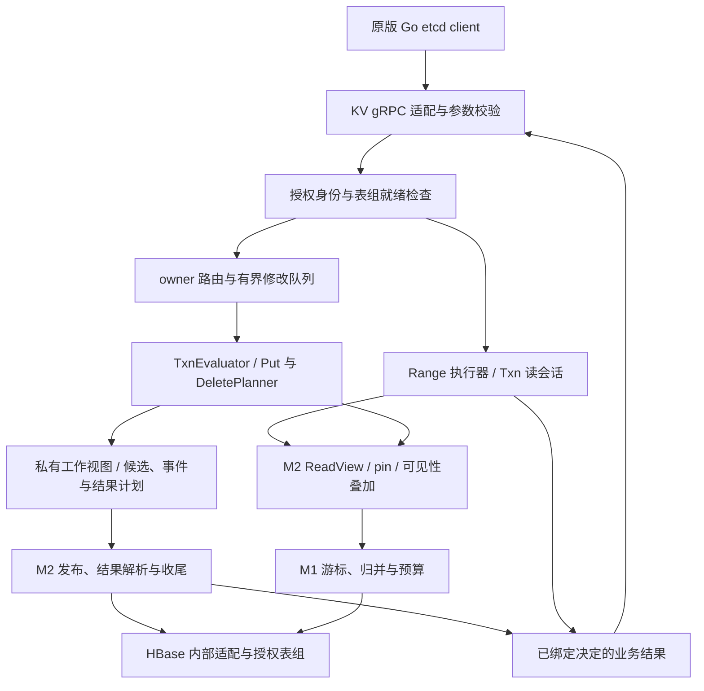

# M3 KV、Range 与 Txn 设计

**状态：待设计评审** · **日期：2026-11-06** · **需求与代码基线：** [DEVELOPMENT_PLAN.md v0.10 / faca1d7](https://github.com/Reidddddd/etcd-hbase/blob/faca1d72199942d09e70b474d395594ebf4da3d6/DEVELOPMENT_PLAN.md)

> 本文定义 J30–J36 及 J28.2 的协议、求值、提交、读取与验收契约，承接已批准的 [M0](2026-10-10-m0-engineering-environment-protocol-design.md)、[M1](2026-10-30-m1-storage-scan-budget-design.md) 和 [M2](2026-11-03-m2-commit-mvcc-recovery-design.md) 设计。本文是设计规格；逐步执行命令、原始报告与恢复记录由实施时维护。

**事实**指固定基线中的实现或锁定上游行为；**已确认要求**来自主计划与 [API 矩阵](../api-matrix.md)；**提议**是本轮待评审的实现选择；**待输入**不由公开临时环境代填。本文新增组件与格式均为提议，设计通过不表示实现或阶段验收通过。

## 1. 目标、现状与范围

M2 提供一次多 key 修改的发布、可见性与恢复依据。M3 将原版 Go etcd client 的 `/etcdserverpb.KV/Range`、`Put`、`DeleteRange` 和 `Txn` 接入这些依据，使创建、更新、删除、条件事务和范围读取返回真实的值、元数据、分支结果、响应顺序与错误。

**事实：** 基线已合入 J20–J29 的相关 PR；`KvService` 的 Range、Put、DeleteRange、Txn 和 Compact 仍返回 `UNIMPLEMENTED`。`ReadViewService`、`ReadViewRecordStore`、持久 pin、manifest、`CommitPublisher` 与 `RecoveryManager` 已有实现；M1 游标及 `ScanRequest` 以升序扫描为基线。合并记录不替代主计划中的 M2 验收、历史布局冻结或目标环境证据。

**表 1　M3 任务与设计交付**

| 任务 | 本设计规定的交付 |
|---|---|
| J30 | Put 元数据、PrevKV、删除后重建、ignore 标志与 Lease 参数边界 |
| J31 | Compare、Then/Else、只读与有修改分支、统一 revision |
| J32 | nested Txn、静态重复/重叠校验、顺序读写与响应树 |
| J33 | 点/区间/前缀删除计划、真实 deleted、PrevKvs 与有界准备 |
| J34 | Range 的 revision、KeysOnly、四项 revision 过滤、Count 边界 |
| J35 | KEY 升降序、全局 Limit/More；逐项明确非 KEY 排序拒绝 |
| J36 | 有界缓存、一致读复用证明、跨副本与身份失效门槛 |
| J28.2 | 经实际 Java gRPC/HBase 路径采集 Go client 并发历史并检查 |

正式 M3 验收使用已验证的 M2 内核。设计与受控 RPC 原型可以先行；真实 Lease 绑定、换绑、到期删除归 J40–J43，Watch 发送归 J44–J47，Compact/长期 GC 归 J52/J53，真实 Milvus 工作流归 M6。M3 仍准备完整事件，但不提前提供 Watch 成功响应。

J36 依赖 J51.1 的身份生命周期证据。基础无缓存 KV 路径独立交付；缓存保持关闭时，不把 J36 标为已完成。J18/J19 装配、真实 Header 身份来源和数据就绪能力也须逐项核对，不能从已存在接口推断运行时已经接通。

## 2. 架构与职责〔提议〕

**表 2　模块及权威状态**

| 模块 | 职责与所有权 |
|---|---|
| grpc | 上游 proto 解码、上下文相关的参数/能力校验、逻辑 DTO 转换、Header/Error 投影与一次 unary 终结 |
| core | Put/Compare/Txn/Delete/Range 语义、基准视图、事务内工作集、结果计划、预算与生命周期；不依赖生成 proto 或 HBase 类型 |
| hbase | 私有工作页/结果页持久化、既有提交与可见性 port、正反向物理页和精确版本访问；不自行决定 Txn 分支 |
| server | 监听端口与表组装配、真实身份、owner 路由、共享账本、能力/就绪门槛和服务恢复上下文 |
| testkit | 固定原生 etcd、无损 trace、字段差分、独立串行模型和故障历史检查 |

`TxnEvaluator` 等名称描述所需职责，不要求每个名称都成为新接口。优先组合现有实现，只有实际装配或替身需求才增加内部 port。公共 SPI 继续只依赖 JDK；提交、读视图、事务结果和缓存证明均不进入公共 SPI。

权威提交状态仍是 M2 控制行与决定；工作集只影响当前私有求值，缓存只复用已取得的结果，gRPC 层只投影真实结果。这三者均不能制造另一套 revision 或提交决定。

## 3. 请求、身份与响应的共同契约

### 3.1 协议与校验边界

沿用固定 etcd v3.5.23 proto 与 client，不增加公开 RPC、事务 ID 字段或分页 token。key/value 是原始 bytes；所有长度和排序以字节为准。精确 key 的点访问只计算一个盐桶，范围访问枚举表组 profile 的全部桶。

`key=[]` 是缺失 key，与 `key=[00]` 不同。`range_end=[]` 是点请求，普通区间为 `[key, range_end)`，`range_end=[00]` 为 FromKey；双 `[00]` 表示全 key 空间。Prefix 使用字节前缀上界，`/root` 与 `/root/` 含义不同，不能按目录层级截断。普通区间耗尽不等于后端失败。

入口先完成可静态判断的大小、key、请求树、oneof、操作数与重复写校验，选定路径后再检查实际执行操作的字段能力与动态条件。Txn 的两条分支都接受结构校验；选定路径的 Lease/历史 revision 等动态校验不随意扩展到未执行路径。校验顺序、空 RequestOp、Compare target/oneof 默认组合及边界值按固定 [v3rpc 校验实现][validation] 建立原生对照，不能用一组额外的“统一非负校验”改变已定义行为。

物理编码长度检查覆盖 KV、私有候选、事件/结果引用和辅助行的最坏膨胀；不截断 key。请求字节上限与扫描/输出资源上限是不同限制，分别保留错误类别。未知 enum 或未定义组合必须有可追溯的接受/拒绝决定，不能静默切换到默认操作。

### 3.2 身份与就绪

所有数据路径消费已授权的表组身份与有效配置。启用 Auth 时，先解析 session，再取得实际后端上下文；身份失败不回退匿名访问。公开 SIMPLE 验证使用显式无认证 profile 和真实 HBase 身份，不生成测试 token 冒充 J50/J51。

写就绪要求格式/profile、控制状态、owner、恢复容量和必需的结果格式均有效。恢复中的已选槽可以由 M2 视图完整读取；它未收尾前不准入下一次修改发布。缺少必要身份、结果记录或保护能力时返回真实错误，不开放半条业务链路。

### 3.3 Header 与聚合输出

Header 使用表组初始化/实例装配提供的真实 cluster/member 标识。clusterId 持久绑定该表组，memberId 对应当前提供服务的实例身份，与端点配置一致且在实例生命周期内稳定；uint64 保留原始位模式。缺少来源时先补足 J03/J54 所需的最小装配，不硬编码成功标识。本设计提议 `raft_term=0` 作为明确披露的非 Raft 投影，纳入本轮评审及差分允许列表；它不表示原生 Raft 任期，不能替换为 owner epoch。

独立 Range 的目标历史 revision 与 Header revision 分开保存：目标决定读取哪个版本，Header 表达本次屏障观察到的当前 revision。修改响应绑定被选择的 revision，不能在收尾后重读最新控制状态替换。Txn 外层 Header、各子响应 Header 和嵌套 Header 的 presence/字段逐项对照固定上游执行位置，不递归填成同一个最终值。[执行与 Header 来源][apply]、[MVCC 读写视图][mvcc]

所有子操作结果先组成有界的完整输出，完成对应 pin 的最终验证后才交给 gRPC。`PointResult`、`RangePage` 和输出字节 lease 的 owner 明确移交；grpc 组装/序列化期间继续计费，取消和失败只终结一次。框架接受输出不等于远端已收到；响应丢失不触发再次提交。

## 4. Put、元数据与 Lease 参数〔提议〕

**表 3　Put 在基准 revision R 上的逻辑结果**

| 基准状态/选项 | 结果 |
|---|---|
| key 不存在 | createRevision=modRevision=R+1，version=1，保留原始 value（空 value 也是存活值） |
| key 存在 | createRevision 保留，modRevision=R+1，version 加一；相同 value 的 Put 仍修改 KV |
| 删除后重新创建 | 新 createRevision=R+1，version 重置为 1；旧历史仍按保留规则可读 |
| `prev_kv=true` | 返回本操作之前的真实完整 KV；不存在时字段不出现，不合成空 KV |
| `ignore_value=true` | 保留旧 value；同时提供非空 value 按原生校验拒绝；缺旧 key 返回 ErrKeyNotFound |
| `ignore_lease=true` | 保留旧 Lease ID；同时提供非零 lease 按原生校验拒绝；缺旧 key 返回 ErrKeyNotFound |
| 两个 ignore 同时启用 | 两项保留规则共同生效，仍是一次 Put，而不是只读或 no-op |

J30 提议支持上述 ignore 语义，避免把合法请求静默改成普通 Put。它们在 Txn 内使用本操作之前的工作视图；执行前的存在性等动态检查仍按固定原生阶段完成。版本计数与 R+1 均检查溢出。

Lease 字段分为无 Lease、显式 Lease ID 和保留旧 Lease 三种意图，不仅用一个 `long` 推断绑定行为。普通 Put 的 `lease=0` 表示无 Lease，不能擅自继承旧绑定。实际有效性、换绑/解除与到期竞争由 M4 的权威 Lease 状态和辅助计划处理，和 KV 使用同一提交决定。

M3 无 Lease profile 只对无绑定数据开放相应写入。非零 Lease 请求或对已带 Lease 数据的修改，在真实绑定能力未装配时于发布前明确返回 `UNIMPLEMENTED`，不能返回假的 ErrLeaseNotFound、写一个 Lease 数字后报成功，或清掉旧数字却遗留绑定索引。M4 装配后，未知/失效 Lease 才按原生错误处理，并补 C08/C16 联动。

每个实际 Put 产生一个最终候选及有序 PUT 事件；事件保留原始 KV 和所需 PrevKV，Watch 是否被请求不影响事件准备完整性。

## 5. Txn 的两阶段求值〔提议〕

### 5.1 基准、Compare 与分支路径

有修改可能的请求进入 owner 的有界队列，先完成前一个已选槽的收尾，再捕获 `(baseSequence, R)` 和读保护。所有 Compare 都在这个基准快照上求值，包括选定路径中的嵌套 Txn；先得到确定的分支树，再按顺序执行操作。不能在前一个 Put 后重新求值嵌套 Compare。[固定分支算法][apply]

Compare 列表按 AND 组合；VERSION、CREATE、MOD、LEASE 用 int64 数值比较，VALUE 用无符号原始字节序；支持 EQUAL、NOT_EQUAL、GREATER、LESS。范围 Compare 对范围内每个存活 KV 检查，不要求区间没有 key 空洞；空结果的数字目标按零元数据比较，VALUE 目标始终 false，包括 NOT_EQUAL。读取/保护/解码失败终止请求，不能包装成 Compare=false。

`Succeeded=false` 只表示选中了 Else。Else 含实际修改时照常使用一次新 revision；只有匹配成功且 Then 写入才增 revision 的实现不成立。两条分支均无实际修改时保持 R。

### 5.2 顺序执行与事务内工作视图

选定路径按 RequestOp 顺序执行，嵌套响应保持树形结构。当前 revision 的读看到“基准 + 此前已执行操作”；显式历史 revision 的读读取对应历史，不叠加本事务的新版本。未执行分支不产生候选、事件或响应。

例如基准 `R=40`、`a=A`，选定分支为 `Range(a), Put(a,B), Range(a)`：第一次读返回 A，第二次返回 B 且 modRevision=41，事务最终只增长到 41。另一个例子中，基准 k 不存在；先 Put(k,x)，再执行嵌套 `Compare Version(k)==0`，该 Compare 仍按基准选 Then，但嵌套分支中的当前读可以看到 x。两种观察面不能混成一套“每步读最新”。

`TxnWorkingSet` 负责私有候选与基准的点/范围叠加，只有当前求值者可读。一次范围删除可能涉及大量 key，因此不能用一个随修改总量增长的常驻 Map 实现工作集。提议复用 J22 的分页/目录机制，在 HBase 私有空间保存已完成操作的有限页与有界目录；后续操作只消费已完成操作的覆盖范围，点读可定位、范围可按桶有序归并，保留操作 ordinal 与 checkpoint。部分写失败或覆盖关系未知时停止求值。

最终候选按桶/key 排序，同一 key 只保留最终修改；事件与响应保留执行 ordinal，不随候选排序重排。被接受的重复删除通过工作视图看到已删除状态，不重复生成同一 key 的事件。准备中断后不盲目续跑半个操作；先按原调用解析未选择并 fence，才能创建新尝试。

### 5.3 nested、重复与重叠校验

静态校验以 [上游 checkIntervals][validation] 的潜在写集合与删除区间为依据，覆盖两条分支和递归树，不能只检查最后选中的路径。至少冻结下列组合：

| 组合 | 设计要求 |
|---|---|
| 同一执行路径重复 Put 同 key | 返回原生 DuplicateKey 类错误，不能合并后成功 |
| Put key 与 DeleteRange 重叠，含嵌套 | 按原生拒绝，与操作先后无关 |
| Range 与 Put/Delete 重叠 | 允许的组合按顺序读取工作视图，不当作重复写拒绝 |
| 重叠/重复 DeleteRange | 原生接受者照常执行；第二次只删除剩余存活集合，deleted 不重计 |
| 同一个 nested Txn 的互斥 Then/Else 写同 key | 保留原生互斥分支的允许规则，不能一律去重拒绝 |
| 多个嵌套节点/父子节点的潜在重复写 | 复现原生递归集合合并规则，不能把任意跨节点分支视为互斥 |

操作数采用固定原生的递归预算计算；另有限制请求字节、嵌套深度、求值时间与扫描成本，防止深树或区间校验放大。静态无效的未选分支同样拒绝，合法未选分支不执行动态数据访问。

### 5.4 多个读取目标与聚合 pin

一笔 Txn 可能含多个显式历史 revision。提议增加内部 `TxnReadSession`，从同一次控制屏障派生各目标视图，保护它们实际需要的最低稳定版本和选定根；不同目标数量受请求树预算约束。不能用多次独立“当前 Range”拼成事务快照。

现有单目标 `ReadViewService.open` 和单操作 `finishRead` 不能直接当作完整聚合会话。子 Range/点读结束只移交已持有的结果，不提前完成共享 pin；全部必需字节持有后，再完成全部代次校验。任一代次被撤销则丢弃整笔输出，解除已取得资源。历史 Compact 边界与 FutureRev 在选定路径执行前按原生上下文检查。

原生独立 Range 的负 revision 与 Txn 子 Range 的预检查并不等价；实现不得在入口无条件把所有 `revision<=0` 改成同一 DTO 状态。[MVCC 读取][mvcc]、[Txn 子请求预检查][apply]

## 6. 删除计划与一次发布〔提议〕

`DeletePlanner` 在同一个事务工作视图中枚举目标存活集合。点删只访问一个桶，范围/Prefix/FromKey 以有限桶页归并；读取发生在固定视图，不能边扫描边对公共行逐个 Delete。

deleted 是实际被本操作删除的存活 key 数；`prev_kv=true` 的 PrevKvs 为这些 key 的真实完整旧值，顺序与原生一致。空集合 deleted=0，不制造墓碑、事件或 KV revision。重叠删除先后作用于工作视图，所以每个 ResponseOp 的 deleted 可不同。

每项删除生成逻辑墓碑与 DELETE 事件，保留历史枚举入口；HBase 原生 Delete 仍只供安全物理回收。墓碑的内部正数版本约束与 wire DELETE/PrevKV 投影分开，不把内部占位字段直接当作 etcd 业务事件。

大删除逐页准备私有候选、事件与所需结果，全部封存后只发布一次。任一项超预算、失败、取消或值缺失均不得返回部分删除成功。发布前预留完整响应、结果恢复及收尾容量；省略 PrevKvs 可以减少输出成本，但不省略 deleted 的真实求值或事件依据。

## 7. 结果计划、提交与未知结果〔提议〕

Put/Delete/Txn 的语义结果包含分支选择、嵌套响应顺序、PrevKV、deleted 及各位置的读值。M2 的 `resultReference` 提供引用槽位，候选和事件本身不足以还原任意 Txn 响应；M3 需补齐有版本的结果计划。

提议在封存前持久化不可变结果页与有界目录，将其身份/摘要绑定到 manifest 根及调用摘要。页存逻辑结果 DTO 和各响应位置的 revision，序列化留在 hbase；不存 proto 实例、凭据或连接。回复实例的 member 标识按真实发送端投影，不把旧实例对象固化进结果页。所需格式新增采用显式 schema/能力校验与部署兼容策略，不能让旧 finalizer 对缺少必需结果依据的新根报成功。

修改路径遵循以下不变量：

1. 私有工作集、事件、完整结果依据及编码长度/响应预算全部确认后才封存。
2. 发布仍比较 owner epoch、逻辑基准与空槽；只有 heartbeat 等控制变化时可刷新 CAS 令牌，逻辑基准变化须按原尝试解析后重新求值。
3. 一次实际修改只分配一个新 KV revision；重复落地与结果重建不再增长。
4. 全部必需物化、结果可查询与收尾确认后才成功响应。恢复查询返回原分支/PrevKV/响应树，禁止读取当前 KV 重新拼结果。

没有实际修改的 Txn/空删除不发布空事务。对于已进入内部 invocation 路径的无修改结果，提议新增明确的“已求值、无修改”终态及有界结果引用：先持有/保存全部结果并完成读保护，再 CAS 保存与基准/授权/摘要绑定的完成状态。它只能从同一尝试的 PREPARING 状态进入，且未封存或交接发布发送权；封存与无修改完成竞争同一调用记录状态，终态禁止后续 seal/派发，不能让迟到执行者用旧对象发布。

该终态不增加 sequence/revision，不伪装成“已选择”或以 NOT_SELECTED 当业务失败；重复内部转发加入原结果，不能在新基准重算而改变 Succeeded。结果写入/CAS 未知时重读同一身份确认，查询窗口结束后仍保留禁止重放的调用身份。该扩展的持久状态、发送权约束、查询窗口和旧格式处理必须一并验证。

确定纯读的 Txn 可在任意数据就绪副本执行；其所有分支/嵌套节点均只含读操作时才走该路径，读会话仍固定单一屏障。写能力请求即使最终无修改，也保持已建立的内部尝试身份与终态约束。

`invocationId` 只去重本服务同一次内部尝试，原生客户端重新发起的外部请求没有该幂等键。发布可能已发送后的取消、超时或断连继续由 M2 服务上下文解析；对外返回实际调用状态，对内保留提交确定性。没有原生重试依据时，不把错误改写成“肯定未执行”的描述诱导 mutable RPC 自动重放。

## 8. Range 视图、选项与排序〔提议〕

### 8.1 执行次序

独立 Range 的 `revision<=0` 选择当前视图，正数选择相应历史；Txn 子请求仍保留第 5.4 节的预检查差别。默认读取得强一致控制屏障，注册/复核 pin，按请求目标选择逻辑版本；M2 选定候选叠加完成后，依次处理存活状态、revision 过滤、排序、全局 Limit/More 和输出投影。`serializable=true` 首版仍可走同一更强路径，不降低默认请求的一致性。

min/max create/mod revision 的非零边界为 inclusive，过滤的是本次视图选中的记录，不从更早版本中寻找“能满足过滤的值”。KeysOnly 只清空响应 value，保留真实元数据；Compare VALUE、PrevKV 和事件所需完整值不能因 KeysOnly 被省略。

目标 revision 的压缩/未来边界在建视图时检查；历史数据必须仍可完整枚举，包括后来删除的 key。缺列、错版、缺候选或 pin 撤销都不是空结果。正式 Compact RPC 归 J52，M3 只验收已存在控制边界的读取解释及专用 fixture，不伪造 Compact 成功。

### 8.2 排序的明确选择

**表 4　J35 的首版选择**

| SortTarget / SortOrder | 行为与实现约束 |
|---|---|
| KEY + NONE / ASCEND | 无符号 key 升序；复用有界桶游标与最小堆 |
| KEY + DESCEND | 支持 key 降序；增加方向明确的桶扫描、manifest 遍历与最大堆，不能倒置升序的前 L 项 |
| VERSION / CREATE / MOD / VALUE（含 NONE） | 本设计提议明确 `UNIMPLEMENTED`；每种目标都有拒绝用例，不静默按 key 排序 |

降序仍读取原逻辑区间 `[lower, upper)`，内部 checkpoint 绑定方向、完整逻辑 key 和同一 ReadView。它排除上次已完整消费 key 的整个版本组；不能简单对既有 `after` 字段换一个比较符号。HISTORY 的反向物理行需正确跨越 revision 后缀，NATIVE 的版本选择仍用固定时间上界；两者都须和反向候选目录合并，不能倒序扫进相邻盐桶。

现有 `ScanRequest`、游标、HBase 页实现、manifest 查找和归并调用方须一起支持方向；升序保持原契约。至少一个 scanner 配额仍能前进，降序不通过加载全部范围再排序来规避该证明。非 KEY 排序若未来扩展，应另评全范围排序/索引、tie、value 读取与预算；本轮选择不削减矩阵已承诺的 KEY 升降序。

### 8.3 Limit、More、Count 与客户端翻页

Limit 为全局限制，L+1 的第额外一项必须是同一视图下已通过过滤的可见记录。墓碑、版本和被过滤记录不占 L；More=false 需要全部相关桶的耗尽证据，短页、空桶和达到物理预算均不能代替。每桶页大小独立于用户 Limit，不做默认 N×L 预读；极大 int64 limit 在计算 L+1 前检查溢出和输出可行性。

**表 5　沿用已批准的轻量 Count 边界**

| 形态 | Count / Kvs / 扫描 |
|---|---|
| 精确普通 Get | Count=实际 Kvs 数，0 或 1 |
| 普通范围，无有效正 Limit | Count=len(Kvs)，在预算内返回完整结果 |
| 普通范围，Limit>0 | Count=本页 len(Kvs)，More 真实；不补扫准确总数 |
| 精确 CountOnly | Count=真实 0/1，Kvs 为空，元数据存在性读取 |
| 范围 CountOnly + Limit=1 | Count=真实存在性 0/1，Kvs 为空，More=false；允许真实提前命中 |
| 其他范围 CountOnly | 明确 `UNIMPLEMENTED`，不暗中执行全范围计数 |

CountOnly 的存在性仍受目标 revision、墓碑、过滤与授权约束，不能直接看到物理行就返回 1。CountOnly 与 KeysOnly 组合保持 Kvs 为空。与原生差分只豁免表中的 Count/对应存在性 More 约定，不能豁免排序、遗漏、版本或错误。

内部页重开持有同一 ReadView。多次独立 Range 不自动共享快照；需要跨 RPC 固定快照时客户端显式携带 revision。对降序响应，后续 RPC 通过缩小独占上界续读；不擅自新增公开 token。没有 Limit 的 unary 结果超预算时整次失败，不返回一部分且称已完成。

## 9. 缓存启用条件〔提议〕

默认禁用缓存，先以既有直接访问路径形成正确性和成本基线。J36 的第一种可启用形态只缓存有界点结果和小范围完整结果，按字节淘汰；事务 Compare/规划先继续走直接视图路径。

缓存项绑定表组/profile、授权范围与身份代次、查询范围/投影/过滤/排序、视图 sequence/revision，以及完整结果与耗尽/More 证据。负缓存必须证明完整覆盖，部分 prefix 页不能复用成更大范围的空结果。缓存值是已持有的不可变 bytes，不留解除 pin 后的懒加载句柄。

每次默认一致读仍取得当前强一致屏障。命中项覆盖相同 sequence 且身份/查询条件匹配时才可复用；sequence 前进的基础策略是弃用/重读。不相关写优化必须有从旧 sequence 到新 sequence 的连续决定与覆盖范围证明，计入选定未收尾候选、删除/到期、格式/Compact 与身份代次变化；根/决定缺页、保留窗口过期或证明超预算时放弃复用。命中只复用已证明的数据结果，Header 使用本次真实屏障与发送实例，不能原样返回缓存中的旧 Header。

只比较 KV revision 不足：metadata-only 提交可以保持 revision 而推进 sequence。只监听本副本写入、仅靠本地 owner 或一次未失效的连接也不构成跨副本新鲜度证明。未来消费 Watch/失效流时，序号间隙或断流立即废弃无法证明的项，不能以 TTL 暂时兜底。

缓存不会绕过当前 compact 边界或授权检查。J51.1 未验收前不得启用；J51.3 补跨副本失效、轮换和会话联动。合并重复请求时，producer 有独立且有界的 owner，等待者取消只结束自己的等待；实际 producer 结束后才归还后端资源，不能让首个请求的 scope 提前取消共享工作。

## 10. 错误、预算与生命周期

### 10.1 错误投影

新增 core 的有限协议语义错误，与 `BackendFailure` 分开：前者表示 EmptyKey、DuplicateKey、KeyNotFound、Compacted、FutureRev 等确定原因，后者保留后端认证、权限、不可用、超时、取消与未知。不解析异常文本来判断业务分支；gRPC 层按固定 [rpctypes][errors] 的 code/描述投影，原始 HBase 地址、异常和完整 key 不输出。

**表 6　关键失败边界**

| 情况 | 要求 |
|---|---|
| 结构/重复 key/原生 request-too-large | 按原生 InvalidArgument 类别及错误描述；不混成内部异常 |
| 逻辑 Compact / FutureRev | OutOfRange 与对应原生可识别错误；不统一报不存在 |
| 未装配的 Lease 联动或明示不支持选项 | 发布前 `UNIMPLEMENTED`；不伪造业务失败原因 |
| 请求/表组/全局资源不足 | `ResourceExhausted`，整体失败；保留与原生请求字节限制的区别 |
| HBase 读取、身份或 pin 失败 | 传播相应类别；不为空 Kvs、deleted=0 或 Compare=false |
| 发布后等待超时或发送失败 | 保留结果未知/调用状态，服务继续解析与恢复；不宣称回滚 |

静态参数错误、动态错误与不支持能力的优先级通过真实 Go client 对照固定。客户端错误识别不仅检查 gRPC code，也检查 canonical description 与 `rpctypes.Error` 结果。

### 10.2 有界工作与清理

复用单一全局/表组/请求账本；新增求值页、比较范围、响应树、私有结果页和序列化容量进入同一账本。入队数量/字节、树节点/深度、扫描页/物理行/RPC、在途 value、单条记录、总输出和截止时间分别有上限。操作数很少的 Txn 也可能含巨大 DeleteRange，不能仅用 maxTxnOps 证明有界。

写请求在发布前已持有或持久化全部结果依据，并预留响应编码峰值和服务收尾空间；不能提交后才发现 PrevKvs 无法装进 unary 响应。无 Limit 读取先整体组装受限结果再交付；内部分页不消除最终响应内存。

RPC/event-loop 线程不阻塞等 HBase、归并或大计划。取消停止新求值与 I/O，等待真实 producer/scanner drain 后释放预算和 pin；发布发送权已交接的工作使用独立服务上下文。请求完成、输出释放、`cleanupCompletion` 和 `Account.termination()` 分别观察，不能因取消了依赖 future 就关闭共享连接或归还仍在用的容量。

指标只用有限类别：方法、操作类型、分支类别、结果/失败类别、布局/profile；记录排队、比较/枚举成本、准备/发布/收尾、输出字节、页重开及取消清理。key、value、密码、token 和用户输入的高基数字符串不作为指标标签或公开日志内容。

## 11. 验证设计与阶段门槛

下列是实现验收要求，本设计 PR 未执行这些行为测试。复用 J07 trace/原生对照工具，但新场景必须实际调用 Java 业务 handler 与真实 HBase，不能把固定成功 fixture 或 M2 最小驱动算作协议验收。

**表 7　按任务形成证据**

| 任务/层次 | 必须覆盖的场景 |
|---|---|
| J30，L1/L2，C01/C07 | 空/二进制/长 key，创建/更新/同值 Put/删除重建；PrevKV、Version/Create/Mod；ignore 四种组合与非法标志；无 Lease 能力拒绝先于发布 |
| J31，L1/L2，C11/C12 | 五目标×四比较结果，缺失/空范围/含空洞范围；Then/Else 写、纯读、无效 Compare 后端失败；一次 revision 与无修改终态重放 |
| J32，L1/L2，C13 | 嵌套 Compare 基准、顺序读写、静态未选分支、重复 Put、Put/Delete 重叠、重叠删除、互斥与跨节点潜在写；子响应树/Headers/错误优先级 |
| J33，L1/L2，C09/C10 | 跨桶删除、真实 deleted/PrevKvs、重复删除、大计划预算、每页准备失败/取消；发布前无公共修改，发布后完整恢复 |
| J34，L1/L2，C02/C04–C06 | Prefix/FromKey/全空间，历史删除重建，四项过滤 inclusive/零/负边界，KeysOnly/CountOnly组合、显式多个历史目标、pin 最终验证 |
| J35，L1/L2，C03 | KEY 双向顺序、空桶/慢桶、墓碑/过滤后的 L+1、单 scanner 配额、HISTORY 版本组/反向候选、页重开无重漏；四种非 KEY 目标真实拒绝 |
| J36，L1/L2，C23 与 J51.3 | 跨副本写后读、相同 revision 的 metadata sequence、失效间隙、Compact、负缓存覆盖、身份轮换/越权、等待者取消与真实 producer 清理；启用前后对照 |
| J28.2，L2 | Put/CAS/Else/Delete/Range/nested 混合并发、跨桶读，发布成功丢响应、重复内部转发、取消、切换 owner 与进程重启；完整调用历史可线性化 |

差分以固定 etcd v3.5.23、相同初始数据/请求 bytes 与固定 seed 执行，既覆盖 `clientv3` 选项转换，也覆盖原始 `apiv3` 请求。比对 KV bytes、元数据、Header 来源、响应 presence/嵌套顺序、More、deleted、Succeeded 与错误。仅按已批准规则归一化 cluster/member 标识及 Count 差异，不能排序响应来隐藏返回顺序错误。

J28.2 的独立串行模型消费实际 RPC invocation/return 与错误历史，不调用生产 TxnEvaluator 算期望值。超时操作保留“可能生效”，结合后续读/决定限制合法补全；不能全部删除或当失败。给出有界历史的检查结果、模型限制与失败 seed，随机压力不代替确定性故障窗口。

公开证据至少包含真实 HBase 的无缓存 RPC 对照、两候选适配的相关正反向/历史契约、发布/恢复与聚合输出竞态、预算和清理证据。最终布局仍由 J24/J25/J52.1 冻结，单次 J29 或某个布局跑通不代替选型。

真实目标身份/权限、跨进程 peer、安全引用、WAL/HDFS 故障和 B04/B05 性能目标各自记录。公开 SIMPLE MiniCluster 证明的访问/协议范围不推广为生产认证与耐久性；M2 必需证据缺失时不宣布 M3 正式通过。

## 12. 设计选择、待输入与退出条件

**表 8　本轮提议及选择理由**

| 决策 | 选择与理由 |
|---|---|
| Txn 执行 | 基准上先固定嵌套分支，随后顺序读取私有工作视图；符合固定上游观察顺序 |
| 多行修改 | 沿用 M2 一次发布；逐页准备不会变成逐页业务提交 |
| 结果恢复 | 不可变结果计划与决定绑定；当前 KV 无法重建旧 PrevKV/分支/响应树 |
| 无修改请求 | 明确可重放结果终态，不分配空提交或假 KV revision |
| KEY 降序 | 实现有界反向访问，保持同一视图和全局 L+1；避免全范围常驻排序 |
| 非 KEY 排序 | 本轮四种目标均明确拒绝，保留未来独立成本评审边界 |
| ignore 标志 | 支持数据语义，Lease 绑定能力有明确门槛，不忽略字段 |
| 缓存 | 默认关闭；一致屏障与连续覆盖/身份依据齐备后才启用 |

**表 9　外部输入及跨任务条件**

| 输入/前置 | 对 M3 的影响 |
|---|---|
| B01、J24/J25/J52.1 | 目标盐/布局与保留证据；公开候选可先验证，不能冻结目标格式 |
| B02 | 实际 HBase/client/Hadoop/JDK 兼容与故障入口；不要求目标集群升级为公开验证版本 |
| B03/B06、J50.1/J51.1 | Authenticate 到后端身份、跨副本与恢复授权、TLS/轮换；无缓存目标访问与缓存启用分别验收 |
| B04/B05 | 事务/范围规模、输出与延迟/资源目标；公开预算行为可先验，目标容量不代定 |
| J40–J43 | 真实 Lease 绑定与到期竞争；M3 只完成参数/能力门槛，完整 WithLease 后验收 |
| J03/J54、J18/J19 | 真实 Header 身份来源、表组与 provider 装配；最小必要能力按依赖接通 |

无缓存的 J30–J35 对外能力与错误对照、J28.2 真实 RPC 历史可以先形成检查点。M3 正式退出仍要求主计划的适用 J30–J36 交付、M2 前置证据及预算/资源释放齐全；J36 只有证明并通过身份联动后才完成，保持关闭不能冒充已验收缓存。J51.1 等前置未满足时保留 J36 和阶段验收未完成。Lease/Compact/Watch 的跨阶段剩余项单列，并由主计划记录检查点与阶段判定。

作者设计自审、独立复核、维护者正式 review、实现验证和目标验收分别记录。本文不修改任务勾选、阶段完成数或现有支持状态；设计批准后按 J30、J31 等任务顺序实施，每个任务形成自己的可审查交付。

## 13. 依据

- [本次固定主计划](https://github.com/Reidddddd/etcd-hbase/blob/faca1d72199942d09e70b474d395594ebf4da3d6/DEVELOPMENT_PLAN.md)、[API 矩阵](../api-matrix.md)、[Milvus v3.0.1 调用基线](../milvus-etcd-usage.md)。
- [基线 KV 骨架](https://github.com/Reidddddd/etcd-hbase/blob/faca1d72199942d09e70b474d395594ebf4da3d6/grpc/src/main/java/io/etcdhbase/grpc/service/KvService.java)、[M2 读视图实现](https://github.com/Reidddddd/etcd-hbase/blob/faca1d72199942d09e70b474d395594ebf4da3d6/core/src/main/java/io/etcdhbase/core/commit/ReadViewService.java)、[M2 调用绑定](https://github.com/Reidddddd/etcd-hbase/blob/faca1d72199942d09e70b474d395594ebf4da3d6/core/src/main/java/io/etcdhbase/core/commit/InvocationBinding.java)。
- [固定 wire schema][proto]、[etcd v3.5 API 保证](https://etcd.io/docs/v3.5/learning/api_guarantees/)、[上游请求校验][validation]、[上游求值与响应构造][apply]、[MVCC 事务读写][mvcc]、[错误定义][errors]。

上游资料约束协议可观察行为；工作集、结果页、M2 提交适配和缓存证明是本项目的设计提议。后续修改固定 client、协议基线或能力选择时，必须同步核对矩阵与差分证据。

[proto]: https://github.com/etcd-io/etcd/blob/1cf4bc40111fd95d1e14a90a09a146357b15eb13/api/etcdserverpb/rpc.proto
[validation]: https://github.com/etcd-io/etcd/blob/1cf4bc40111fd95d1e14a90a09a146357b15eb13/server/etcdserver/api/v3rpc/key.go
[apply]: https://github.com/etcd-io/etcd/blob/1cf4bc40111fd95d1e14a90a09a146357b15eb13/server/etcdserver/apply.go
[mvcc]: https://github.com/etcd-io/etcd/blob/1cf4bc40111fd95d1e14a90a09a146357b15eb13/server/mvcc/kvstore_txn.go
[errors]: https://github.com/etcd-io/etcd/blob/1cf4bc40111fd95d1e14a90a09a146357b15eb13/api/v3rpc/rpctypes/error.go
