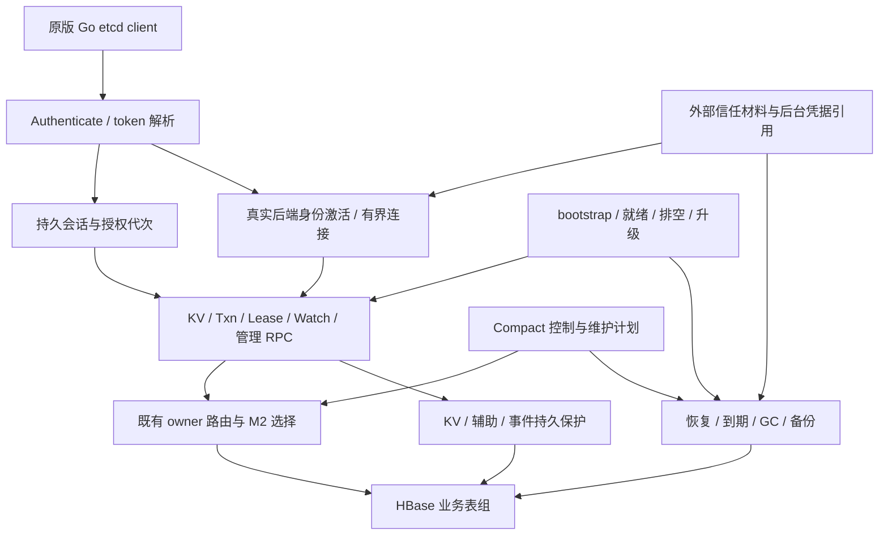

# M5 Auth、GC、运维与生命周期设计

**状态：待设计评审** · **日期：2026-11-20** · **需求与代码基线：** [上游 main / 1de13e9](https://github.com/Reidddddd/etcd-hbase/tree/1de13e973c84ad917d1e344f0eeefd02a92ad374)

> 本文定义 J50–J59 的行为、状态、恢复、安全和验收契约，承接 [主计划](../../DEVELOPMENT_PLAN.md)、[API 矩阵](../api-matrix.md)及 [M0](2026-10-10-m0-engineering-environment-protocol-design.md)、[M1](2026-10-30-m1-storage-scan-budget-design.md)、[M2](2026-11-03-m2-commit-mvcc-recovery-design.md)、[M3](2026-11-06-m3-kv-txn-compatibility-design.md)、[M4](2026-11-11-m4-lease-watch-design.md) 设计。实施命令、agent 执行步骤和原始报告留在本地。

**事实**以本节固定代码为准；**已确认要求**来自主计划与已批准设计；下文新增机制均为**提议**，需经本设计评审和后续实现验证。本文不勾选 M4/M5 阶段验收，不把既有接口视作完整功能已经实现。

## 1. 目标、场景与现有边界

M2–M4 已提供提交、读视图、KV/Txn、Lease 和 Watch 的公开开发基础。M5 要使这些能力在真实身份、多副本重启、数据回收和版本升级时仍然可用，并交付可独立构建、启动和维护的默认发行包。

典型场景：客户端在副本 A 使用 HBase 凭据 Authenticate，取得 token；后续请求落到 B 时，B 取得同一授权范围的真实后端身份。A 退出后，B 继续恢复已选择事务、处理 Lease 到期和 Watch 回放。管理员 Compact 旧历史时，已经开始的读取仍有保护；全部副本重建后，后台无需等某个用户重新登录才能收尾已选择事务。备份恢复则在新的隔离表组恢复一致边界，避免把新旧服务同时指向同一数据代次。

**表 1 基线中已具备的能力与 M5 缺口**

| 基线事实及源码入口 | M5 需要补齐 |
|---|---|
| `BackendIdentityProvider`、`HBaseBackendIdentityProvider` 已验证多种后端认证，见 [J04](../hbase/j04-backend-access.md)；身份 handle 归当前 provider 所有 | Authenticate/session、跨副本恢复身份、逐身份退役和轮换；不可直接把 A 的 handle 序列化给 B |
| `M3RuntimeGroups` 当前仅装配显式开发身份；`ServiceAuthorizationContextReference` 明确只适用于该路径 | 生产身份解析、请求级连接绑定及安全后台身份；生产 Lease 门槛在 J51 证明前保持拒绝 |
| `SnapshotPinManager`、`EventHistoryPinManager`、`EventHistoryRetention` 提供持久化保护和候选回收边界 | Compact RPC、逐类长期 GC、进度和失败恢复；边界对象本身不是删除许可 |
| `AuthService`、`ClusterService`、`MaintenanceService` 及 `KvService.compact` 仍为 `UNIMPLEMENTED` | 交付矩阵内真实结果、显式拒绝和兼容投影 |
| `M3TableGroupInitializer.initializeFresh` 仅支持受控新建，不接管既有表或自动重试未知创建 | 可恢复且幂等的 bootstrap、schema 演进与隔离恢复 |
| J09 已有锁定 Java 21 运行包、镜像及公开验证，J36 缓存仍有独立启用门槛 | 安全默认发行、生命周期、兼容检查和 Quickstart；不借 M5 设计自动开启缓存 |

M4 的 J40–J47 实现 PR 已合并，阶段证据和主计划状态仍需核对。M5 设计可先行；实施时按各任务依赖使用已验证接口，M4 收口和 J29.4 证据继续保留原归属。实际 Milvus 工作流归 M6，压力、长期运行及目标环境容量归 M7；本阶段仍须完成可在安全 MiniCluster、多进程和临时 K8s 环境验证的功能。

**表 2 M5 任务与交付**

| 任务 | 本设计规定的交付 |
|---|---|
| J50 | Authenticate、有界持久会话、token 跨副本使用、后端身份激活及全部副本重建 |
| J51 | 权限/凭据/连接生命周期、转发与后台身份、Auth 管理矩阵、J36 失效联动契约 |
| J52 | Compact、独立 revision/sequence 回收边界、历史/事件/决定安全回收 |
| J53 | 未选择准备记录、陈旧 Lease 索引、会话与维护记录清理；有界检查点和迟到写防护 |
| J54 | MemberList、Status、Alarm GET、全部未支持 RPC 的正确拒绝 |
| J55 | 空表组 bootstrap、schema/profile 校验、未知结果恢复和重复启动 |
| J56 | Java 21 运行包、认证可达路由、数据就绪、排空、K8s 多副本与扩缩容 |
| J57 | 一致边界备份、隔离恢复、Lease 时间策略、schema 升级与回退边界 |
| J58 | 公开 SPI/API 兼容、格式矩阵、默认及示例扩展契约 |
| J59 | 独立默认发行包、公开 CI、Quickstart 与兼容差异披露 |

## 2. 总体架构与不变量〔提议〕

职责沿用八模块：`core` 管理会话、授权决策、压缩/回收计划及生命周期状态；`hbase` 实现实际身份、条件记录、版本删除和管理操作；`grpc` 只处理协议与流；`server` 装配受控凭据、身份引用、后台和预算；`admin` 承担初始化、备份恢复与离线维护；`testkit` 承担原生对照和公共契约。HBase/gRPC 类型不进入公共 SPI，内部状态不因需要跨模块使用就变成公开接口。

必须保持：

1. **token 与后端授权分开。** token 能定位会话不等于可访问 HBase；每个数据路径还须取得有效身份及权限。
2. **已选择事务可恢复。** 用户 token 失效不改变 M2 决定；后台只能按原不可变根收尾，不能借服务身份替用户准入新修改。
3. **回收与注册有竞争点。** 持久保护下界先阻止更旧注册，再允许清理；不采用“扫描一次 pin 后直接删除”。
4. **revision 与 sequence 分开。** 纯认证/维护不制造 KV revision；Lease 辅助历史、结果和决定不得只按 KV revision 回收。
5. **删除不能被迟到写撤销。** 正式落地与维护复用行 fence/guard，删除数据仍保留必要退休证明。
6. **生命周期不回滚提交。** Pod 退出、凭据失效、Compact 超时或备份失败均不推翻已经选择的操作。
7. **证据对应真实能力。** 无法获取后端大小、Raft 字段或权限时不填造成功；投影和限制公开披露并进入对照允许列表。

## 3. 持久状态与权限边界〔提议〕

业务表组仍按已选择的 HISTORY/NATIVE 布局保存数据，不因 Auth 改写业务 key 的 rowkey。业务 system 表新增内部记录类型时，复用 `SystemRecordKeyCodec` 的类别、盐和长度校验，family 取经过校验的 `SystemTableBinding.family()`，记录 value 使用既有 `r` qualifier 和版本化内部 proto。新类别、descriptor 能力与读写格式由 J55 显式升级，不改上游 etcd proto。

会话含安全控制信息，另使用部署级 `auth-control` 逻辑表；物理名称、连接 profile 与信任域由配置绑定。该表只授权会话服务身份和受控管理员，普通业务 HBase 账号不得直接改会话或授权代次。部署可将它与业务表置于同一 HBase 集群，但它不参与用户 KV Range、Txn 或 Watch。

**表 3 新增逻辑状态与权威来源**

| 状态 | 持久位置与关键内容 | 更新规则 |
|---|---|---|
| AuthSession | auth-control；token 摘要、随机 sessionId、subject 安全引用、scope、凭据代次、授权代次、创建/到期时间、状态 | 单行 CAS；创建前完成真实认证，终态不恢复为 ACTIVE |
| CredentialEnvelope | 与 session 同行的受限密文或外部安全引用；keyId、nonce、AAD 版本、密文摘要 | 默认与会话原子创建；不得把密码、keytab 或后端 token 明文放入表 |
| SubjectAuthority | auth-control；provider/subject/scope 的当前授权代次、撤销状态及失效传播任务 | CAS 单调推进，不伪装成原生用户数据库 |
| 后台激活配置 | 外部安全配置引用；允许的表组、任务及凭据版本；表中只存非敏感绑定摘要 | 运维授予，启动时独立获取和实际核权 |
| 授权发布 fence | 业务控制状态中的授权屏障代次，以及可恢复的跨表安装任务 | 与发布资格在同一控制行比较；J51 安装后才确认撤销完成 |
| Compact 操作 | system；operationId、目标 C、控制状态版本、GC 目标及阶段 | owner fencing；控制行中的 compactRevision 仍是唯一逻辑压缩权威 |
| GC 检查点 | system；记录域、计划代次、revision/sequence 边界、bucket、完整逻辑记录游标 | 单调、条件更新；页删除确认后才推进 |
| Bootstrap / Schema / Backup | system 或受控管理目录；操作身份、计划摘要、格式能力、一致边界、结果摘要 | 不覆盖既有权威状态；未知结果按同一 operationId 恢复 |
| Member / Alarm | system 的有界成员登记和受控告警记录 | 绑定实例 incarnation、授权写入者及有效期；不与 owner epoch 混用 |

auth-control 的 rowkey 采用 `bucket || recordKind || length-prefixed identity`，session identity 为 SHA-256(token)，subject identity 使用不可逆域隔离摘要。提议 family=`a`、qualifier=`r`，所有关键变更 `SYNC_WAL`、强一致读、明确记录上限；HBase TTL 不负责判定会话有效性。过期清理由 J53 执行。密文仍属敏感数据，禁止进入日志、普通诊断、备份示例和未授权导出。

持久会话的总容量使用固定分片、有限槽的登记行 CAS 约束，不能只限制单 Pod map。登录在启动后端工作前预留槽和代次，会话记录绑定该预留；取消、结果未知、迟到创建和未完成清理继续占槽，直到确认资源及记录可安全退役。读取 token 同时验证槽代次，旧创建不能借复用槽恢复有效性；槽数、分片数和记录字节都是显式容量配置。

## 4. J50：Authenticate、会话与跨副本身份〔提议〕

### 4.1 登录与 token

1. 根据监听 endpoint 的已验证绑定选择表组、认证 provider 和 scope；不接受客户端自报的新表组。
2. 校验凭据及请求长度，在 TLS 通道接受固定 `Authenticate(name,password)`；调用 J04 的实际后端认证和表组权限 verifier。账号、scope 或后端机制不匹配均失败，不尝试其他机制或 SIMPLE 回退。
3. 为该会话准备可在其他副本激活的凭据材料，实际核验后台恢复所需身份可独立激活；失败则销毁本次资源，不发 token。业务恢复是否完成由数据就绪另行判定。
4. 用密码学安全随机源生成至少 256 bit opaque token，以 SHA-256 摘要建唯一行，将 ACTIVE 会话及密文/安全引用同行持久化；碰撞重新生成。返回的 token 仅为随机值，不含账号、密码或后端身份。
5. 结果未知时用本次 sessionId/摘要查询同一行，不能无界新增会话。若客户端已取消，清理已创建但未交付的会话；清理未确认仍计容量，过期收尾可接管。

会话落盘后、响应前再次校验原 SubjectAuthority 代次和容量槽；若其间发生撤销，不交付可用 token，按终态清理。初始 auth-control 由受控管理员使用独立启动凭据初始化，J50 交付其最小格式和初始化工具，J55 再统一恢复与幂等协议，避免要求先登录才能创建认证存储。Authenticate 可在业务恢复尚未完成时建立真实身份；Header 从已初始化表组的权威屏障取得，不能虚构 revision。

会话到期独立于 etcd Lease TTL；KeepAlive 不延长认证会话。后续 RPC 从固定 metadata 解析 token，未知、过期、撤销 token 返回客户端可识别的 `ErrInvalidAuthToken`。Authenticate 凭据错误按既有矩阵映射 `ErrAuthFailed`，权限不足返回 `ErrPermissionDenied`；后端或凭据服务不可用不能当作密码错误。

proto 的 password 是生成的不可变字符串，不能承诺其 JVM 副本可全部清零。适配层限制存活范围，不写日志或配置；转入 provider 后使用可关闭 secret 副本，按 J04 所有权清理。J50 同时验证日志、异常、heap dump 的运行策略及故障诊断不主动泄露凭据。

### 4.2 可在 B 激活的凭据材料

首版默认提供**外部密钥保护的会话凭据封套**，使账号密码入口可独立完成多副本验证：采用 AES-256-GCM，每次加密使用新随机 nonce，AAD 绑定部署信任域、sessionId、provider、scope、凭据代次和有效期。密钥来自挂载的受控 Secret 或外部 KMS，独立于业务 HBase 访问；表中只存 keyId 和密文，不存解密密钥。所有副本按同一信任域获得受控解密能力，密钥轮换保留仍被有效封套引用的解密版本，销毁前核对迁移和过期。

这是待批准的凭据保存策略。拒绝保存可恢复密文的部署必须提供具备相同生命周期契约的外部 credential broker；仅保存 A 的内存引用不满足本阶段要求。broker/provider 必须实际获取可用后端授权，不能根据 token 中的 subject 创建一个 User 即视为成功。

用户名密码、Kerberos 密码、delegation token、自定义 SASL 使用各自显式 adapter；keytab/票据缓存只来自服务端受控路径或 broker，网络请求不得指定本地文件。SIMPLE 仅用于明确开发配置。各机制都有适用有效期、续期/重新登录和错误语义，支持范围逐项验证，不能因默认封套存在就宣称所有 HBase 认证组合自动兼容。

### 4.3 A 登录，B 处理

B 强一致读取会话及 SubjectAuthority，校验 token 摘要、信任域、scope、状态、有效期与授权代次，再解析安全引用/解密封套，通过本地 provider 取得真实身份。A 的 `AuthorizedBackendIdentity.contextRef` 不跨进程使用；B 获得自己的已签发 handle。

本地连接键至少包含 provider、后端集群/profile、subject、表组、credentialGeneration、authorizationGeneration。连接租借有引用计数、总数/字节、idle 和截止时间；请求只能归还借用，不能关闭共享连接。认证/激活执行器、有界合并加载、负缓存和待清理资源均计容量，取消者不取消其他借用者的源 future。

默认不缓存会话 ACTIVE 判定，避免以本地过期时间掩盖撤销。连接可复用，但每次新 RPC、流中新 Lease 请求及 Watch 批次出站前均核对当前授权；长流使用有界的授权复核定时器，最长复核间隔作为配置和验收指标。auth-control 不可读时拒绝新准入并停流，不以旧缓存继续授权。

全部副本重建后，从外部信任材料激活 auth-control 与后台身份，读取既有会话并在访问时恢复本地身份；token 在仍有效且凭据可激活时继续使用，否则客户端收到真实失效错误并重新 Authenticate。后台恢复不依赖有客户端在线。

## 5. J51：身份失效、权限和后台工作〔提议〕

### 5.1 请求身份与后台身份

前台 Range、私有准备及核权使用当前用户授权的实际 HBase 上下文；表组控制/事件/恢复由显式服务后台身份承担。后台拥有内部表权限不授予用户访问权限：提交器必须先得到用户 scope 的有效授权证明，事件共享读取后仍按订阅原 scope 交付，不能让广权后台连接变成匿名访问通道。

owner 协调器仍按表组单活排序，但 store/执行 scope 必须绑定具体授权上下文；改造当前单开发身份装配时同步更新 Range、Txn、Lease、Watch、结果查询和转发，不能仅在 gRPC 加 token interceptor。请求转发携带有界会话安全引用、scope 摘要、授权代次、invocationId、请求摘要与剩余 deadline；mTLS peer、表组、目标 owner 和会话均在接收端重新验证，密码和 token 不进入 manifest/控制行。

后台任务记录任务类型、表组、不可变决定/根及授权来源。恢复身份可收尾已选决定，即使原 session 已过期；它不得改写候选内容或接受新业务操作。Lease 到期、tailer、GC 和备份各用声明的后台权限。缺少授权时持久任务保持待办、表组降为相应未就绪，认证和受控修复入口仍可达。

### 5.2 轮换、撤销与竞争

采用 ACTIVE → DRAINING → RETIRED 的本地上下文状态；旧代次停止新借用，新连接完成实际认证和权限验证后才接管。存量借用完成或被取消并真实排空后关闭旧连接/Subject；迟到创建的连接归旧代次清理，不重新放回可用池。公共 SPI 当前缺少逐身份释放能力，J51 基于实际调用补最小的 JDK-only 生命周期契约及默认适配，HBase 类型仍留在 HBase API，兼容影响由 J58 检查。

撤销按持久安装任务推进：先将 SubjectAuthority 置为撤销中并提高代次，使新准入失败；再对受影响表组安装新的授权发布 fence，取消旧代次流和排队操作。控制 CAS 同时比较该 fence 与原 owner/提交状态，旧代次准备完成后也不能发布；若旧发布先被选择，按原决定恢复。跨表安装有持久进度，只有各组安装确认才报告撤销完成，失败不退回旧代次。

发布 fence 采用每表组单调屏障代次，不在控制行保存随用户数量增长的授权清单。每次准备先取得当前屏障及用户有效授权证明，发布 CAS 比较该屏障；推进会使其他用户的旧准备也需要重新核权或按原 invocation 判定重试。subject 的精确状态仍由 SubjectAuthority 管理，不能为通过新屏障给旧证明直接换代。其兼容成本和撤销期间的排队影响进入负载报告。

读操作和流出站在批次交付前重新核对代次，权限变更后停止新读取和新出站；已进入网络的字节无法撤回。撤销语义明确到“新准入/新发布/新出站”，不承诺瞬时收回客户端已收到的数据。需要验证长暂停后恢复、授权检查后排队发送以及失效与 pin 完成竞争。

HBase 外部 ACL/账号变化可能没有通知：优先使用可验证变更订阅，缺少时按有上界的权限复核发现；后端 RPC 的认证/权限失败立即失效相关上下文。记录外部变更到拒绝新工作的实测延迟，不能把本项目授权代次的强 fence 等同于外部身份系统支持原子通知。

J36 缓存键和复用证明加入 subject、scope、凭据/授权代次；失效停止命中并清除相应数据与在途合并。J51.3 与 J36 完成独立跨副本证据后才可解除缓存门槛；默认关闭本身不构成该项完成。

### 5.3 Auth 管理矩阵

**表 4 首版默认 Auth 行为与扩展条件**

| 方法 | 默认行为 | 有映射扩展时的必要条件 |
|---|---|---|
| Authenticate | 实际后端验证、scope 核权和持久会话 | 所有 adapter 遵守相同错误/所有权契约 |
| AuthStatus | 返回真实桥接启用状态；`authRevision` 投影为持久授权配置代次，公开说明不是原生 RBAC revision | 来源不可用时返回错误 |
| AuthEnable / AuthDisable | `UNIMPLEMENTED`；安全模式由受控配置选择，普通 RPC 不能关闭认证 | 单独评审模式切换、权限与存量会话行为 |
| UserAdd / UserGet / UserList / UserDelete / UserChangePassword | `UNIMPLEMENTED` | 真实后端管理 API、管理授权、字段/分页/错误映射与密码策略均验证 |
| UserGrantRole / UserRevokeRole | `UNIMPLEMENTED` | 存在语义等价且可验证的后端用户角色关系 |
| RoleAdd / RoleGet / RoleList / RoleDelete / RoleGrantPermission / RoleRevokePermission | `UNIMPLEMENTED` | HBase 表/列族权限不能直接冒充 etcd 字节范围 RBAC；不能等价时仍拒绝 |

所有列出的方法都进入 C31，包括明确拒绝、未知 enum/字段、权限与错误身份测试。默认不创建第二套账号数据库，扩展能力必须由部署显式声明。上述 AuthStatus 投影属于本设计评审点，不能未经评审写成已支持。

## 6. J52：Compact 与受保护历史回收〔提议〕

### 6.1 逻辑压缩与物理任务

Compact 路由到表组 owner，校验管理权限、请求 revision 及当前控制状态。成功推进 `compactRevision=C` 的线性化点为同一控制行的 fencing CAS；保留 KV revision，不生成 PUT/DELETE 或伪 Watch 事件。CAS 比较 ownerEpoch、完整原状态及维护/授权屏障，不能与发布或恢复交错覆盖彼此的字段。

先持久创建有界 Compact 操作记录，再尝试推进控制行。记录包含目标 C 和原状态身份；崩溃后依据控制状态及操作阶段确认是否需要继续，未确认推进的任务不得删除。多个 Compact 按 owner 顺序比较并合并物理工作，不能让较旧 checkpoint 回退逻辑边界。CAS 超时不假装回滚；查询原操作和权威控制状态判定。

固定原生 v3.5.23 的边界需区别：新的 Compact 请求 `C<=现有 compactRevision` 返回 ErrCompacted，未来 C 返回 ErrFutureRev；Range 的历史读取及 Watch 起点按各自固定实现检查，不能统一写成 `revision<=C` 都拒绝。保留边界 C 可读所需的基线和事件，并用 C−1/C/C+1、零与负数请求逐字段对照，延续 M4 已确认的 Created/Canceled 顺序。

- `physical=false`：逻辑边界持久化且可恢复的维护工作已登记后回复；历史读取立即遵守新边界，GC 可异步完成。
- `physical=true`：等待本次 C 对应的保护排空和物理删除工作达到持久完成水位；超时返回 deadline，后台按原操作继续。不得因逻辑 CAS 成功就返回物理完成。

HBase Delete 的确认与 HFile 空间归还不同。提议 physical 完成表示：本次应回收且已解除保护的 Cell/内部记录完成精确删除并强一致复核，受保护项已排空，必要基线和 guard 保留；HFile 空间归还由 HBase compaction 异步执行，不承诺磁盘字节立即下降。该投影与 proto “backend database” 的含义需明确评审并披露，默认不能称为原生物理空间等价。若评审要求 HFile 级回收确认，J52 必须增加获授权 compaction 的完成证据和空间观测，不能以空结果或 `NONE` 状态单独证明；本设计不将 physical=true 降为不实现。

### 6.2 回收许可的形成

Compact 只改变新请求可读窗口。已有读视图可继续受原 pin 保护；落后 Watch 按 M4 规则取消，物理清理等待相应 producer 排空或具体 pin 代次被 CAS 撤销。pin 过期时间本身不构成删除许可。

回收器读取固定控制/维护屏障，分别调用 KV/辅助和事件保护机制。沿用 `SnapshotPinManager.advanceRegistrationFloors`、`EventHistoryRetention.advance`：在每个分片行 CAS 中核对 ACTIVE 槽、独立 revision/sequence 下界，先阻止更旧注册。所有分片齐备并成功确认后，才取对应最小边界；缺失、超时、未知、注册表版本不符均暂停该轮清理。

随后再约束发布槽、恢复进度、索引回填、结果查询窗口、备份 pin 和确切根引用，形成不可变的本轮 GC 许可。许可绑定表组/profile、注册表 namespace、维护代次和记录域；它只有保守推进效力，不能被 worker 视为任意 Delete 权限。检查点不靠“当前已经更高”推断旧决定不存在。

**表 5 各记录域的保留规则**

| 记录域 | 最早允许回收的条件及必须保留内容 |
|---|---|
| KV 历史 | 边界以下仍保留每个 key 重建允许视图所需的最后基线及墓碑；所有更高版本保留 |
| 当前值与历史枚举入口 | 当前有效值不因版本号旧被删除；删除入口只有在所有可读历史不再依赖它时才能退休 |
| Lease/绑定等辅助历史 | 按 safeSequence 和活动/已选引用保留基线；同一 KV revision 的多次续约不能批量删掉 |
| 事件页与 revision 索引 | 逻辑 C、事件 pin、完整 revision/ordinal、tailer/replay/backfill 进度共同限制；仍可 Watch 的 revision 必须可定位 |
| manifest/候选/决定 | 未收尾发布、精确根引用、事件、结果和备份依赖全部解除后按引用闭包回收；共享页不能先删 |
| invocation/完整结果 | 先结束已声明结果窗口，保留请求摘要与不可重放证明；过期后返回不能查询，不把同一 invocation 当新写再执行 |

例如 key 的值在 revision 4、10、18 变化，Compact 到 12 后仍须保留 10 作为读取 12–17 的基线，并保留 18。如果旧读 pin 需要 revision 7，还须保留 4，直到该 pin 完成/撤销。删除后重建同样保留正确墓碑，不能让旧值复活。

### 6.3 HBase 删除及迟到写

HISTORY 行采用既有 PRESENT/RETIRED guard：比较完整 guard、维护代次、选定事务及内容身份，以同一次 `CheckAndMutate(RowMutations)` 退休并删除指定版本/列。NATIVE 在同一逻辑 key 行比较 fence，精确删除计划内的 `m`/`v` Cell timestamp，保留基线；不能用不带 timestamp 的 `DeleteColumn` 扫掉新版本。

物理删除使用当前维护操作确定的版本，不用应用墙钟冒充 KV revision。ACK 丢失先重读 guard 和目标版本；相同计划可确认幂等，冲突则重新计算该 key 的计划，不能给旧 mutation 换上更高 fence 重发。并发新提交、晚到 materializer 与维护竞争都通过同行条件序列化。

目录和系统记录也需要退休状态/代次，不能仅删除 value 后允许旧 absent-CAS 重新创建。每页处理受 IO、行数、字节与总时长限制，游标指向最后完整处理的逻辑记录/版本组；删除确认之前不推进检查点，取消后在途写仍占预算直至排空。后台所有 mutation 使用 `SYNC_WAL`。

## 7. J53：陈旧准备、Lease 索引与长期增长〔提议〕

未选择的准备记录不能按“创建时间久”直接删除。先依据 invocation、封存根、发布槽和持久决定确认未选择，并撤销原发布资格；无法判定的 CAS 结果继续保留。根、目录、候选和结果按有界引用清单清理，缺页视为待核实完整性问题，不解释为已经成功回收。

expiry 记录要同时核验 Lease incarnation、renewalGeneration、deadline、所处已关闭窗口、该窗口的 finalized sequence 及持久待办。旧 generation 只是陈旧候选，删除前仍须确认恢复或受保护视图不需要它。Lease 枚举、binding 和权威 Lease 版本按相同辅助 sequence 边界清理，不因单个索引消失推断 Lease 不存在。

后台任务按 `tableGroup + recordDomain + bucket` 分片，从持久 checkpoint 限定扫描；不每轮 fullscan 业务 KV。任务领取/交还带维护 epoch 和 incarnation；旧 worker 的删除条件、检查点更新仍绑定原代次。先 fencing、再接管；未知结果最多有界重做。前台与恢复、续约、到期保留独立准入，GC 无额度则让步并记录 backlog，不能占满恢复 reserve。

会话先转终态、排空身份借用再清除密文；失败保留关闭/清除待办。迟到 Authenticate 不得重建已撤销 session，跨表撤销任务未完成不能清除其依据。过期不替代状态 CAS，日志只记录有限原因码。

**增长边界：** 有界内存和每轮扫描不等于所有磁盘数据永远常数大小。活跃 KV、保留窗口及最小 retired guard/去重证明均有真实空间成本；在无新 fence 证明时，删除 guard 会重新暴露迟到写，首版在线清理保留这些最小证明。J53 必须按记录域报告新增/回收/保留字节和增长率，不宣称一套 TTL 已解决长期增长。

为控制长期 guard 积累，J53/J57 提供受控的**物理表代次重建**：停止该表组新写并 fencing，排空合法读/后台及已选择事务；在新物理表名下导入保留闭包，验证后通过受控绑定切换到新代次；旧表禁用，所有旧实例只持旧表访问能力且无 DDL 创建权限。确认旧代次已隔离后删除旧表，迟到 RPC 只能命中不可用的旧表，不能写入新表。恢复/失败按同一重建任务继续，禁止复用旧物理表名。该操作可有维护窗口，未验证前 guard 空间风险必须保留，不能自动开启不安全的 guard GC。

## 8. J54：成员、状态、告警与明确拒绝〔提议〕

MemberList 描述本服务实例，不伪装 HBase RegionServer 或原生 Raft 成员。每个实例登记受控 memberId、incarnation、公开 ClientURLs、可选内部 URL 安全引用和有效期；登记写入者需通过部署身份验证。实例不能以任意用户输入登记 URL。广告端点必须满足配置的 scheme、证书和表组绑定；过期/撤销成员不向客户端自动同步返回。

`linearizable=true` 使用强一致成员目录屏障，`false` 首版也可走该路径。多个成员行不是原子快照时，采用带代次的目录页和单根 CAS 发布完整集合；心跳只触发受控重算，返回的目录有明确版本与有效期。空目录或无法读取所需屏障返回真实不可用，不能伪造一个 localhost 成员。

**表 6 Status 字段投影及来源**

| 字段 | 提议行为 |
|---|---|
| Header.cluster_id / member_id / revision | 已初始化表组身份、当前服务实例和同次控制屏障；不跨表组混用 |
| version | 实际应用构建版本，发行文档同时声明 wire 兼容 etcd v3.5.23，不伪报原生 etcd 二进制版本 |
| leader | 经验证的当前提交 owner 对应 memberId；无有效 owner 返回 0 并在 errors 报告不可用；它不是 Raft leader |
| raftIndex / raftTerm / raftAppliedIndex、Header.raft_term | 明确非适用投影 0，errors/能力说明披露本服务无 Raft；禁止用 sequence/epoch 冒充 |
| dbSize / dbSizeInUse | 由可核验的表组 HBase 物理/逻辑指标适配供给，附采样时间和范围到运维指标；数值不可得时投影 0 且 errors 明示 unavailable，不能解释为空库 |
| errors | 有限、脱敏的表组未就绪/指标缺失/持久告警类别；不能因字段齐全就报告健康 |
| isLearner | 非 Raft 服务投影 false，含义和其余 Raft 字段一起披露 |

这是 O03/C32 的明确兼容提议，需核对原版 Go client/etcdctl 消费行为。无法接受这些投影的消费者不在已验证兼容声明中，不能为其返回编造的 Raft 数值。

Alarm GET 实现 memberID=0/指定成员、NONE/NOSPACE/CORRUPT 过滤及 Header。NOSPACE 仅映射持久存储/配额不可继续接受写入，瞬时请求预算不足不升格为 NOSPACE；CORRUPT 必须来自已核实的决定/根/记录完整性失败。其他健康故障用 Status/指标说明，未知状态返回失败。ACTIVATE/DEACTIVATE 首版默认 `UNIMPLEMENTED`，受控运维修复后由真实检测器更新告警；GET 不清除故障。

成员变更、MoveLeader、Hash/HashKV、Defragment、原生 Snapshot、Downgrade、Lock/Election 继续逐项 `UNIMPLEMENTED`，方法和流形态保留固定上游契约。J57 的服务备份不接管原生 Snapshot RPC。

## 9. J55：bootstrap 与 schema〔提议〕

bootstrap 按 `NEW → TABLES_CREATED → METADATA_READY → ACTIVE` 推进，operationId 与完整计划摘要不可变。由外部管理配置指定受控初始化登记位置及管理员身份；竞争初始化者在登记行 CAS 取得唯一资格，结果未知重读同一任务。运行数据身份没有创建/删除表权限，不能自行收养同名表。

每个新表由创建操作附带 tableGroup、物理 generation、schema/盐/profile 和 bootstrap operationId descriptor。创建超时后精确读取 descriptor：全部匹配才接续；不匹配或来源未知立即停止，既不覆盖也不删除。并行初始化同一计划只能归同一任务，计划摘要不同拒绝。

逐项安装表组 clusterId、初始控制状态、KV/辅助/事件 pin 注册表、事件索引能力及维护记录，使用 initialize-if-absent 并核对已经存在的精确内容；控制激活标记最后发布。中途失败后按任务阶段继续，不能从“控制行为空”推断其他表可随意重置。首次 ACTIVE 后重复执行只验证，不归零 revision、owner epoch、Lease、pin 或 GC 水位。

启动读取实际 descriptor、控制格式和 provider 能力，核对 salt strategy/encoding/bucket/width、布局、durability、版本保留及 family。未知格式拒绝数据准入；需要升级的表组进入明确维护状态。旧客户端可读、旧 writer 是否允许继续写由格式矩阵分别声明。

schema 升级使用持久任务和新能力门槛，先部署兼容读取，再离线或受 fencing 的有界回填，验证引用闭包后原子切换能力标记；禁止原地改写已封存根。涉及 rowkey/salt/表绑定变化走 J57 物理代次重建。应用回退只允许目标版本可读且可安全写当前格式，否则进入只读/维护恢复，不做自动降级。

## 10. J56：运行包、路由、就绪与排空〔提议〕

### 10.1 三种就绪状态

- **进程存活：** 主事件循环和必要执行器可响应；临时 HBase 故障不应令 liveness 反复杀进程。
- **认证可达：** TLS、信任域和认证依赖可服务 Authenticate；认证失败与认证服务不可用分别返回。
- **数据就绪：** 对应表组 schema、实际身份、保护注册表、恢复容量、已选择事务状态和所启用功能满足准入；读/写/历史 Watch 可有独立原因码。

进程启动依次进入 `STARTING → AUTH_READY → RECOVERING → SERVING → DRAINING → STOPPED`，故障可转入认证仍可达的降级状态。数据未就绪不能以“空 KV”掩盖；已选择未收尾时是否允许读仍遵守 M2 完整叠加契约。

部署提供认证可达的入口路由，避免全部数据未就绪 Pod 被 Service 摘除后无法登录。提议将受控的 auth-bootstrap Service 与数据 Service 分开；前者可使用 `publishNotReadyAddresses`，但只开放同一受认证监听器，数据 RPC 仍受表组准入限制。它可能送流量到未启动副本，因此客户端须有多个 endpoint 和有界重试；不能用就绪绕过认证。普通数据 Service 只路由数据就绪实例，证书覆盖广告地址，网络策略隔离内部转发端口。

### 10.2 关闭与接管

SIGTERM/preStop 先撤销数据就绪和成员广告，再停止新 unary、订阅、KeepAlive 子请求及后台任务领取；取消只读/未选择工作并排空 producer。已选择操作转入服务恢复 scope，继续在剩余预算内收尾，或持久化可接管状态。关闭 Watch/KeepAlive 触发原版客户端重连，不承诺流无中断。

producer、结果序列化和出站结束后解除 pin/预算；再停止 tailer/worker、交还 owner、归还连接借用，最后关闭 provider/执行器。清理异常不能跳过后续释放，未排空资源仍计账并报告。超过关闭期限可退出，由新 owner 按原 epoch/决定接管；不把退出码当作提交回滚证明。

Deployment/Service、PodDisruptionBudget、资源 requests/limits、readiness/startup/liveness、终止宽限及滚动参数进入默认模板，应用不挂业务 PVC。Secret/证书可只读挂载；默认容器非 root、只读根目录、有限临时盘与进程数。关闭总预算必须小于 K8s 终止宽限，并记录 LB 摘除传播窗口。

扩容验证新增请求和长流分布；L4 均衡不会自动迁移既有 HTTP/2 连接。HPA 使用 CPU/内存和经验证的请求/流/队列指标，单表组 owner 写队列饱和不能被描述为加 Pod 即解决。K8s 公共临时环境验证单 Pod 删除、全部 Pod 重建、滚动和缩容；真实部署版本与负载另在 J71/J75 复核。

## 11. J57：一致边界备份、隔离恢复与代次重建〔提议〕

### 11.1 首版备份边界

首版采用明确的**短暂停写、一致切点备份**，不以分别对多张表拍 snapshot 宣称跨表原子。管理员建立持久维护任务并冻结该表组新修改，fencing 所有 owner/维护写者；完成已选择事务，使 `publishedSequence=finalizedSequence=S`，记录 revision R、compact 边界、辅助及事件覆盖、schema/profile、表清单与 descriptor 摘要。

暂停 expiry、GC、回填等会改变备份闭包的工作，并排空实际在途 mutation；未确认旧写者停止时备份不得进入完成态。读请求/Watch 根据维护策略取消或固定在允许视图，待 pin 和后台 producer 的处理符合备份策略后逐表制作 HBase snapshot/导出。每个步骤绑定同一维护 operationId 和冻结代次，包含清单、摘要、完成记录；部分产物可重试、失败产物不可作为完整备份。

数据身份和管理员 DDL 权限分离；如部署无法证明远端旧 writer 已排空，则先禁用相关表并确认禁用完成，再执行离线 snapshot，直到完成后恢复。该后备方式会有明确停机窗口。不能用本进程“没有 pending future”替代全表组写者隔离。

产物包含保留历史、当前值、Lease/binding/expiry、事件及索引、必要决定与防重放证明和可验证切点。auth-control 的 token/session 和解密密钥不进入普通数据备份；恢复后要求重新 Authenticate。后台凭据从目标安全配置重新激活。密文凭据若单独备份，使用独立安全流程和权限，不能随公开 artifact 导出。

### 11.2 隔离恢复与 Lease

恢复只能写新物理表组，持久任务验证完整摘要、格式和引用闭包后激活；不覆盖在线源表，不复用旧表名或旧 owner/pin/member incarnation。默认分配新的服务 clusterId，并使旧 token 和旧内部转发身份失效；业务 KV 的 create/mod revision、version、bytes 及承诺保留窗口按备份保留。消费者换 endpoint 后重新列表并 Watch，不把它当作原客户端无缝继续原集群的承诺。

表绑定参与内部 profile 指纹，因此不能原样 clone 后改表名即开放。J57 导入器按版本解码、生成目标绑定及受验证的恢复根，重建相关摘要/索引/guard；恢复根记录源 clusterId、S/R、备份摘要及转换版本，使已导入数据有独立可验证归属。旧决定和 invocation 可作只读审计来源，但旧调用不能作为目标新提交重放。实现须补恢复根的读取/物化证明及对应 schema，不能跳过现有选择校验。

Lease 使用备份中的绝对 deadline 和 incarnation，不重新授予完整 TTL。恢复时按已验证时钟窗口判断：已过期 Lease 的绑定 key 通过同一原子撤销路径删除并生成新事件；尚未过期的 Lease 保持原期限。进入数据就绪前完成到期补查和既有不变量校验，避免向发现方短暂展示已过期注册。备份过旧导致注册全部过期是可解释结果，客户端须重新注册，不能静默延长存活。

隔离环境核对 KV/历史/元数据、Lease 绑定、事件连续性、压缩边界及新 owner 接管，并用实际读写/Watch 验证。RPO 表示备份切点后的数据不在产物内，RTO 分别计导入、核验、恢复和再激活时间；目标值待实际部署冻结。

物理代次重建复用该一致切点和导入闭包，但在线切换需明确源→目标 endpoint/绑定代次，先阻止旧实例写入，再开放新实例。因已写新格式或新修订而无法安全回退时，只能从一致产物隔离恢复；不把空原生 etcd 当作数据回退路径。

## 12. J58/J59：扩展兼容、默认发行与公开验证〔提议〕

### 12.1 兼容对象与版本

**表 7 兼容矩阵及检查**

| 对象 | 兼容承诺与门禁 |
|---|---|
| etcd wire/client | 固定 v3.5.23 descriptor、字段/stream 和真实 Go client；Count 轻量语义、非 Raft Status、Auth 桥接及 physical 投影逐项披露 |
| 公共 Java SPI/API | 以实际发布基线做二进制/源码差异检查，禁止扩展引用 core/server 未公开包；首版无前版时明确不适用，不造一个发布版本 |
| HBase 专属 API/provider | 声明 client/Hadoop/JDK 支持组合，HBase 类型只在该 API；默认与自定义 adapter 执行同一身份隔离/生命周期套件 |
| 持久 schema/盐/profile | 声明读兼容、写兼容和迁移路径；未知格式拒绝，bucket/编码变化不热改 |
| 应用与配置 | 新旧程序对配置字段、默认值、启用条件和 provider 服务描述均有可核验结果 |

provider 采用 classpath + 显式 ID 选择，发现与装配在启动进行；缺失、重复 ID、能力不兼容均拒绝。默认发行不依赖扩展仓库、私有包源或目标配置，公开示例扩展以独立工程固定依赖公共 artifact，实际编译、打包并通过 ServiceLoader 加载；不能只测测试 classpath 上的手工 new。

J58 契约包含凭据所有权、实际身份/权限、跨副本引用、逐身份退役、取消与迟到资源、预算、连接借用、错误分类和 provider 关闭。认证机制不能在装配时被封闭枚举排除，也不能因为机制未知而自动降级。公开工件版本、弃用周期及不兼容策略在 I08 确认后固定。

### 12.2 默认发行与 Quickstart

J59 复用 J09 的锁定工具链、公开依赖、构建摘要、运行 classpath、非 root 镜像和完整验证入口；增加真实 Auth→KV/Txn→Lease→Watch→Compact 的默认能力 smoke。开发 Quickstart 显式标识无认证 loopback 环境，安全 Quickstart 用临时 KDC/证书或已验证密码 adapter，凭据随机生成并清理，只在运行时受控注入。

README、API 矩阵、运行手册和版本说明一致列出 Count 的现有首版差异、Auth 管理明确拒绝、非 Raft 字段投影、Compact physical 的批准口径、备份停写窗口和 HBase/client 支持边界。不得声称通用 etcd drop-in 或全部目标环境自动兼容，也不重新把精确总数加入本阶段范围。

运行配置校验未知项、凭据引用、TLS/信任域、权限、session/连接额度、恢复/GC 配额及就绪路由。Java 21 指本服务编译和运行基线，不强制目标 HBase 使用相同 JDK；client 锁定用于可重复构建，目标版本组合由兼容证据决定。

公开 CI 在无扩展依赖、无目标凭据的新环境构建默认包和示例扩展，并运行真实产物 smoke。脚本缺测试、缺报告、skip、基础设施失败均保留失败/未验证状态，不从旧 XML 推导通过。当前任务定向测试先行，完整 Jxx/集成验证交 CI；阶段组合门槛保持稳定汇总。

I07/I08 仍以 [发行决定](../../build/release-decisions.json) 为准。未批准许可、坐标或发布授权时可完成源码包/本地制品验证，不能伪造 LICENSE、正式发布坐标或外部发布记录；验收中明确发行决定未完成，实际发布按项目流程另行授权。

## 13. 资源、故障与安全边界〔提议〕

认证和运维复用全局→表组→请求的真实账本，并增加认证信任域配额；避免新建一套彼此不知情的 global。敏感资源包括会话、封套明文窗口、登录任务、在途连接、轮换时双代次、流授权复核、GC 页、备份缓冲和待清理资源，全部有数量、字节及时间上限。

每次 token 校验默认产生持久会话/授权读取，冷激活另有解密、认证、连接和权限 RPC；Watch/KeepAlive 复核也有持续成本。报告分别计认证 p99、会话查找 RPC、热/冷身份激活、轮换峰值、后台读写、GC backlog、回收字节和前台尾延迟。扩副本增加这些成本，不能只报告缓存命中后的热路径。

auth-control、外部密钥/KMS、HBase、证书或时钟健康失败分别命名并降低相应就绪。维持有界重试和持久待办，恢复/到期优先于普通 GC；连续失败不新增无限 future、线程或重试队列。HBase client 接收完整响应前的严格内存上界仍是独立风险，分页、decode 检查或 gRPC 限额不能冒充其已解决；新读取必须限定消息、投影与记录大小并保留启用限制。

所有生产 RPC/TLS、内部 mTLS、后端 SASL/QOP 和信任材料按实际 profile 组合验证。日志和指标不含密码、bearer token、封套、完整 key/subject、内网端点和本地安全文件路径；只用有限类别与受控摘要。管理导出、备份和 heap dump 使用独立权限和保留策略。损坏/缺失记录、错误密钥或 scope 不匹配全部 fail closed，不当作空会话、空表或健康状态。

## 14. 按 J50–J59 的验收设计

**表 8 任务、真实入口与必需证据**

| 任务及前置 | 功能与竞争验证 | 实际依赖/失败验证 |
|---|---|---|
| J50；J03/J04/J20 | 原版 Go Authenticate→带 token 的 KV/Txn；A 登录 B 读写；scope 错配、过期/撤销、碰撞、未知创建、会话满额 | 安全 MiniCluster/KDC、密码 adapter、delegation token 的实际 WhoAmI/ACL；TLS、错误凭据、损坏封套、密钥不可达、全部进程重建；SIMPLE 不替代安全证据 |
| J51；J50 | 请求与后台隔离；轮换/撤销、授权 fence 与发布竞争；Watch/KeepAlive 失效、缓存联动、逐方法 C31 | 两个真实运行时与独立进程，ACL 收回、证书/凭据过期、挂起旧副本、迟到连接；用户失效后已选事务仍由获授权后台收尾 |
| J52；J26/J27/J47 | C−1/C/C+1、重复/未来 Compact、physical 等待/超时、旧读完成或失效、Watch 取消、后台重启 | HISTORY/NATIVE MiniCluster；pin 注册/推进/撤销竞争、部分删除/ACK 丢失、旧 materializer、新提交与基线保留；不支持请求不可假成功 |
| J53；J43/J52 | 孤儿根、未知决定、陈旧 renewalGeneration/expiry 窗口、session 清理、checkpoint 接管及长期 churn | 持续混合负载计逐类增长、前台/恢复配额；旧 worker 晚到和 guard 重插负例；物理代次重建失败/恢复/切换 |
| J54；J03/J21 | MemberList→客户端 Sync→真实端点请求；Status 字段来源/投影；Alarm 过滤和全部明确拒绝 RPC | 两实例、目录发布竞争、过期/恶意地址、无 owner、指标不可得、状态目录不可达；Go client/etcdctl 消费者验证 |
| J55；J05/J27/J50 | 两个 bootstrap 相同/不同计划、每一步故障与未知创建、重复启动、schema/盐不符 | 新表真实 descriptor、权限不足、部分表已建、ACTIVE 后重跑状态不变、全部进程重启及格式升级 |
| J56；J06/J55.2/J50/J51.1 | 认证可达与数据未就绪、无 owner 只读、排空所有资源、已选事务接管 | 实际 Java 21 包/镜像；临时 K8s 单/全 Pod 删除、滚动/缩容、TLS/广告地址和连接分布，进程与集群测试分别记录 |
| J57；J52/J55 | 切点 S/R、部分 snapshot/导入失败、摘要和引用闭包、Lease 过期策略、schema 回退 | 两布局 snapshot/导入及独立集群/表组读回；源旧副本迟到写、无 DDL 权限、禁止旧表名复用；RPO/RTO 按实测报告 |
| J58；J08/J19/J50/J51/J56 | SPI/API 差分、格式矩阵、装配、能力和默认/示例扩展同套契约 | 独立打包扩展、新进程发现、缺失/重复 provider、非法内部包依赖、旧接口适配；无前版发布时记录条件不适用 |
| J59；J09/J18/J19/J56/J58/M3/M4 | 全新公开环境→构建默认发行→Quickstart 完整调用链及关闭 | 真实包/镜像而非 classes；无私有源/扩展依赖；兼容差异公开；许可与发布决定单列 |

L1 用可控时间、屏障和失败点验证状态、授权 fence、读保护及清理次序；HBase CAS/Delete/snapshot、SASL 与 ACL 必须经真实 MiniCluster。L2 用固定 etcd v3.5.23 的原版 Go client/raw proto 比较 bytes、错误身份、流终止及管理字段；只豁免已批准的差异，不能豁免认证失败、丢事件或误删。L3 的实际 Milvus 注册/发现、部署组件和调用面在 M6 接续复核。

公开测试使用临时账号、KDC、证书、安全配置和隔离资源；目标环境的认证实现/TLS、HDFS/WAL 故障、时钟界限、容量、RPO/RTO 与运维权限另记实际证据。缺少目标输入不阻塞可独立实现的公共功能，也不能将其写成全部 target 通过。

交付仍按 J50→J59，每个 Jxx 一个实现 PR；设计评审与实现计划分开。J51.3/J36、J52.1 原型及 J56 的已有子交付按实际依赖复用，不重建无关前置，也不因有默认关闭开关而认定承诺功能完成。慢检查交 CI，正式 review 顺序遵循前置 PR 合并后的项目流程。

M5 阶段收口需逐项对照表 8、API 矩阵 C14/C28–C33 和主计划退出条件，登记实际源码、设计、产物、验证、评审及未关闭风险。开发功能通过、阶段记录通过、目标验收、制品发布分别记录；M4/J29.4、J36/M3 缓存及 M6/M7 待办保留原归属。

## 15. 方案取舍与本轮评审点

**表 9 需明确批准的关键选择**

| 提议 | 理由及代价 | 拒绝时需要补足的能力 |
|---|---|---|
| 独立 auth-control 表、随机 token 与外部密钥封套 | 隔离业务账号对会话控制的写权限，跨副本/全部重启可恢复；增加控制表、信任材料和逐次查验成本 | 等价的会话权威存储和可跨副本恢复身份的 credential broker；仅内存 handle 不满足要求 |
| 默认按表组 HBase 权限核权、Auth 管理以明确拒绝为主 | 不虚构原生字节范围 RBAC 或另一套账号 | 逐 RPC 提供可核验的后端语义映射、权限与生命周期 |
| 同行授权发布屏障、请求与后台身份分工 | 失效不允许新发布，已选事务仍可恢复；多表失效安装有持久任务成本 | 等价的跨副本撤销与已提交恢复证明 |
| Compact 逻辑确认与物理完成分开；HFile 释放异步 | 保持应用可读边界与实际删除水位，避免把逻辑 CAS 当物理完成 | 若要求磁盘级回收，增加 compaction 的明确完成证据和运行权限 |
| 在线 GC 保留最小 fence/guard，物理代次重建回收累积证明 | 避免迟到 absent-CAS 重插；代价是额外空间与受控维护窗口 | 证明在线安全删除 guard 的存储端 fencing，不能仅用时间阈值 |
| 非 Raft Status 与 Alarm 的显式投影 | 真实反映本服务，不伪造原生 Raft/bbolt | 明确消费者不兼容及替代运维入口，不造假的 leader/index/size |
| 首版备份短暂停写、隔离导入与新 clusterId | 给跨表一致性和旧副本隔离提供可验证边界；代价是维护窗口与客户端重新列表 | 在线备份须另证持续写、pin、跨表闭包及凭据/Lease 时间语义 |

B03/B06 的具体身份系统、凭据安全交接和网络策略，B04/B05 的容量目标，I07/I08 的发行决定继续由各自记录承接。设计评审须先确认上述产品/安全取舍，不能把目标环境待输入当作允许伪成功或省略公共功能的理由。

## 16. 固定来源与代码核对入口

- 需求：[主计划 §3.5、§4、§5.4、M5、§11.4](../../DEVELOPMENT_PLAN.md)，[API 矩阵](../api-matrix.md)，[Milvus 调用基线](../milvus-etcd-usage.md)。
- 身份：[公开 SPI](../spi/m0-spi-contract.md)、[J04 实际认证与权限](../hbase/j04-backend-access.md)、`BackendIdentityProvider`、`HBaseBackendIdentityProvider`、`M3RuntimeGroups`、`ServiceAuthorizationContextReference`。
- 回收：M2 §7/§9、M4 §7/§9；`CommitState`、`SnapshotPinManager`、`EventHistoryPinManager`、`EventHistoryRetention`、`HBaseMaterializationStore` 与 `HBaseSystemRecordStore`。
- 初始化与发行：`M3TableGroupInitializer`、`SystemTableBinding`、`M3RuntimeConfiguration`、[J09 公开构建](../build/j09-public-delivery.md)、[发行决定](../../build/release-decisions.json)。
- 固定 wire：[仓库 vendored rpc.proto](../../protocol/src/main/proto/etcd/api/etcdserverpb/rpc.proto)、[来源锁](../../protocol/upstream-lock.json)。
- 原生 Compact/Range 边界：[v3.5.23 kvstore.go](https://github.com/etcd-io/etcd/blob/v3.5.23/server/mvcc/kvstore.go)、[kvstore_txn.go](https://github.com/etcd-io/etcd/blob/v3.5.23/server/mvcc/kvstore_txn.go)、[apply.go](https://github.com/etcd-io/etcd/blob/v3.5.23/server/etcdserver/apply.go)；Auth 错误和客户端刷新：[rpctypes](https://github.com/etcd-io/etcd/blob/v3.5.23/api/v3rpc/rpctypes/error.go)、[Go client](https://github.com/etcd-io/etcd/blob/v3.5.23/client/v3/client.go)。
- HBase：[版本与删除语义](https://hbase.apache.org/book.html#versions)、[Snapshots](https://hbase.apache.org/book.html#ops.snapshots)、[安全](https://hbase.apache.org/book.html#security)。实际依赖以仓库 lock 为准，不从文档推出所有 client/server 组合兼容。
- 密码封套：[JDK 21 Cipher](https://docs.oracle.com/en/java/javase/21/docs/api/java.base/javax/crypto/Cipher.html)、[GCMParameterSpec](https://docs.oracle.com/en/java/javase/21/docs/api/java.base/javax/crypto/spec/GCMParameterSpec.html)；同一密钥下 nonce 不得重复。
- 部署：[Kubernetes Service](https://kubernetes.io/docs/concepts/services-networking/service/)、[探针](https://kubernetes.io/docs/concepts/configuration/liveness-readiness-startup-probes/)、[Pod 终止](https://kubernetes.io/docs/concepts/workloads/pods/pod-lifecycle/#pod-termination)、[gRPC 负载均衡](https://grpc.io/blog/grpc-load-balancing/)。
